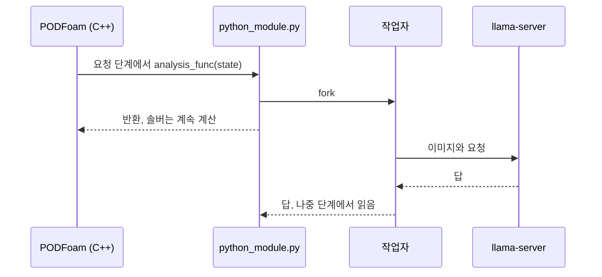

# PythonFOAM: 비전-언어 모델로 OpenFOAM 계산 관찰하기

[](https://github.com/seungminyome/PythonFOAM-Korean/actions/workflows/tests.yml)
[](https://github.com/seungminyome/PythonFOAM-Korean/actions/workflows/evidence.yml)


[](LICENSE)

[결과 페이지](https://seungminyome.github.io/PythonFOAM-Korean/) · [최신 보고서](docs/results-20261103.md) · [실행 방법](Solver_Examples/PODFoam/llm_demo/README.md) · [GPU 노드](Solver_Examples/PODFoam/llm_demo/hpc/README.md) · [English](https://github.com/seungminyome/PythonFOAM)

OpenFOAM이 도는 동안 Python이 유동을 이미지로 그리고, 같은 컴퓨터에서 도는 이미지 읽는
모델에게 무엇이 보이는지 묻습니다. 이 저장소는 그런 모델이 솔버 이미지에서 무엇을 읽을 수
있고 무엇을 읽지 못하는지 보여 줍니다.
[PythonFOAM](https://github.com/argonne-lcf/PythonFOAM)의 PODFoam 예제 위에 만들었고, 모델은
[llama.cpp](https://github.com/ggml-org/llama.cpp)로 돌리며, 모델이 한 말은 솔버로 돌아가지
않습니다.

## 알아낸 것

모델은 Gemma 4 12B이고, 다른 크기를 쓴 줄에는 따로 적었습니다. 모델은 한 시간 단계의 이미지 두
장, |U|와 p를 받거나, 추세와 붕괴 질문에서는 짧은 연속 이미지를 받고, 질문 하나를 받습니다.

| 질문 | 어떻게 됐나 | 판정 |
|---|---|---|
| 어디가 가장 빠르고, 어디가 압력이 가장 낮은가? | 대부분의 이미지에서 맞는 자리를 짚습니다. 발달한 유동에서 무작위로 잘라 낸 이미지 140개에서 가장 빠른 자리는 108개, 가장 낮은 압력은 130개를 맞히고, 모든 이미지에 한 자리로 답하는 상수 기준선은 16개와 17개입니다. 솔버가 그린 단면 프레임 24장에서는 모델이 21장과 24장, 상수 기준선이 24장과 24장입니다. | 됨 |
| 솔버가 도는 동안에도 되나? | 됩니다. 250단계마다 한 번 물으면 이미지를 그리는 시간 위에 계산 시간이 0.7 % 늘고, 솔버가 쓴 필드 파일 2,016개는 요청 없는 실행과 모두 같습니다. | 됨 |
| 스냅샷 사이에 유동이 빨라지나, 느려지나? | 최고 속도의 추세는 변화가 2 % 이상이면 읽습니다. 30번 중 29번입니다. 압력의 추세는 덜 읽습니다. 38번 중 28번입니다. | 뚜렷한 변화만 됨 |
| 이 계산이 곧 터지나? | 중단 1단계 전, 필드가 이미 터진 뒤에야 그렇다고 하고, 5단계 넘게 앞서 경고한 적은 없습니다. 숫자로 만든 간단한 규칙이 같거나 더 낫습니다. | 안 됨 |
| 이 계산은 설정이 잘못됐나? | 첫 시험에서는 31B가 될 것 같았습니다. 실행 29쌍으로 요청 전에 계획을 고정한 두 번째 시험에서는 31B가 색 막대 양 끝에 적힌 숫자로 만든 회귀보다 앞서는 것을 보이지 못했습니다. 잘못된 실행은 더 많이 잡지만 정상 실행 29개 중 11개도 잘못됐다고 합니다. | 보이지 않음 |
| 큰 모델이 더 나은가? | 작은 E2B가 솔버 이미지를 읽는다는 것은 보이지 않았습니다. 합성 이미지 32장에서 1\~12장을 맞혔고, 상수 기준선은 5\~6장입니다. 위치는 12B로 충분합니다. 31B는 작은 압력 점을 원기둥을 지나는 유동의 이미지 40개 중 38개에서 찾고 12B는 18개에서 찾으며, 첫 잘못된 설정 시험에서는 31B가 12B를 앞섰습니다. 두 번째 시험은 31B만 돌렸고, 거기서는 색 막대 숫자로 만든 회귀보다 낫지 않았습니다. | 부분적으로 |

행마다 기록한 실행과 맞힌 수가 있고, 둘째 행인 실행 시간 확인을 뺀 모든 행에는 기준선도 있습니다.
[결과 페이지](https://seungminyome.github.io/PythonFOAM-Korean/)에 수치가 있고,
[근거 자료 폴더](docs/evidence/README.md)에 원래 답과 해시 매니페스트가 있습니다.

 

*모델이 보는 것: 발달한 후향 계단 유동의 250단계에서 실행 중인 솔버가 그려 Gemma 4 12B에
보낸 |U|와 p입니다.*

두 가지를 염두에 두어야 합니다. 모든 시험은 2차원 층류와 압출한 3차원 케이스 하나로 했으므로,
다른 유동에서는 다르게 읽힐 수 있습니다. 채점한 것은 위치와 정해진 단어뿐이며, 자유로운 설명
글은 채점하지 않았습니다.

## 동작 방식

솔버는 시간 단계마다 Python 훅을 한 번 부릅니다. 요청 단계에서 훅은 작업자를 fork하고,
작업자는 이미지를 그려 llama.cpp의 HTTP 서버인 llama-server에 보냅니다. 솔버는 계속 계산하고,
답은 나중 단계에서 읽어 바탕이 된 배열과 함께 기록합니다.



요청은 동기나 비동기로, 한 번 또는 N단계마다 보내며 답을 기다리는 요청은 한 번에 최대 8개입니다. MPI
실행은 필드를 주 rank로 모으고, 3차원 격자는 평면 단면으로 그립니다. 요청 모드 셋, 이미지 방식
둘, 모든 설정은 [llm_demo/README.md](Solver_Examples/PODFoam/llm_demo/README.md)에 있습니다.

## 빠른 시작

단위 테스트와 근거 자료 해시 확인에는 OpenFOAM도 모델도 필요 없습니다:

```bash
pip install -r Solver_Examples/PODFoam/llm_demo/requirements.txt
make test          # 테스트 177개, 2분쯤
make evidence      # 매니페스트의 파일마다 해시가 맞는지
```

OpenFOAM(v2012, v2106, v2212, 8)을 source하고 Python 3.10\~3.12가 있으면, CPU에서 작은
Gemma 4 E2B 모델로 케이스 다섯 개 묶음을 돌려 연결과 검증을 확인합니다. 내려받는 것은 모델,
이미지 프로젝터, llama.cpp로 3.4 GB쯤이고 토큰은 필요 없습니다:

```bash
export PYTHON=${PYTHON:-$(command -v python3)}   # 또는 다른 Python의 경로
export PATH=$(dirname "$PYTHON"):$PATH
export LD_LIBRARY_PATH=$(dirname "$PYTHON")/../lib:$LD_LIBRARY_PATH   # 시스템 Python이 아니면
cd Solver_Examples/PODFoam
./validation/run.sh              # C++와 Python 연결을 확인; 그 실행이 묶음의 참조 실행
./llm_demo/setup_runtime.sh      # Gemma 4 E2B Q4_0, 이미지 프로젝터, llama.cpp b11429
python3 llm_demo/runtime.py start
./llm_demo/run_demo.sh           # PODFoam 빌드, 케이스 다섯 개 실행, 검증
python3 llm_demo/runtime.py stop
```

보고서의 GPU 실행은 Slurm 노드에서 Gemma 4 12B부터 31B까지를 돌린 것이며,
[llm_demo/hpc/README.md](Solver_Examples/PODFoam/llm_demo/hpc/README.md)에 있습니다.

## 보고서

보고서마다 실행 조건, 하드웨어, 코드 리비전, Slurm 작업을 적었습니다.

- [11월 3일](docs/results-20261103.md): 잘못된 설정 시험 2. 실행 29쌍을 같은 이미지를 보는
  규칙과 비교.
- [11월 2일](docs/results-20261102.md): 네 OpenFOAM 버전의 PR 브랜치, OpenFOAM 8이 다른 까닭,
  3차원 단면 이미지, 시점 없는 붕괴 시험.
- [10월 30일](docs/results-20261030.md): OpenFOAM 버전, 원본 PODFoam, 첫 잘못된 설정 시험.
- [10월 28일](docs/results-20261028.md): 동시 요청 두 개, 3차원 단면, 붕괴 시험.
- [근거 자료 목록](docs/evidence/README.md) · [변경 기록](CHANGELOG.md).

## 코드 위치

관찰 기능은 `Solver_Examples/PODFoam/`의 `Python*.H` 훅과 `llm_demo/`에 있습니다. 다른 예제는
argonne-lcf/PythonFOAM과 같습니다. 브랜치 `pr/podfoam-fix`는 PODFoam 수정만 담고, `pr/podfoam-observer`는
훅과 관찰 기능을 더합니다. 그 수정이 무엇인지는 [11월 2일 보고서](docs/results-20261102.md)에 있습니다. 훅 둘은 [HOOKS.md](Solver_Examples/PODFoam/HOOKS.md)에, 연결 검증은
[validation README](Solver_Examples/PODFoam/validation/README.md)에 있습니다.

## 인용

관찰 기능을 사용한다면 PythonFOAM과 영문 저장소를 인용해 주십시오.

```bibtex
@article{maulik2022pythonfoam,
  title   = {PythonFOAM: In-situ data analyses with OpenFOAM and Python},
  author  = {Maulik, Romit and Fytanidis, Dimitrios K. and Lusch, Bethany and
             Vishwanath, Venkatram and Patel, Saumil},
  journal = {Journal of Computational Science},
  volume  = {62},
  pages   = {101750},
  year    = {2022},
  doi     = {10.1016/j.jocs.2022.101750}
}

@software{yome2026observer,
  author = {Yome, Seungmin},
  title  = {PythonFOAM: a vision-language observer for OpenFOAM runs},
  year   = {2026},
  url    = {https://github.com/seungminyome/PythonFOAM}
}
```

## 감사의 글

이 저장소는 Argonne National Laboratory의 [PythonFOAM](https://github.com/argonne-lcf/PythonFOAM)에 있는 PODFoam 예제를 확장합니다.
원본 소개와 설치 안내는 [프로젝트 참고 문서](docs/upstream-project.md)에 있습니다.
모델은 [llama.cpp](https://github.com/ggml-org/llama.cpp)로 실행합니다.
모델 가중치는 이 저장소에 포함되지 않으며, 각 모델의 라이선스를 따릅니다.
보고서의 GPU 노드 실행과 CPU 노드 실행에는 University of Wyoming Advanced Research Computing Center의 MedicineBow 클러스터를 사용했습니다.

## 라이선스

UChicago Argonne, LLC의 PythonFOAM 오픈 소스 [라이선스](LICENSE)를 그대로 적용합니다.
