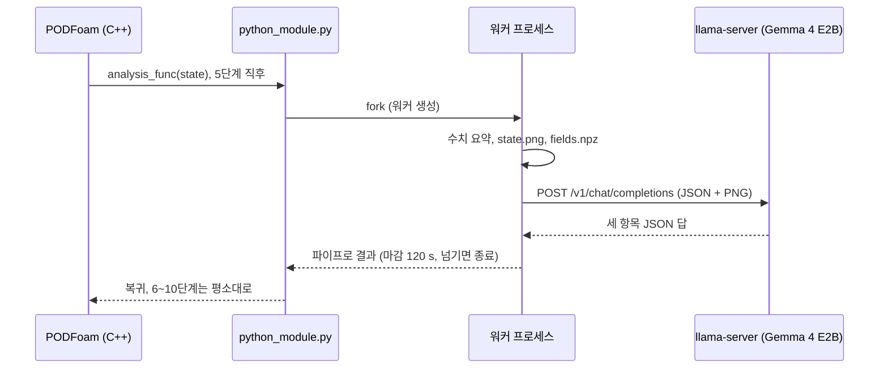

# PythonFOAM + Gemma 4 E2B: 계산 중 상태 읽기 시험

[](https://github.com/seungminyome/PythonFOAM-Korean/actions/workflows/tests.yml)
[](https://github.com/seungminyome/PythonFOAM-Korean/actions/workflows/evidence.yml)


[](LICENSE)

[10월 28일](docs/results-20261028.md) · [10월 27일](docs/results-20261027.md) · [10월 22일 이어서](docs/results-20261022-live.md) · [10월 22일 보고서](docs/results-20261022.md) · [10월 20일 보고서](docs/results-20261020.md) · [10월 17일 보고서](docs/results.md) · [근거 자료](docs/evidence/README.md) · [실행 방법](Solver_Examples/PODFoam/llm_demo/README.md) · [English](https://github.com/seungminyome/PythonFOAM)

PODFoam 계산 도중 한 단계의 수치와 속도·압력 그림, 또는 계산 중간중간의 그림 여러 장을
llama.cpp가 띄운 시각·언어 모델에 보내고, 답을 저장한 뒤 계산을 이어갑니다. 요청은 비동기로 보낼
수 있습니다. 솔버는 계속 걸음을 가고 답은 도착했을 때 기록됩니다. 여기까지는 됩니다.
모델이 한 말은 계산으로 들어가지 않습니다. 처음 구성인 CPU의 Gemma 4 E2B는 쓸 만한 답을 주지
못합니다. 솔버가 읽기 쉬운 그림(그림 한 장에 필드 하나, 퍼센트 축과 격자; `LLM_IMAGE_STYLE=v2`)을
그리고 GPU 노드의 Gemma 4 12B가 답하게 하자, 돌고 있는 솔버에서 그린 범위(창)를 저마다 다르게 정해
보낸 요청 열한 개 중 가장 빠른 곳은 9개, 가장 낮은 압력은 10개를 그린 범위의 10 % 안에 짚었습니다.
답 하나로 고정하면 4개씩입니다. 저장한 흐름 필드는 요청 없는 실행과 같았습니다([10월 22일 이어서](docs/results-20261022-live.md)).
10월 27일([보고서](docs/results-20261027.md))에는 필드마다 그림 한 장을 제 색 범위로 그리자, 12B가 뚜렷한
변화가 있는 sequence 30개 중 29개에서 최고 속력이 올랐는지 내렸는지를 맞혔습니다. 솔버의 예전 그림으로는
어느 모델도 답 하나로 고정한 것보다 뚜렷하게 낫지 않았습니다. 2 %보다 작은 변화는 여전히 잘못 읽습니다.
24,000걸음 동안 250걸음마다 describe 요청을 보내도 실행 시간은 그림 그리기에 더해 0.7 %만 늘었고, 저장 파일은
모두 그대로였으며, 답은 가장 낮은 압력이 소용돌이 중심 사이를 옮겨 다니는 것을 따라갔습니다(96개 중 89개가
10 % 안). 관찰 기능은 MPI rank 2개에서도 돕니다.
10월 28일([보고서](docs/results-20261028.md))에는 요청 두 개가 나란히 돌았고(요청 하나에 솔버 시간 약 0.1 s),
콜백의 메모리가 더는 실행과 함께 늘지 않으며, 증감 단어는 배열로 계산하고, 3차원 경우는 평면 단면으로 그립니다.
곧 중단될 실행의 프레임 세 장을 보여 주자, 모델들은 필드가 이미 발산한 뒤에야 "unstable"이라고 했습니다.


*10월 17일 실행의 5단계에서 모델에 보낸 그림. 위는 속력 |U|, 아래는 운동학적 압력 p (640x360, 각 셀을 다각형 하나로 그림).*

## 바로 실행해 보기

단위 테스트 125개. OpenFOAM과 모델이 없어도 되고 80초쯤 걸립니다.

```bash
pip install -r Solver_Examples/PODFoam/llm_demo/requirements.txt
make test          # 또는 cd Solver_Examples/PODFoam/llm_demo && python3 -m unittest
make evidence      # 근거 파일 전부를 manifest의 해시와 대조
```

전체 실행. OpenFOAM v2106, 모델 파일용 디스크 약 3.4 GB가 필요하고, 서버는 실행 중 약 2.4 GiB(10월 20일 기록)를 쓰므로 RAM 8 GB 정도면 됩니다.

```bash
cd Solver_Examples/PODFoam
./validation/run_v2106.sh        # 연결 검증. 통과한 실행이 기준 사례가 됩니다
./llm_demo/setup_runtime.sh      # Gemma 4 E2B Q4_0, 이미지 프로젝터, llama.cpp b11429
python3 llm_demo/runtime.py start
./llm_demo/run_demo.sh           # PODFoam 빌드, 다섯 조건 실행, 검증
python3 llm_demo/runtime.py stop
```

자세한 설명과 환경 변수는 [llm_demo/README.md](Solver_Examples/PODFoam/llm_demo/README.md)에 있습니다.

## 구현



- OpenFOAM v2106 PODFoam에 Python 콜백을 추가했습니다(10월 22일에는 GPU 노드의 Apptainer 이미지에서
  v2212로도 돌림). 지정한 시간 단계 직후
  잔차, Courant 수, 연속성 오차, SVD 요약과 그 단계의 |U|·p 그림(PNG)을 로컬
  llama.cpp 서버(Gemma 4 E2B Q4_0, 이미지 프로젝터 포함)에 보내고 응답을
  저장합니다. 이 문서의 "5단계"는 전체 10개 시간 단계 중 다섯 번째
  (t = 5×10⁻⁷ s)를 뜻하며, 기본값입니다. `LLM_ANALYSIS_STEP`으로 바꿀 수 있습니다.
- 요청 모드 셋(`LLM_MODE`): `observe`(수치와 그림, 원래 방식), `describe`(그림 한 장.
  설명과, 가장 빠른 곳·가장 낮은 압력의 위치를 그린 범위의 %로), `sequence`
  (`LLM_SEQUENCE_STEPS` 걸음마다 그림을 저장했다가 마지막에 한 요청으로. 흐름이 어떻게
  변하는지를 정해진 추세 단어로). `LLM_IMAGE_XRANGE`는 영역 전체 대신 일부만 그립니다.
- 기본은 동기입니다. 솔버가 답이나 마감을 기다립니다. `LLM_ASYNC=1`이면 요청 걸음은 워커를
  포크만 하고, 이후 걸음마다 막힘 없이 확인해 답이 온 걸음과 함께 기록하며, 마감을 넘긴
  워커는 종료하고, 동시에 하나의 요청만 둡니다. 마지막 걸음에서는 남은 답을 기다리거나
  분리합니다.
- 서버가 없거나 늦어도 어느 모드에서든 솔버가 마감보다 오래 막히지 않습니다.
- 검증 스크립트가 걸음 완료, 저장된 필드 파일 전부가 요청 없는 실행과 같은지, 로그와
  기록이 맞는지, 프레임의 배열이 저장된 필드와 같은지 확인합니다. 그림 해시가 요청 본문과
  같은지는 동기 그림 조건과 비동기 sequence 조건에서 확인합니다.
- `readable_image.py`는 그림 한 장에 필드 하나만 그립니다. 축은 그린 범위의 퍼센트로 적고 10 %마다
  격자선을 그으며, 색 막대에는 최솟값부터 최댓값까지 값 다섯 개를 적습니다(v2). `LLM_IMAGE_STYLE=v2`이면
  콜백이 `describe`와 `sequence` 요청에 이 그림을 그리고, 그림 시험이 쓰는 `readable_request.py`로
  요청을 만듭니다. 실시간 요청 본문은 모두 디스크의 프레임에 그 빌더를 적용한 결과와 바이트까지 같은지
  확인합니다. 기본값은 여전히 `pod_image.py`의 두 패널 그림(v1)입니다. `LLM_LONG_START`는 비동기 조건을
  발달한 흐름 상태에서 시작하게 하고, `run_live_sweep.py`는 걸음마다 무작위 창으로 describe 요청을 더
  보내며, `window_test.py`는 무작위 창 그림 묶음을 만듭니다.
- `LLM_ANALYSIS_EVERY=N`은 N걸음마다 describe 요청을 보내고(동시에 기다리는 요청은 최대 하나), 요청마다 자기
  폴더에 기록합니다. MPI 실행에서는 격자와 필드를 마스터 rank로 모으고, 마스터만 관찰 기능을 부릅니다. POD
  스냅샷과 SVD는 rank마다 따로 합니다. `sequence_test.py`는 저장 상태로 변화 읽기 묶음을 만들고, 원하면
  정답의 기준과 극값을 프롬프트에 넣습니다.
- 10월 17일 측정은 코드 `23089bb`, 10월 20일 측정은 모드·비동기 경로·그림 창을 더한
  `9449085`를 썼습니다. `9449085`는 영문 저장소의 커밋이고, 이 저장소에서 같은 코드는 `74553ea`입니다.
  10월 19일 12B 재생은 `934da23`(영문 저장소, 이 저장소에서는 `f4a99f3`)에서 돌렸고, 요청과
  채점 코드는 `23089bb`와 같습니다. 10월 22일 그림 시험은 `58e00d9`(영문 저장소, 이 저장소에서는
  `7435513`)에서 돌렸습니다. 그 뒤의 10월 22일 실행은 `354caf9`(영문 저장소)에 커밋하지 않은 변경을 얹어
  돌렸고, 점검에서 나온 수정과 함께 `dee7731`(영문 저장소, 이 저장소에서는 `f26bac5`)로
  공개했습니다([기록](docs/results-20261022-live.md#기록)). 10월 27일 실행은 `6afbdeb`부터 `ab6b943`까지(영문
  저장소)를 썼습니다([기록](docs/results-20261027.md#기록)).

## 측정값 (2026-10-28, 요청 두 개 동시 진행, 텔레메트리, 3차원 단면, 불안정 시험)

- 요청 두 개 동시 진행(작업 24929296, 50걸음마다 요청, 서버 슬롯 둘): 120개 중 118개 답함, 112개는 다른 요청을
  기다리는 동안 보냄, 2개는 한도에 걸려 건너뜀; 저장 파일 2,520개 중 2,520개가 요청 없는 실행과 같음; 벽시계
  시간 +3.2 %, 요청 하나에 약 0.1 s로 하나씩 보낼 때와 같음. 답을 받은 요청 하나의 기록이 쓰기 프로세스의
  0.2 s 한도 안에 써지지 않았습니다. 이제 목록이 그것을 적습니다(`record_written`).
- 상태를 쌓아 두지 않는 텔레메트리(작업 24929555): 재생한 상태 24,000개에서 Python 힙이 31.7 MiB 대신 최대
  0.52 MiB에 머물고, 마지막 걸음은 0.699 s 대신 0.023 s 걸리며, `telemetry.jsonl`은 바이트까지 같습니다.
- 3차원 단면(작업 24929629): z 방향으로 칸 8개만큼 늘인 계단 경우를 가운데 높이에서 자릅니다. 잘린 칸
  20,540개를 다각형으로 그리고, rank 2개에서도 직렬과 같으며(칸 중심이 4.2×10⁻¹⁷ m까지 같음), 2차원 프레임은
  그대로입니다.
- 불안정 시험(작업 24929533, 24929534): 마지막 프레임이 중단 1~10걸음 전인 세 장 묶음 27개와 끝까지 돈
  실행의 묶음 27개에서, 모델 네 개는 54개 중 30~33개를 맞혔습니다. 최고 |U|의 증가를 보는 규칙은 33개,
  이웃한 칸 사이 차이를 보는 규칙은 38개입니다. 모든 모델이 중단 한 걸음 전에 끝나는 묶음, 곧 필드가 이미
  발산한 묶음은 알아보았고, 5걸음보다 앞서 알린 모델은 없습니다.

## 측정값 (2026-10-27, 변화 읽기, 250걸음마다 요청, MPI)

변화 읽기 시험: 발달한 흐름의 세 시각 묶음 45개, 묶음마다 무작위 창 하나; 최고 속력 / 가장 낮은 압력의
증감을 맞힌 수(Slurm 작업 24903974와 24903975):

| 모델 | 솔버의 v1 그림 | v2, 그림마다 제 색 범위 | v2 + 메모에 극값 | 극값만, 그림 없음 |
|---|---:|---:|---:|---:|
| Gemma 4 12B | 14 / 15 | 32 / 28 | 33 / 28 | 32 / 28 |
| Gemma 4 26B-A4B | 16 / 19 | 31 / 36 | 33 / 33 | 36 / 37 |
| Gemma 4 31B | 18 / 20 | 32 / 33 | 37 / 41 | 35 / 42 |
| Qwen3.5-35B-A3B Q8_0 | 15 / 18 | 31 / 32 | 32 / 28 | 34 / 33 |
| 답 하나로 고정 | 15 / 20 | 15 / 20 | 15 / 20 | 15 / 20 |

45개 중입니다. 최고 속력이 2 % 이상 바뀐 sequence 30개에서 v2 그림의 12B는 29개를 맞혔고, 틀린 것은 대부분
2 %보다 작은 변화입니다. 메모에 극값이 있으면 31B는 뚜렷한 속력 변화를 모두 맞혔습니다.

250걸음마다 describe 요청, 발달한 흐름에서 5×10⁻⁶ s 간격 24,000걸음, NVIDIA A30의 Gemma 4 12B(작업
24903264): 96개 중 96개 답함, 저장 파일 2,016개 중 2,016개가 요청 없는 같은 실행(같은 그림을 그림)과 같음,
걸음당 벽시계 시간 0.7 % 늘어남, 요청 걸음에서 콜백이 쓴 시간은 최대 0.017 s(마지막 걸음은 설계대로 대기 중인
답을 기다림); 가장 낮은 압력이 10 % 안인 답 96개 중
89개(고정 답 65), 그리고 답한 위치가 소용돌이 중심 사이를 옮겨 다니는 가장 낮은 압력을 따라감(x의
상관계수 0.78).

- llama.cpp가 권하는 이미지 토큰 설정의 4비트 Qwen: Qwen3.5-35B-A3B와 27B가 발달한 흐름의 가장 빠른 곳을
  그림 140장 중 133장과 128장에서 짚었습니다. Gemma 4는 106~113장이었습니다(10월 22일).
- 원기둥 흐름(`offsetCylinder`, OpenFOAM-9 튜토리얼): 12B, 26B-A4B, 31B가 가장 빠른 곳을 그림 40장 중
  32~39장에서 짚었고, 넓고 어두운 후류 옆의 작은 점인 가장 낮은 압력은 31B가 40장 중 38장, 12B가 18장에서
  짚었습니다.
- A30 노드 하나에서 10월 22일 솔버 실행을 두 번 반복하자 두 반복의 답이 서로 같았습니다. RTX A6000에서 돈
  첫 실행과 비교하면 요청 본문은 같고, 답은 글과 일부 위치가 달랐으며, 10 % 안인 수는 같았습니다.
- MPI, rank 2개: 프레임의 칸이 직렬 실행과 같고, 칸 중심은 4×10⁻¹⁷ m까지 같습니다. 10월 22일에 본 작은 POD
  모드 파일 차이는 BLAS 스레드 수에서 옵니다(스레드 하나면 같음).

## 측정값 (2026-10-22, 돌고 있는 솔버가 그린 v2 그림)

MedicineBow GPU 노드의 OpenFOAM v2212(Apptainer 이미지)에서 PODFoam을 돌리고, 같은 노드의 NVIDIA RTX
A6000에서 Gemma 4 12B QAT가 답했습니다(Slurm 작업 24757460). 그림은 v2입니다. 모든 경우는 계단 뒤에서
소용돌이가 말려 생기는 발달한 흐름의 t = 0.1 s에서 시작해 5×10⁻⁶ s 간격 6000걸음을 돌았습니다.

| 실행 | 요청 걸음 | 답을 기록한 걸음 | 요청 걸음에서 솔버가 기다린 시간 | 모델 대기 | 기준과 같은 파일 |
|---|---:|---:|---:|---:|---:|
| 스냅샷 하나 설명 | 250 | 320 | 0.004 s | 3.17 s | 432 / 432 |
| 스냅샷 세 개 비교 | 3750 | 3823 | 0.004 s | 3.15 s | 432 / 432 |
| 연결 거부 | 250 | 261 | 0.004 s | 0.011 s | 432 / 432 |
| 서버를 멈추게 함(마감 4 s) | 250 | 324 | 0.004 s | 4 s 마감에서 끊음 | 432 / 432 |

describe 답은 가장 빠른 곳을 정답 칸에서 그린 범위의 3.3 %, 가장 낮은 압력을 5.0 % 떨어진 곳에
짚었습니다. sequence 답은 줄어드는 최고 속도와 움직이는 가장 빠른 곳은 맞혔고 압력 증감은 틀렸습니다.
500~5500걸음에 창을 저마다 무작위로 정해 보낸 describe 요청 열한 개는 모두 솔버가 도는 동안
(69~93걸음 뒤) 왔고, 본문은 모두 시험한 빌더를 프레임에 적용한 결과와 같았습니다. 가장 빠른 곳은
11개 중 9개, 가장 낮은 압력은 10개가 10 % 안이었고, 답 하나로 고정하면 4개와 4개입니다. 더 짧은 시험
실행에서는 describe 답이 33 %와 29 % 떨어졌습니다.

창을 가장 빠른 칸 둘레에 무작위로 놓은 그림 시험(답 하나로 고정하면 48개 중 7~10개)에서 12B, 26B-A4B,
31B, Qwen3.5-35B-A3B는 창 시드 세 개 모두에서 v2 그림 48장 중 45~48장의 두 극값을 10 % 안에
짚었고, v1에서는 48장 중 2~17장이었습니다.
발달한 흐름의 상태 35개(고정 답은 140개 중 16개와 17개)에서는 v2 그림 140장 중 130~139장에서 가장 낮은 압력을,
106~121장에서 가장 빠른 곳을 10 % 안에 짚었고, 가장 빠른 곳을 틀린 답은 대부분 최고 속도의 90 % 이상인 다른 점을
짚었습니다.

## 측정값 (2026-10-22, GPU 노드의 그림 읽기 시험)

미리 만든 같은 요청 308개(거의 모두 그림에 대해 묻는 것)를 Gemma 4 모델 일곱 개에 차례로
보냈습니다. NVIDIA RTX A6000 한 장(MedicineBow, Slurm 작업 24756981), llama.cpp b11429, temperature 0.
솔버는 돌리지 않았습니다. v1은 솔버가 보내는 그림(패널 둘, 축은 미터), v2는 새 그림(그림 한 장에 필드
하나, 축은 퍼센트, 10 %마다 격자선)입니다. 합성: |U|에 밝은 점 하나, p에 어두운 점 하나를 넣은 그림
32장. 심은 그림: 저장 상태 4개를 그린 그림 32장에 좁은 |U| 봉우리와 p 골을 넣은 것. 그린 범위의
10 % 안이면 맞은 것으로 셉니다.

| 모델 | 합성, 가장 빠른 곳, v1 / v2 | 심은 그림, 가장 빠른 곳, v1 / v2 | 심은 그림, 가장 낮은 p, v1 / v2 | 요청당 시간 중앙값 |
|---|---:|---:|---:|---:|
| E2B Q4_0 (솔버가 쓰는 모델, 시간은 여기서 GPU로 잰 것) | 4 / 11 | 2 / 10 | 3 / 6 | 1.01 s |
| E4B QAT | 9 / 15 | 4 / 15 | 4 / 5 | 1.31 s |
| 12B QAT | 9 / 32 | 5 / 32 | 9 / 25 | 2.86 s |
| 26B-A4B QAT | 17 / 32 | 15 / 31 | 5 / 20 | 2.18 s |
| 31B QAT | 18 / 32 | 17 / 32 | 9 / 24 | 6.33 s |
| 답 하나로 고정 | 5 | 6 | 6 | |

32개 중 맞힌 수입니다. 12B, 26B-A4B, 31B가 심은 그림에서 가장 낮은 압력을 틀린 답은 모두, 골을
심지 않은 상태에서 원래 압력이 가장 낮은 계단 모서리를 댄 것이었습니다. 세 시각을 그린 합성 연속
그림 가운데 변화가 뚜렷한 12개에서, 같은 세 모델은 그림마다 색 막대에 자기 최댓값이 찍혀 있으면
최고 속력 추세를 12개 모두 맞혔고, 색 범위를 하나로 같이 쓰면 5~10개 맞혔습니다. "거의 그대로"의
2 % 기준을 프롬프트에 적지 않아서, "거의 그대로" 설계 여섯 개는 공정한 시험이 아닙니다. 아무것도
심지 않은 저장 상태에서는 극값이 계단 모서리에 머물고 추세 단어도 거의 같아서, 답을 하나로 고정해도
위치 24개 중 24개를 맞힙니다. 그 상태들에서 색 막대에 숫자가 있으면 26B-A4B와 31B는 압력 추세를
14개 중 11개와 12개 맞혔고, 12B는 3개였습니다. E2B의 다른 두 가지(BF16 프로젝터, QAT 가중치)와 10월 17일·20일 요청의 결과는
[10월 22일 보고서](docs/results-20261022.md)에 있습니다.

## 측정값 (2026-10-20, 비동기 실행과 재생)

5×10⁻⁷ s 간격으로 3000걸음, 같은 컴퓨터와 서버. 조건마다 한 번.

| 실행 | 요청 걸음 | 답이 기록된 걸음 | 요청 걸음에서 솔버가 기다린 시간 | 모델 대기 | 기준과 같은 파일 |
|---|---:|---:|---:|---:|---:|
| 모델 끔 (기준. 요청을 만들지만 보내지 않음) | 1250 | 1261 | 0.004 s | - | - |
| 그림 한 장 설명 | 250 | 1093 | 0.006 s | 34.0 s | 216 / 216 |
| 그림 세 장 연속 | 1250 | 2321 | 0.004 s | 43.4 s | 216 / 216 |
| 연결 거부 | 250 | 280 | 0.005 s | 0.002 s | 216 / 216 |
| 서버를 일부러 멈춤 (마감 4 s) | 250 | 353 | 0.005 s | 4 s 마감에 종료 | 216 / 216 |

콜백 시간은 답이나 오류를 기록한 걸음에서 0.008~0.019 s(결과 파일을 쓰는 자식 프로세스를 기다림),
마지막 걸음에서 약 0.1 s, 나머지 걸음에서 0.0052 s 이하였습니다. 실행 전체로는 걸음당 약 0.05 s입니다. 두 답 모두 솔버가 아직 도는 동안 왔습니다
(요청 뒤 843걸음, 1071걸음). 모델 대기가 10월 17일보다 짧은 것은 주로 프롬프트가 짧기 때문입니다
(10월 17일 1541토큰, 이번 570·907토큰). 그중 266·273토큰은 몇 분 앞선 시험 실행 덕에 서버 캐시에도
있었습니다.

저장 프레임 재생, 각 3회, 보기 둘(전체 영역과 계단 주변 창):

| 질문 | 프레임 | 결과 |
|---|---|---|
| 가장 빠른 곳은 어디인가? (그린 범위의 %) | 상태 3 × 보기 2 | 답 18개(프레임 6개, 각 3회), 정답 지점의 10 % 안은 없음. 전체 영역에서 14~18 % (0.27~0.39 m), 창에서 50~80 % 벗어남 |
| 흐름이 어떻게 변하는가? (추세 단어) | 프레임 3 × 보기 2 | 최고 속력이 60에서 47(42) m/s로 떨어지는데 두 보기 모두 `increasing`. 단어 셋 중 전체 영역 1개, 창 2개 맞음 |

자세한 내용, 모델이 쓴 글, 주의점은 [10월 20일 보고서](docs/results-20261020.md)에 있습니다.

## 측정값 (2026-10-19, GPU 노드의 Gemma 4 12B)

아래 10월 17일 쌍별 재생을 모델 이름만 바꿔 다시 보냈습니다. Gemma 4 12B QAT Q4_0과 이미지
프로젝터, NVIDIA A30 한 장(MedicineBow, Slurm 작업 24696203), 소스에서 CUDA로 빌드한
llama.cpp b11429, 모든 층을 GPU에, 문맥 길이 2048.

| 모델, 컴퓨터 | 조건 | 답한 위치 | 오차 | 요청당 시간 |
|---|---|---|---:|---:|
| E2B, CPU, 10월 17일 | 수치만 | (0.6012, 0.1143) m, 3번 모두 | 60.92 cm | 14.5~55.6 s |
| E2B, CPU, 10월 17일 | 수치 + 그림 | (0.5, 0.1143) m, 3번 모두 | 50.97 cm | 13.2~20.8 s |
| 12B, A30, 10월 19일 | 수치만 | "unknown", 3번 모두 | 채점 안 됨 | 2.0~3.3 s |
| 12B, A30, 10월 19일 | 수치 + 그림 | "unknown", 3번 모두 | 채점 안 됨 | 2.1~2.7 s |

"unknown"은 오차 0이 아닙니다. 그림 포함 답은 가능한 해석으로 빠른 흐름이 "near x=0.00 m"라고
덧붙였지만(정답 x = 0.0005 m) y가 없고, 채점기는 이 부분을 읽지 않습니다. 수치만 받은 답 두 개는
그림을 보내지 않았는데도 "the image" 탓을 했습니다. 응답 시간 차이에는 모델 크기, CPU 대신 GPU,
이미 떠 있던 상주 서버 대신 새로 띄운 서버가 섞여 있습니다. 자세히: [10월 17일 보고서](docs/results.md#gpu에서-gemma-4-12b로-같은-재생-2026-10-19),
[근거](docs/evidence/2026-10-19-12b/README.md).

## 측정값 (2026-10-17, 실행 `pod-llm-demo.LRfJBN`)

8 vCPU, RAM 7.8 GiB, GPU 없음. llama-server 4스레드, llama.cpp b11429,
문맥 길이 2048. 셀 20,540개, 시간
간격 10⁻⁷ s, 10단계. 이 날짜에는 조건마다 한 번씩 실행했습니다. 10월 19일에
되풀이한 실행은 5단계 해시, 그림 요청의 답, 재생 답의 좌표가 같았고, 수치만 요청의 답과 재생 답
다섯 개의 문장은 달라졌습니다([자세히](docs/results.md#2026-10-19-반복)).

| 조건 | 결과 | 완료 단계 | 기준과 같은 파일 | 콜백 시간 |
|---|---|---:|---:|---:|
| 모델 요청 없음 | 기준 | 10 | - | 0.493 s |
| 수치 + 그림 | 답변 저장 | 10 | 45 / 45 | 78.256 s |
| 수치만 | 답변 저장 | 10 | 45 / 45 | 39.672 s |
| 연결 거부 | 오류 저장, 계산 계속 | 10 | 45 / 45 | 0.509 s |
| 서버를 일부러 멈춤 (마감 4 s) | 시간 초과 저장, 계산 계속 | 10 | 45 / 45 | 4.013 s |

콜백 시간은 C++에서 Python 분석 함수를 호출 직전부터 돌아온 직후까지입니다.
그림 조건의 78.256 s 중 그림 생성이 0.438 s, 모델 응답 대기가 77.560 s입니다.

저장한 5단계 상태 하나로, 질문·수치·설정을 고정하고 그림 포함 여부만 바꿔 세
쌍(여섯 번)을 다시 물었습니다. 아래에서 이것을 "쌍별 재생"이라고 부릅니다. 최대 속력 값 82.53 m/s는 두 조건 모두 입력에
있었고, 위치는 알려주지 않았습니다. 정답은 셀 12090, (0.0005, 0.0127) m입니다.

| 조건 | 답한 위치 (x, y) m | 평면 오차 | 결과 |
|---|---|---:|---|
| 수치만 | (0.6012, 0.1143) | 60.92 cm | 3회 모두 오답 |
| 수치 + 그림 | (0.5, 0.1143) | 50.97 cm | 3회 모두 오답 |

수치만 받은 답은 입력에 있던 계산 영역의 x, y 최댓값을 그대로 위치로
적었습니다. 그림을 받은 답은 약 10 cm 가까웠지만 역시 틀렸습니다.

## 남은 문제

1. 답의 정확도. 기본 모델인 E2B의 설명은 쓸 수 없습니다. v2 그림에서는 12B와 더 큰 모델이, 돌고 있는
   솔버에서도 긴 실행에서도 대부분의 그림에서 가장 빠른 곳과 가장 낮은 압력을 10 % 안에 짚습니다.
   그림마다 제 색 범위가 있으면 12B는 최고 속력의 뚜렷한 변화를 읽지만(30개 중 29개) 2 %보다 작은 변화는
   대부분 놓칩니다. 다른 모델은 뚜렷한 변화도 놓칩니다(30개 중 17~25개). 이제 증감 단어는 콜백에서 배열로
   계산합니다. 비슷한 색의 넓은 영역 옆에 있는 작은 극값(원기둥의 압력)은 12B가 놓칩니다.
2. 경고. 시험한 모델은 그림에서 다가오는 중단을 보지 못합니다. 배열에서 얻는 간단한 숫자(최고값의 증가,
   이웃한 칸 사이 차이)가 그만큼 또는 더 잘 맞힙니다.
3. 하드웨어가 바뀔 때의 재현성. 같은 노드에서는 같은 요청이 같은 답을 줍니다. 다른 GPU에서는 글과 일부
   위치가 바뀝니다.
4. 범위. 2차원 층류 사례와 늘여 만든 3차원 사례 하나(아직 단면 그림을 읽은 모델은 없음), 모델 요청 없는 MPI
   rank 2개, 동시에 요청 둘까지. 요청 기록은 쓰기 프로세스가 0.2 s 한도를 넘기면 잃을 수 있습니다(118개 중
   1개).

## 다음 단계

1. 발달한 3차원 흐름의 단면 그림을 모델에게 보입니다.
2. 프레임 시각을 적지 않은 불안정 시험, 그리고 콜백에서 계산한 숫자 경고를 모델의 답 옆에 둡니다.
3. 요청 기록을 쓰는 데 더 큰 시간 한도를 주거나, 워커가 직접 쓰게 합니다.
4. PythonFOAM에 기여를 엽니다: 연결부, MPI 모으기, 3차원 단면, v2 그림, 요청 빌더, 비동기와 주기 경로, 시험.
   GPU 노드용 스크립트는 [llm_demo/hpc/](Solver_Examples/PODFoam/llm_demo/hpc/README.md)에 있습니다.

## 저장소 구성

```
Solver_Examples/PODFoam/      PODFoam 솔버(OpenFOAM v2106, v2212에서도 빌드)와 콜백 연결 코드
  validation/                 연결 검증: 10단계, SVD 왕복, verify.py
  llm_demo/                   콜백 모듈, llama-server 클라이언트, v2 그림과 요청 빌더, 다섯 조건 실행기(동기·비동기),
                              describe sweep, N걸음마다 요청, 재생 비교(쌍별, describe, sequence), 그림 읽기 시험,
                              무작위 창 시험과 변화 읽기 시험, 단위 테스트, requirements.txt
  llm_demo/hpc/               GPU 노드용 Slurm 스크립트: 12B 쌍별 재생, 그림 시험, v2 솔버 실행, 주기 실행(모두 MedicineBow에서 실행)
docs/results-20261028.md      10월 28일: 요청 두 개 동시 진행, 상태를 쌓아 두지 않는 텔레메트리, 계산한 증감 단어, 3차원 단면, 불안정 시험
docs/evidence/2026-10-28-inflight/       그 요청 두 개 동시 진행 실행(Slurm 작업 24929296): 요약, 목록, 로그, 비교 스크립트, 해시 목록
docs/evidence/2026-10-28-callback/       그 콜백 점검(Slurm 작업 24929555): 비교, 메모리 재생, 해시 목록
docs/evidence/2026-10-28-3d/             그 3차원 단면 시험(Slurm 작업 24929629): 경우, 프레임, 비교, 해시 목록
docs/evidence/2026-10-28-instability/    그 불안정 시험(Slurm 작업 24929533, 24929534): 답, 정답, 다시 세기, 해시 목록
docs/results-20261027.md      10월 27일: 변화 읽기 시험, 4비트 Qwen, 원기둥 흐름, 250걸음마다 요청, 반복, MPI, POD 파일
docs/evidence/2026-10-27-picture-tests/  그 그림 시험(Slurm 작업 다섯 개)과 원기둥 계산: 답, 정답, 다시 세기, 해시 목록
docs/evidence/2026-10-27-solver/         그 솔버 실행: 주기 실행, 반복, MPI, POD 파일, 불안정 흐름 시도, 해시 목록
docs/results-20261022-live.md 10월 22일 이어서: 돌고 있는 솔버의 v2 그림, 무작위 창, Qwen 모델
docs/evidence/2026-10-22-live-v2/       그 솔버 실행(Slurm 작업 24757460): 프레임, 본문, 답, 로그, 검산 스크립트, 해시 목록
docs/evidence/2026-10-22-window-test/   그 그림 시험(Slurm 작업 여섯 개)과 발달한 흐름: 답, 정답, 다시 세기, 해시 목록
docs/results-20261022.md      10월 22일 보고서: 그림 읽기 시험, Gemma 4 모델 일곱 개, 그림 두 가지
docs/evidence/2026-10-22-picture-test/  그 기록(Slurm 작업 24756981), 정답, 독립 재채점, 해시 목록
docs/results-20261020.md      10월 20일 보고서: 비동기 실행, describe·sequence 재생
docs/evidence/2026-10-20/     10월 20일 실행과 재생의 기록, 해시 목록
docs/results.md               10월 17일 시험 보고서
docs/evidence/2026-10-17/     요청·응답 원문, 로그, 검증 결과, 해시 목록
docs/evidence/2026-10-13/     이전 실행(pod-llm-demo.SwwR2e)과 그 보고서 docs/results-20261013.md
docs/evidence/2026-10-19/     10월 17일 실행의 반복(pod-llm-demo.o5sNLJ), 해시와 재생 좌표 동일
docs/evidence/2026-10-19-12b/ NVIDIA A30의 Gemma 4 12B로 한 쌍별 재생(Slurm 작업 24696203), 해시 목록
docs/evidence/check_manifest.py  근거 파일 전부를 manifest와 대조 (CI에서도 실행)
docs/progress.ko.md           10월 8일부터의 작업 기록
docs/upstream-project.md      원본 PythonFOAM README (다른 솔버, Docker, 빌드 안내)
.github/workflows/            tests.yml (단위 테스트, Python 3.10·3.12), evidence.yml (해시, 링크, 영문 저장소와 코드 일치)
CHANGELOG.md, Makefile
```

나머지 폴더(`APMOSFoam`, `AEFoam`, `PINNFoam`, `TurbulenceModel_Examples`, `Handson_Examples`)는 원본 그대로입니다.

## 자료

- [10월 28일](docs/results-20261028.md): 요청 두 개 동시 진행, 상태를 쌓아 두지 않는 텔레메트리, 계산한 증감 단어, 3차원 단면, 불안정 시험
- [10월 27일](docs/results-20261027.md): 변화 읽기, 4비트 Qwen, 원기둥 흐름, 250걸음마다 요청, 반복, MPI
- [10월 22일 이어서](docs/results-20261022-live.md): 돌고 있는 솔버가 그린 v2 그림과 12B, 무작위 창, 발달한 흐름, Qwen 모델
- [10월 22일 보고서](docs/results-20261022.md): 그림 읽기 시험, E2B부터 31B까지 Gemma 4 모델 일곱 개, 그림 두 가지
- [10월 20일 보고서](docs/results-20261020.md): 비동기 실행, 스냅샷 하나·연속 재생, 주의점
- [10월 17일 보고서](docs/results.md): 동기 조건, 그림 유무 쌍별 재생
- [12B 재생](docs/results.md#gpu에서-gemma-4-12b로-같은-재생-2026-10-19): 10월 17일의 쌍별 요청, GPU 노드의 Gemma 4 12B
- [근거 자료](docs/evidence/README.md): 요청·응답 원문, 로그, 검증 결과, 해시 목록
- 10월 28일 내려받기: [tests-2026-10-28](https://github.com/seungminyome/PythonFOAM/releases/tag/tests-2026-10-28)(영문 저장소 릴리스): 요청 두 개 동시 진행 실행의 요청·답·프레임, 불안정 시험 묶음과 그 작업들
- 10월 27일 내려받기: [tests-2026-10-27](https://github.com/seungminyome/PythonFOAM/releases/tag/tests-2026-10-27)(영문 저장소 릴리스): 그림 작업 다섯 개와 새 시험 묶음 두 개, 원기둥 계산, 주기 실행의 요청·답·프레임, MPI와 POD 파일 실행
- 그림 시험 내려받기: [10월 22일](https://github.com/seungminyome/PythonFOAM/releases/tag/picture-test-2026-10-22)(영문 저장소 릴리스): 요청 308개와 정답, 무작위 창 묶음, 작업 일곱 개의 모든 답
- v2 솔버 실행 내려받기: [10월 22일](https://github.com/seungminyome/PythonFOAM/releases/tag/pod-insitu-v2-2026-10-22)(영문 저장소 릴리스): 다섯 조건과 sweep 열한 경우의 모든 시각 폴더, 시험 실행, 발달한 흐름, 작업 기록
- 전체 실행 결과 내려받기: [10월 20일](https://github.com/seungminyome/PythonFOAM/releases/tag/pod-insitu-async-2026-10-20)(영문 저장소 릴리스), [10월 17일](https://github.com/seungminyome/PythonFOAM-Korean/releases/tag/korean-docs-2026-10-18): 다섯 조건의 저장 결과 전체와 실행 소스(모델 가중치 제외, 10월 20일 창 프레임 실행의 시각 폴더는 없음)
- [작업 기록](docs/progress.ko.md): 10월 8일부터의 진행
- [그림으로 보는 결과](https://seungminyome.github.io/PythonFOAM-Korean/)
- [변경 기록](CHANGELOG.md)

## 출처와 라이선스

[PythonFOAM](https://github.com/argonne-lcf/PythonFOAM)(Argonne National Laboratory)의 PODFoam 예제를 확장했습니다. 원본 소개와 설치 안내는 [프로젝트 참고 문서](docs/upstream-project.md)에 있습니다. 모델 실행에는 [llama.cpp](https://github.com/ggml-org/llama.cpp)를 썼습니다. [라이선스](LICENSE)는 원본과 같습니다.
