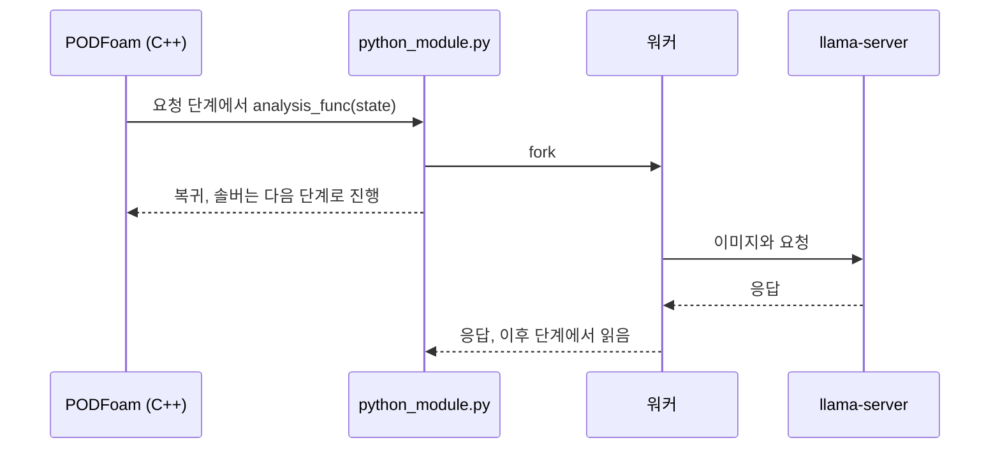

# PythonFOAM: 비전-언어 모델로 OpenFOAM 계산 관찰하기

[](https://github.com/seungminyome/PythonFOAM-Korean/actions/workflows/tests.yml)
[](https://github.com/seungminyome/PythonFOAM-Korean/actions/workflows/evidence.yml)


[](LICENSE)

[결과 페이지](https://seungminyome.github.io/PythonFOAM-Korean/) · [최신 보고서](docs/results-20261103.md) · [실행 방법](Solver_Examples/PODFoam/llm_demo/README.md) · [GPU 노드](Solver_Examples/PODFoam/llm_demo/hpc/README.md) · [English](https://github.com/seungminyome/PythonFOAM)

이 포크는 [PythonFOAM](https://github.com/argonne-lcf/PythonFOAM)의 PODFoam 예제에 선택형 관찰 기능을 더합니다.
OpenFOAM 계산 중에 솔버가 상태를 Python에 넘기면, Python은 |U|와 p 이미지를 그립니다.
그다음 비전-언어 모델에 이미지 설명을 요청합니다. 비전-언어 모델은 이미지와 글을 함께 읽는 모델이며, [llama.cpp](https://github.com/ggml-org/llama.cpp)로 같은 컴퓨터에서 실행합니다.
응답은 이미지의 바탕이 된 배열과 함께 기록하며, 모델 출력은 솔버로 돌아가지 않습니다.
이 저장소는 이런 모델이 솔버 필드를 얼마나 잘 읽는지, 요청이 실행에 얼마나 부담을 주는지 측정합니다.

 

*발달한 후향 계단 유동의 250단계, t = 0.10125 s에서 실행 중인 솔버가 Gemma 4 12B에 보낸 v2 이미지 두 장입니다.*

## 기능

- 솔버는 시간 단계마다 한 번 Python 훅 `analysis_func`를, 시작할 때 `mesh_func`를 호출합니다.
  `snapshot_func`와 `svd_func`만 있는 모듈도 그대로 동작합니다.
- 이미지 방식은 두 가지입니다.
  v1은 솔버의 두 패널 이미지이고, v2는 이미지 한 장에 필드 하나를 그리며 축을 표시 영역의 백분율로 적습니다.
- 요청 모드는 세 가지입니다. `observe`는 그 시간 단계의 수치와 v1 이미지를 보내고, `describe`는 가장 빠른 유동과 가장 낮은 압력의 위치를 묻습니다.
  `sequence`는 스냅샷 2\~6개, v2에서는 최대 3개에 걸친 추세를 묻습니다.
- 요청은 동기나 비동기로 보내며, 지정한 시간 단계에 한 번 또는 N단계마다 보냅니다.
  동시에 진행하는 요청은 최대 8개입니다.
- MPI 실행에서는 필드를 마스터 rank로 모으고, 3차원 격자는 v2 이미지에 평면 단면으로 그립니다.
- 모델에 요청을 보내지 않은 같은 실행과 비교해 확인합니다.
  단위 테스트 165개는 OpenFOAM과 모델 없이 실행됩니다. 그중 85개는 관찰 예제와 함께 들어 있습니다.
  나머지 80개는 포크 전용입니다. 그중 두 개는 이 콜백을 main의 `2ed6da2` 콜백과 비교하고, 나머지는
  실험 스크립트를 시험합니다.

## 결과

v2 이미지를 받은 Gemma 4 12B입니다. 표시 영역의 10 % 안이면 맞힌 것이고, 상수 기준선은 행마다 그 이미지 모두에 같은 답을 낼 때의 최고 점수입니다.

| 이미지 | 맞힘: 가장 빠른 유동 / 가장 낮은 압력 | 상수 기준선 |
|---|---|---|
| 발달한 유동의 무작위 표시 영역 140장 | 108 / 130 | 16 / 17 |
| 표시 영역 하나, 실행 중인 솔버에서 250단계마다 | 96개 중 65 / 89 | 53 / 65 |
| 3차원 케이스: 솔버가 그린 단면 프레임 24장 | 24개 중 21 / 24 | 24 / 24 |
| 3차원 케이스: 그 프레임에서 나중에 그린 무작위 표시 영역 48장 | 48개 중 39 / 47 | 11 / 8 |

250단계마다 보낸 요청은 이미지 그리기 외에 벽시계 시간을 0.7 % 늘렸습니다.

## 동작 방식

`LLM_ASYNC=1`이면 요청 단계에서 콜백이 워커를 fork합니다.
워커는 그 시간 단계의 이미지를 그려 llama.cpp의 HTTP 서버인 llama-server에 요청을 보냅니다.
그동안 솔버는 다음 단계로 계속 진행하고, 응답은 이후 단계에서 읽어 기록합니다.



## 요구 사항

- OpenFOAM v2012, v2106, v2212 또는 8.
  `async_v2.slurm`과 `periodic_v2.slurm`은 Apptainer 이미지에 든 v2212로 실행합니다.
- numpy, matplotlib, scipy가 있는 Python 3.10\~3.12. 관찰 예제의 솔버 실행은 3.10과 3.11에서
  시험했습니다.
- llama.cpp b11429와 GGUF 형식의 비전-언어 모델.
  CPU에서는 파일 약 3.4 GB의 Gemma 4 E2B Q4_0을, GPU에서는 llama.cpp CUDA 빌드를 합쳐 약 8 GB의 Gemma 4 12B QAT를 씁니다.
  Gemma 라이선스가 적용되며, 토큰은 필요 없습니다.

## 빠른 시작

단위 테스트와 근거 자료 해시는 OpenFOAM과 모델 없이 확인합니다. 테스트 165개에 약 85\~120 s가 걸립니다.

```bash
pip install -r Solver_Examples/PODFoam/llm_demo/requirements.txt
make test
make evidence      # manifest에 적힌 모든 파일이 해시와 일치하는지 확인
```

OpenFOAM을 source한 환경에서는 CPU의 Gemma 4 E2B로 동기 방식의 다섯 케이스를 실행해 연결, 마감 처리, 확인을 시험합니다.
솔버는 여기서 지정한 Python에 링크됩니다.

```bash
export PYTHON=<python>    # 기본값: PATH의 python3
export PATH=$(dirname "$PYTHON"):$PATH
export LD_LIBRARY_PATH=$(dirname "$PYTHON")/../lib:$LD_LIBRARY_PATH   # 시스템 Python이 아닐 때
cd Solver_Examples/PODFoam
./validation/run.sh              # 연결 검증. 통과한 실행이 기준 실행이 됨
./llm_demo/setup_runtime.sh      # Gemma 4 E2B Q4_0, 이미지 프로젝터, llama.cpp b11429
python3 llm_demo/runtime.py start
python3 llm_demo/runtime.py standalone   # 선택: 합성 그래프로 요청 하나
./llm_demo/run_demo.sh           # PODFoam 빌드, 다섯 케이스 실행, 확인
python3 llm_demo/runtime.py stop
```

Slurm GPU 노드에서는 `async_v2.slurm`이 v2 이미지와 Gemma 4 12B로 비동기 시험 묶음을 실행하고, `async_v2_sweep.slurm`은 describe sweep을 더합니다.
`periodic_v2.slurm`은 N단계마다 요청을 보내는 실행과 요청을 보내지 않은 실행을 함께 돌립니다.
자세한 내용은 [llm_demo/hpc/README.md](Solver_Examples/PODFoam/llm_demo/hpc/README.md)에 있습니다.

```bash
export POD_LLM_RUNTIME=$PWD/../llm-runtime-12b PYTHON=<python>
bash Solver_Examples/PODFoam/llm_demo/hpc/setup_12b.sh   # llama.cpp b11429 (CUDA), Gemma 4 12B QAT
export SIF=<of2212.sif> POD_REFERENCE_RUN=<pod-v2212.XXXXXX> LLM_LONG_START=<developed case>/0.1
sbatch --account=<account> --partition=<partition> Solver_Examples/PODFoam/llm_demo/hpc/async_v2.slurm
POD_SUITE_RUN=<PASS한 async_v2.slurm 실행의 pod-llm-async.XXXXXX> \
  sbatch --account=<account> --partition=<partition> Solver_Examples/PODFoam/llm_demo/hpc/periodic_v2.slurm
```

## 설정

| 설정 | 기본값 | GPU 솔버 실행 |
|---|---|---|
| `LLM_MODE` | `observe` | `describe` 또는 `sequence` |
| `LLM_IMAGE_STYLE` | `v1` | `v2` |
| `LLM_ASYNC` | `0`: 솔버가 응답이나 마감 120 s를 기다림 | `1` |
| `LLM_ANALYSIS_STEP`, `LLM_ANALYSIS_EVERY` | 시간 색인 5에서 요청 하나 | 지정한 시간 색인에서 요청 하나, 또는 N단계마다 `describe` 요청 |
| `LLM_ASYNC_MAX_PENDING` | 1 | 1 또는 2 |
| `LLM_MODEL` | Gemma 4 E2B Q4_0 | Gemma 4 12B QAT |
| `POD_SLICE_Z` | 3차원 케이스: z 범위의 가운데 | – |

모든 설정은 [llm_demo/README.md](Solver_Examples/PODFoam/llm_demo/README.md)에 있습니다.

## 출력 파일

관찰 기능은 케이스 디렉터리에 다음 파일을 씁니다.

- `llm_observation/step-NNNNNN/`에는 시간 단계 하나의 v2 이미지와 배열이 있습니다: `U.png`, `p.png`, `fields.npz`, `readable-metadata.json`.
- v1은 `state.png`, `fields.npz`, `image-metadata.json`을 `llm_observation/`에 쓰고, v1 시퀀스의 앞선 프레임은 `step-NNNNNN/`에 씁니다.
- `llm_request.json`, `llm_request_body.json`, `llm_response.json`, `llm_result.json`은 요청, 실제로 보낸 본문, 서버 응답, 그리고 상태와 해석한 응답과 소요 시간을 담은 결과입니다.
- `LLM_ANALYSIS_EVERY`를 쓰면 요청마다 `llm_requests/` 안에 폴더가 따로 있고, 그 목록은 `llm_requests/index.json`에 있습니다.
- `telemetry.jsonl`: 시간 단계마다 한 줄.
- `llm_errors.jsonl`: 콜백 자체의 오류. 오류가 나도 솔버는 멈추지 않습니다.

## 한계

- 채점한 것은 위치와 정해진 단어뿐입니다.
  Gemma 4 E2B는 쓸 만한 답을 내지 못합니다.
- 시험은 2차원 층류 유동과 압출한 3차원 케이스 하나로 했으며, 그 케이스의 단면 네 개에서 두 위치는 0.1 % 안에서 같습니다.
- 병렬 실행은 rank 2개에서 모델 요청 하나로 시험했고, 동시에 진행한 요청은 최대 두 개입니다.
- 채점한 항목에서 계산 중단보다 5단계 넘게 앞서 경고한 모델은 없었습니다. 요청에 프레임의 시점을 적었을 때도, 적지 않았을 때도 같습니다.
- 잘못된 설정, 첫 시험: 31B는 프레임 80개 중 67개, 최대 |U| 규칙은 56개를 맞혔습니다. 31B가 앞선 것은 점성 실행과 움직이는 벽 실행, 두 실행 때문입니다.
- 잘못된 설정, 두 번째 시험: 실행 29쌍, 요청을 보내기 전에 고정한 설계. 31B는 실행 58개 중 44개, 색 막대 숫자로 만든 로지스틱 회귀는 45개를 맞혔습니다. 모델이 규칙보다 낫다는 것은 보이지 않았습니다.

## 문서와 보고서

- [실행 방법과 모든 설정](Solver_Examples/PODFoam/llm_demo/README.md), [GPU 노드](Solver_Examples/PODFoam/llm_demo/hpc/README.md), [연결 검증](Solver_Examples/PODFoam/validation/README.md), [두 훅](Solver_Examples/PODFoam/HOOKS.md).
- [포크 전용 실험 스크립트, 10월 30일판](https://github.com/seungminyome/PythonFOAM-Korean/blob/5c56995/Solver_Examples/PODFoam/llm_demo/README.md).
- [결과 페이지](https://seungminyome.github.io/PythonFOAM-Korean/): 모든 보고서와 근거 자료, 내려받기.
- [11월 3일](docs/results-20261103.md): 잘못된 설정 시험 2. 실행 29쌍을 같은 이미지를 보는 기준선과 비교.
- [11월 2일](docs/results-20261102.md): 네 버전에서 빌드하고 검증한 PR 브랜치, OpenFOAM 8이 다른 까닭, 단면 이미지의 12B,
  시점 없는 불안정 시험.
- [10월 30일](docs/results-20261030.md): OpenFOAM 버전, 원본 PODFoam, 잘못된 설정 시험.
- [10월 28일](docs/results-20261028.md): 동시 요청 두 개, 3차원 단면, 불안정 감지 시험.
- [근거 자료 목록](docs/evidence/README.md) · [변경 기록](CHANGELOG.md) · [영문 저장소](https://github.com/seungminyome/PythonFOAM).
- [작업 기록](docs/progress.ko.md)과 [한국어판 해설 페이지](https://seungminyome.github.io/PythonFOAM-Korean/#ko-pages)는 이 저장소에만 있습니다.
  이전 용어 대응표: 결과 페이지의 [보고서](https://seungminyome.github.io/PythonFOAM-Korean/#reports) 절.

관찰 기능은 `Solver_Examples/PODFoam/`의 `Python*.H` 훅과 `llm_demo/`에 있습니다. `PODFoam_Debug`, `APMOSFoam`, `AEFoam`은 PODFoam과 같은 스냅샷 복사를 받고, 나머지 예제는 argonne-lcf/PythonFOAM과 같습니다.
영문 저장소의 브랜치 `pr/podfoam-fix`에는 PODFoam 수정만 있고, `pr/podfoam-observer`는 훅과 관찰 예제를 더합니다.

## 인용

관찰 기능을 사용한다면 PythonFOAM과 영문 저장소를 인용해 주십시오.

```bibtex
@article{maulik2022pythonfoam,
  title   = {PythonFOAM: In-situ data analyses with OpenFOAM and Python},
  author  = {Maulik, Romit and Fytanidis, Dimitrios K. and Lusch, Bethany and
             Vishwanath, Venkatram and Patel, Saumil},
  journal = {Journal of Computational Science},
  volume  = {62},
  pages   = {101750},
  year    = {2022},
  doi     = {10.1016/j.jocs.2022.101750}
}

@software{yome2026observer,
  author = {Yome, Seungmin},
  title  = {PythonFOAM: a vision-language observer for OpenFOAM runs},
  year   = {2026},
  url    = {https://github.com/seungminyome/PythonFOAM}
}
```

## 감사의 글

이 저장소는 Argonne National Laboratory의 [PythonFOAM](https://github.com/argonne-lcf/PythonFOAM)에 있는 PODFoam 예제를 확장합니다.
원본 소개와 설치 안내는 [프로젝트 참고 문서](docs/upstream-project.md)에 있습니다.
모델은 [llama.cpp](https://github.com/ggml-org/llama.cpp)로 실행합니다.
모델 가중치는 이 저장소에 포함되지 않으며, 각 모델의 라이선스를 따릅니다.
보고서의 GPU 노드 실행과 CPU 노드 실행에는 University of Wyoming Advanced Research Computing Center의 MedicineBow 클러스터를 사용했습니다.

## 라이선스

UChicago Argonne, LLC의 PythonFOAM 오픈 소스 [라이선스](LICENSE)를 그대로 적용합니다.
