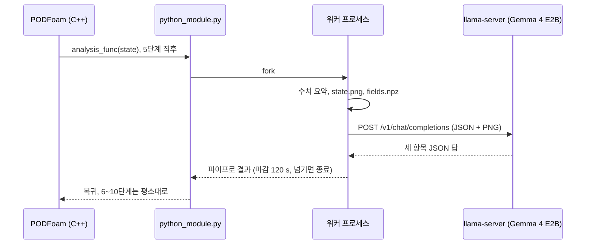

# PythonFOAM + Gemma 4 E2B: 계산 중 상태 읽기 시험

[](https://github.com/seungminyome/PythonFOAM-Korean/actions/workflows/tests.yml)
[](https://github.com/seungminyome/PythonFOAM-Korean/actions/workflows/evidence.yml)


[](LICENSE)

[시험 보고서](docs/results.md) · [근거 자료](docs/evidence/2026-10-17/README.md) · [실행 방법](Solver_Examples/PODFoam/llm_demo/README.md) · [English](https://github.com/seungminyome/PythonFOAM)

PODFoam 계산 도중 한 단계의 수치와 속도·압력 그림을 로컬 CPU의 Gemma 4 E2B에
보내고, 답을 저장한 뒤 계산을 이어갑니다. 여기까지는 됩니다. 모델이 한 말은
계산으로 들어가지 않습니다. 답의 내용은 아직 믿을 수 없고, 답을 기다리는 동안
솔버가 멈춥니다.


*10월 17일 실행의 5단계에서 모델에 보낸 그림. 위는 속력 |U|, 아래는 운동학적 압력 p (640x360, 셀마다 다각형 하나).*

## 바로 실행해 보기

단위 테스트. OpenFOAM과 모델이 없어도 되고 10초쯤 걸립니다.

```bash
pip install -r Solver_Examples/PODFoam/llm_demo/requirements.txt
make test          # 또는 cd Solver_Examples/PODFoam/llm_demo && python3 -m unittest
make evidence      # 근거 파일 전부를 manifest의 해시와 대조
```

전체 실행. OpenFOAM v2106, 모델 파일용 디스크 약 3.4 GB, RAM 몇 GB가 필요합니다.

```bash
cd Solver_Examples/PODFoam
./validation/run_v2106.sh        # 연결 검증. 통과한 실행이 기준 사례가 됩니다
./llm_demo/setup_runtime.sh      # Gemma 4 E2B Q4_0, 이미지 프로젝터, llama.cpp b11429
python3 llm_demo/runtime.py start
./llm_demo/run_demo.sh           # PODFoam 빌드, 다섯 조건 실행, 검증
python3 llm_demo/runtime.py stop
```

자세한 설명과 환경 변수는 [llm_demo/README.md](Solver_Examples/PODFoam/llm_demo/README.md)에 있습니다.

## 구현



- OpenFOAM v2106 PODFoam에 Python 콜백을 추가했습니다. 지정한 단계(시험에서는
  5단계) 직후 잔차, Courant 수, 연속성 오차, SVD 요약과 그 단계의 |U|·p PNG를
  로컬 llama.cpp 서버(Gemma 4 E2B Q4_0, 이미지 프로젝터 포함)에 보내고 응답을
  저장합니다.
- 서버가 없거나 늦으면 정해진 마감 시간 안에 솔버로 돌아옵니다.
- 검증 스크립트가 10단계 완료, 저장 파일 45개가 기준과 같은지, 로그와 기록이
  맞는지, 보낸 그림의 해시가 요청 본문과 같은지 확인합니다.
- 시험에 쓴 코드 버전은 `23089bb`입니다. 이후 커밋은 문서, 근거 자료, 저장소
  구성만 바꿨습니다.

## 측정값 (2026-10-17, 실행 `pod-llm-demo.LRfJBN`)

CPU 4스레드, GPU 없음, llama.cpp b11429, 문맥 길이 2048. 셀 20,540개, 시간
간격 10⁻⁷ s, 10단계. 조건마다 한 번씩 실행했습니다.

| 조건 | 결과 | 완료 단계 | 기준과 같은 파일 | 콜백 시간 |
|---|---|---:|---:|---:|
| 모델 요청 없음 | 기준 | 10 | - | 0.493 s |
| 수치 + 이미지 | 답변 저장 | 10 | 45 / 45 | 78.256 s |
| 수치만 | 답변 저장 | 10 | 45 / 45 | 39.672 s |
| 연결 거부 | 오류 저장, 계산 계속 | 10 | 45 / 45 | 0.509 s |
| 서버를 일부러 멈춤 (마감 4 s) | 시간 초과 저장, 계산 계속 | 10 | 45 / 45 | 4.013 s |

콜백 시간은 C++에서 Python 분석 함수를 호출한 직전부터 돌아온 직후까지입니다.
이미지 조건의 78.256 s 중 그림 생성이 0.438 s, 모델 응답 대기가 77.560 s입니다.

저장한 5단계 상태 하나로, 질문·수치·설정을 고정하고 PNG 포함 여부만 바꿔 세
쌍(여섯 번)을 물었습니다. 최대 속력 값 82.53 m/s는 두 조건 모두 입력에
있었고, 위치는 알려주지 않았습니다. 정답은 셀 12090, (0.0005, 0.0127) m입니다.

| 조건 | 답한 위치 (x, y) m | 평면 오차 | 결과 |
|---|---|---:|---|
| 수치만 | (0.6012, 0.1143) | 60.92 cm | 3회 모두 오답 |
| 수치 + 이미지 | (0.5, 0.1143) | 50.97 cm | 3회 모두 오답 |

수치만 받은 답은 입력에 있던 계산 영역의 x, y 최댓값을 그대로 위치로
적었습니다. 이미지를 받은 답은 약 10 cm 가까웠지만 역시 틀렸습니다.

## 남은 문제

1. 답의 정확도. 한 상태에서 여섯 번 모두 위치를 틀렸습니다. 다른 상태에서는
   시험하지 않았으므로 그림이 도움이 되는지는 아직 말할 수 없습니다.
2. 동기 대기. 이미지 요청 동안 솔버가 약 78 s 멈춥니다. 솔버가 계속 계산하는
   비동기 경로는 아직 없습니다.
3. 비용 측정. 재생 요청은 13–56 s가 걸렸지만 프롬프트 캐시 재사용량이 요청마다
   달라서, 이미지의 추가 비용을 분리할 수 없습니다.
4. 범위. 짧은 직렬 유체 사례 하나입니다. MPI, 3D, 장시간 실행, 12B 모델, SVD
   요약의 기여는 시험하지 않았습니다.

## 다음 단계

1. 여러 시간 단계와 다른 유동 상태에서 같은 쌍별 비교를 반복합니다.
2. 스냅샷을 고정하고 대기 요청 수를 제한한 비동기 경로를 구현합니다.
3. 캐시 조건을 맞춘 뒤 이미지 유무의 시간 비용을 다시 잽니다.
4. 메모리가 허용하면 12B 모델과 비교하고, 축과 격자 표시 등 그림 입력을
   개선합니다.

## 저장소 구성

```
Solver_Examples/PODFoam/      PODFoam 솔버(OpenFOAM v2106)와 콜백 연결 코드
  validation/                 연결 검증: 10단계, SVD 왕복, verify.py
  llm_demo/                   콜백 모듈, llama-server 클라이언트, 다섯 조건 실행기,
                              쌍별 재생 비교, 단위 테스트, requirements.txt
docs/results.md               10월 17일 시험 보고서
docs/evidence/2026-10-17/     요청·응답 원문, 로그, 검증 결과, 해시 목록
docs/evidence/2026-10-13/     이전 실행(pod-llm-demo.SwwR2e)과 그 보고서 docs/results-20261013.md
docs/evidence/check_manifest.py  근거 파일 전부를 manifest와 대조 (CI에서도 실행)
docs/progress.ko.md           10월 8일부터의 작업 기록
docs/upstream-project.md      원본 PythonFOAM README (다른 솔버, Docker, 빌드 안내)
.github/workflows/            tests.yml (단위 테스트, Python 3.10·3.12), evidence.yml (해시, 링크, 영문 저장소와 코드 일치)
CHANGELOG.md, CITATION.cff, Makefile
```

나머지 폴더(`APMOSFoam`, `AEFoam`, `PINNFoam`, `TurbulenceModel_Examples`, `Handson_Examples`)는 원본 그대로입니다.

## 자료

- [시험 보고서](docs/results.md): 조건, 측정값, 한계
- [근거 자료](docs/evidence/2026-10-17/README.md): 요청·응답 원문, 로그, 검증 결과, 해시 목록
- [전체 실행 결과 내려받기](https://github.com/seungminyome/PythonFOAM-Korean/releases/tag/korean-docs-2026-10-18): 다섯 조건의 저장 결과 전체와 실행 소스(모델 가중치 제외)
- [작업 기록](docs/progress.ko.md): 10월 8일부터의 진행
- [그림으로 보는 결과](https://seungminyome.github.io/PythonFOAM-Korean/)
- [변경 기록](CHANGELOG.md)

## 인용

루트의 `CITATION.cff`를 GitHub의 "Cite this repository" 버튼이 읽습니다. 사용한
코드 버전을 함께 적어 주세요(10월 17일 결과는 `23089bb`).

## 출처와 라이선스

[PythonFOAM](https://github.com/argonne-lcf/PythonFOAM)(Argonne National Laboratory)의 PODFoam 예제를 확장했습니다. 원본 소개와 설치 안내는 [프로젝트 참고 문서](docs/upstream-project.md)에 있습니다. 모델 실행에는 [llama.cpp](https://github.com/ggml-org/llama.cpp)를 썼습니다. [라이선스](LICENSE)는 원본과 같습니다.
