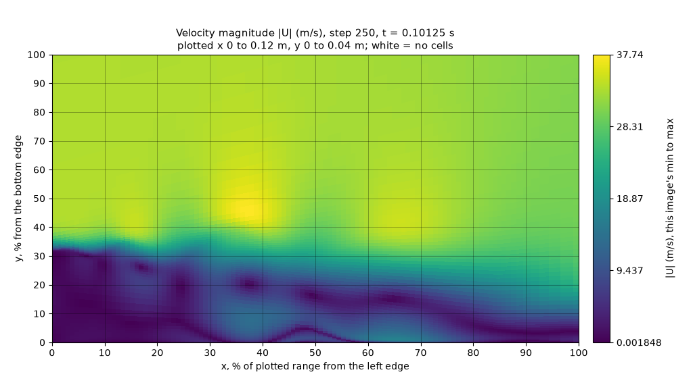
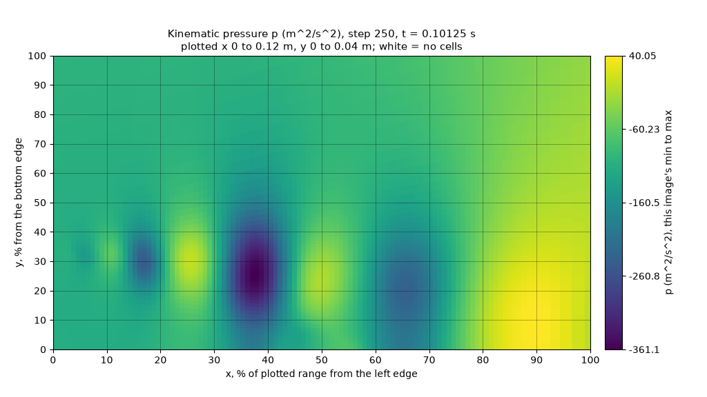
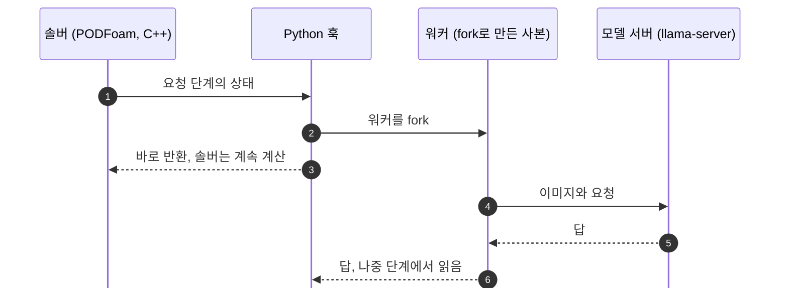

# PythonFOAM: 비전-언어 모델로 OpenFOAM 계산 관찰하기

[](https://github.com/seungminyome/PythonFOAM-Korean/actions/workflows/tests.yml)
[](https://github.com/seungminyome/PythonFOAM-Korean/actions/workflows/evidence.yml)


[](LICENSE)

[결과 페이지](https://seungminyome.github.io/PythonFOAM-Korean/) · [최신 보고서](docs/results-20261103.md) · [실행 방법](Solver_Examples/PODFoam/llm_demo/README.md) · [GPU 노드](Solver_Examples/PODFoam/llm_demo/hpc/README.md) · [English](https://github.com/seungminyome/PythonFOAM)

OpenFOAM이 계산하는 동안 Python이 유동을 이미지로 그립니다. 그리고 이미지를 읽는 모델에게 그 이미지에서
무엇이 보이는지 묻습니다. 이 저장소는 이 관찰 기능을
[PythonFOAM](https://github.com/argonne-lcf/PythonFOAM)의 PODFoam 예제에 더한 포크입니다. 코드는
`Solver_Examples/PODFoam/`에 있습니다. 모델은 솔버와 같은 컴퓨터에서
[llama.cpp](https://github.com/ggml-org/llama.cpp)로 실행합니다. 모델의 답은 기록만 하고, 솔버의 계산에는
쓰지 않습니다. 아래 시험은 이런 모델이 솔버가 그린 이미지에서 무엇을 읽고 무엇을 읽지 못하는지 잰 것입니다.

## 이 포크가 더한 것

1. 원본 PODFoam의 버그 수정: SVD 구간마다 첫 스냅샷이 다음 시간 단계의 값으로 덮어써지던 문제를 고쳤습니다.
2. 관찰 기능: 솔버가 계산하는 동안 유동 이미지를 그려 모델에 묻고, 모델의 답을 기록합니다. 250단계마다 물으면
   계산 시간이 묻지 않은 같은 실행보다 1 % 미만 늘어납니다.
3. 시험: 아래 표의 질문 일곱 가지에서 모델이 읽는 것과 읽지 못하는 것을 간단한 규칙과 비교해 쟀습니다.
4. 확인 수단: 단위 테스트 177개, OpenFOAM 8, v2012, v2106, v2212에서의 빌드, 근거 자료 폴더마다 있는 해시 목록입니다.

## 알아낸 것

따로 적지 않은 곳의 모델은 Google의 Gemma 4 12B입니다. 모델은 질문과 함께 이미지를 받습니다. 이미지는
아래 그림처럼 한 시간 단계의 속도 크기 |U|와 압력 p를 그린 것입니다. 시험에 따라서는 모델이 여러 시간 단계의
이미지를 차례로 받습니다.

| 질문 | 어떻게 됐나 | 판정 |
|---|---|---|
| 어디가 가장 빠르고, 어디가 압력이 가장 낮은가? | 모델은 대부분의 이미지에서 맞는 자리를 짚습니다. 늘 같은 답을 내는 방법보다 모델이 더 자주 맞힙니다. | 됨 |
| 이미지를 그리는 방식이 중요한가? | 중요합니다. 이미지 한 장에 필드 하나만 그리고 축 눈금을 백분율로 적으면, 모델 넷이 이미지 48장 중 45\~48장에서 가장 빠른 곳과 압력이 가장 낮은 곳을 둘 다 맞혔습니다. 솔버가 원래 그리던 이미지는 한 장에 두 필드를 나란히 그립니다. 이 이미지로는 모델마다 2\~17장을 맞혔습니다. | 매우 중요 |
| 솔버가 계산하는 동안에도 되나? | 됩니다. 250단계마다 모델에 요청을 보내면, 요청을 보내지 않은 같은 실행보다 계산 시간이 1 % 미만 늘어납니다. 솔버가 쓴 결과 파일은 두 실행에서 같습니다. | 됨 |
| 두 시점 사이에 유동이 빨라졌나, 느려졌나? | 모델은 최대 속도가 첫 시점의 값에서 2 % 이상 바뀐 경우를 읽습니다. 그보다 작은 변화는 대부분 잘못 읽습니다. | 뚜렷한 변화만 됨 |
| 이 계산이 곧 발산하나? | 모델의 경고는 발산하기 다섯 단계 전보다 일찍 나오지 않습니다. 속도와 압력 값으로 만든 간단한 규칙이 모델만큼 맞히거나 모델보다 잘 맞힙니다. | 조기 경고 없음 |
| 이 실행은 설정이 잘못됐나? | 첫 시험에서는 Gemma 4 31B가 간단한 규칙보다 많이 맞혔지만, 그 차이는 실행 두 개에서 나왔습니다. 실행 29쌍으로 한 두 번째 시험에서는 31B가 회귀식보다 낫다는 결과가 나오지 않았습니다. 이 회귀식은 색 막대에 적힌 숫자와 모델에 알려 준 설정값으로 만들었습니다. 31B는 잘못된 실행을 회귀식보다 많이 찾지만, 정상 실행도 잘못됐다고 답하는 일이 많습니다. | 규칙보다 낫다는 결과 없음 |
| 큰 모델이 더 나은가? | 작은 모델인 Gemma 4 E2B는 이 이미지를 제대로 읽지 못합니다. 이 시험에서는 위치를 읽는 일이 12B로 충분합니다. 31B는 작은 저압 영역을 12B보다 잘 찾습니다. 그러나 설정을 판단하는 일에서는 31B도 간단한 규칙이나 회귀식보다 낫다는 결과가 나오지 않았습니다. | 부분적으로 |

'늘 같은 답'은 가장 자주 정답이 되는 답 하나를 모든 이미지에 내는 방법입니다. 모델 넷은
Gemma 4 12B, 26B-A4B, 31B와 Qwen3.5-35B-A3B입니다.

정확한 수와 비교에 쓴 규칙은 [결과 페이지](https://seungminyome.github.io/PythonFOAM-Korean/)와
그 페이지가 링크한 보고서에 있습니다. 모델의 답은 [근거 자료 폴더](docs/evidence/README.md)와 그 폴더가 링크한
릴리스에 있습니다. 폴더마다 파일의 해시를 적은 목록(매니페스트)이 있습니다.

 

*모델이 보는 것: 250단계의 |U|와 p입니다. 유동은 뒤로 꺾인 계단을 지나는 유동(후향 계단 유동)이며, 계단 뒤의
와류가 발달한 뒤의 시점입니다. 실행 중인 솔버가 이 이미지를 그려 Gemma 4 12B에 보냈습니다.*

모든 시험은 2차원 층류 케이스와 3차원 케이스 하나로 했습니다. 이 3차원 케이스는 2차원 격자를 두께 방향으로
늘려 만든 것입니다. 다른 유동에서는 모델이 다르게 읽을 수 있습니다. 채점한 것은 모델이 답한 위치와 정해진
단어뿐입니다. 모델이 자유롭게 쓴 설명 글은 채점하지 않았습니다.

## 동작 방식

솔버는 시간 단계마다 `python_module.py`의 함수 `analysis_func`를 한 번 부릅니다. 솔버가 이렇게 정해진 때에
부르는 Python 함수를 이 문서에서는 훅이라고 부릅니다. 아래 그림은 비동기 모드(`LLM_ASYNC=1`)에서 요청 하나가
처리되는 순서입니다. 시간은 위에서 아래로 흐릅니다. 실선은 보내는 것이고, 점선은 돌아오는 것입니다. 솔버는
3번 화살표 뒤에 바로 다음 시간 단계를 계산합니다. 솔버는 모델의 답을 기다리지 않습니다.



워커는 |U|와 p 이미지를 그려 llama.cpp의 HTTP 서버인 llama-server에 보냅니다. 워커는 모델의 답을 이미지를
그리는 데 쓴 배열과 함께 기록합니다. 기본값은 동기 모드이며, 동기 모드에서는 솔버가 모델의 답을 기다립니다.
요청의 제한 시간은 따로 정하지 않으면 120초입니다.

솔버는 요청을 한 번만 보내거나 N단계마다 보냅니다. 답을 기다리는 요청은 기본으로 한 번에 1개입니다. 설정을
바꾸면 8개까지 늘릴 수 있습니다. MPI 실행에서는 각 프로세스의 필드를 첫 번째 프로세스(마스터 rank)로 모아서
그립니다. 3차원 격자는 평면으로 자른 단면을 그립니다.
[llm_demo/README.md](Solver_Examples/PODFoam/llm_demo/README.md)는 요청 모드 셋(`observe`, `describe`,
`sequence`), 이미지 방식 둘, 모든 설정을 설명합니다.

## 빠른 시작

단위 테스트와 근거 자료 해시 확인에는 OpenFOAM도 모델도 필요 없습니다:

```bash
pip install -r Solver_Examples/PODFoam/llm_demo/requirements.txt
make test          # 테스트 177개, 2분쯤
make evidence      # 매니페스트의 파일마다 해시가 맞는지
```

아래 명령은 C++와 Python 연결을 확인한 뒤, CPU에서 작은 Gemma 4 E2B 모델로 PODFoam 케이스 다섯 개를
돌리고 검증합니다. 이 명령에는 OpenFOAM v2012, v2106, v2212, 8 중 하나를 source한 환경과
Python 3.10\~3.12가 필요합니다. 명령이 내려받는 모델, 이미지 프로젝터, llama.cpp는 합쳐서 3.4 GB쯤입니다.
토큰은 필요 없습니다:

```bash
export PYTHON=${PYTHON:-$(command -v python3)}   # 또는 다른 Python의 경로
export PATH=$(dirname "$PYTHON"):$PATH
export LD_LIBRARY_PATH=$(dirname "$PYTHON")/../lib:$LD_LIBRARY_PATH   # 시스템 Python이 아니면
cd Solver_Examples/PODFoam
./validation/run.sh              # C++와 Python 연결을 확인; run_demo.sh에는 통과한 이 실행이 필요함
./llm_demo/setup_runtime.sh      # Gemma 4 E2B Q4_0, 이미지 프로젝터, llama.cpp b11429
python3 llm_demo/runtime.py start
./llm_demo/run_demo.sh           # PODFoam 빌드, 케이스 다섯 개 실행, 검증
python3 llm_demo/runtime.py stop
```

[llm_demo/hpc/README.md](Solver_Examples/PODFoam/llm_demo/hpc/README.md)는 보고서가 더 큰 모델을
돌린 Slurm GPU 노드용 스크립트를 설명합니다.

## 보고서

보고서마다 실행 조건, 하드웨어, 코드 리비전, Slurm 작업을 적었습니다.

- [11월 3일](docs/results-20261103.md): 잘못된 설정 시험 2. 실행 29쌍에서 모델을 같은 이미지를
  보는 기준선과 비교.
- [11월 2일](docs/results-20261102.md): 네 OpenFOAM 버전의 PR 브랜치, OpenFOAM 8이 v2212와 다른
  까닭, 3차원 단면 이미지, 시점을 적지 않은 불안정 시험.
- [10월 30일](docs/results-20261030.md): OpenFOAM 버전, 원본 PODFoam과의 비교, 첫 잘못된 설정 시험.
- [10월 28일](docs/results-20261028.md): 동시 요청 두 개, 3차원 단면, 불안정 시험.
- 10월 13일부터 27일까지의 이전 보고서:
  [결과 페이지](https://seungminyome.github.io/PythonFOAM-Korean/#reports).
- [근거 자료 목록](docs/evidence/README.md) · [변경 기록](CHANGELOG.md).

## 코드 위치

관찰 기능의 코드는 `Solver_Examples/PODFoam/`의 `Python*.H` 파일과 `llm_demo/` 폴더에 있습니다.

영문 저장소에는 원본 프로젝트에 보낼 브랜치가 셋 있습니다.

- `pr/podfoam-snapshot-copy`: 아래에 적은 버그의 수정만 담습니다. 파일 넷을 바꿉니다.
- `pr/podfoam-fix`: 버그 수정, 솔버의 다른 변경, 연결 검증을 담습니다. 관찰 기능은 없습니다.
- `pr/podfoam-observer`: 훅과 관찰 기능을 더합니다.

세 브랜치가 고치는 버그는 원본 PODFoam에 있습니다. 원본 PODFoam에서는 SVD 구간마다 다음 시간 단계의 값이
첫 스냅샷을 덮어썼습니다. SVD 구간은 스냅샷을 모아 SVD를 한 번 계산하는 묶음입니다. 같은 수정이
`PODFoam_Debug`, `APMOSFoam`, `AEFoam`에도 들어 있습니다. 다른 예제의 코드는 argonne-lcf/PythonFOAM과
같습니다. 이 수정으로 무엇이 바뀌는지는 [11월 2일 보고서](docs/results-20261102.md)에 있습니다.

- [HOOKS.md](Solver_Examples/PODFoam/HOOKS.md)는 선택해서 쓰는 훅 둘(`analysis_func`, `mesh_func`)을 설명합니다.
- [validation README](Solver_Examples/PODFoam/validation/README.md)는 연결 검증을 설명합니다.

## 인용

관찰 기능을 사용한다면 PythonFOAM과 영문 저장소를 인용해 주십시오.

```bibtex
@article{maulik2022pythonfoam,
  title   = {PythonFOAM: In-situ data analyses with OpenFOAM and Python},
  author  = {Maulik, Romit and Fytanidis, Dimitrios K. and Lusch, Bethany and
             Vishwanath, Venkatram and Patel, Saumil},
  journal = {Journal of Computational Science},
  volume  = {62},
  pages   = {101750},
  year    = {2022},
  doi     = {10.1016/j.jocs.2022.101750}
}

@software{yome2026observer,
  author = {Yome, Seungmin},
  title  = {PythonFOAM: a vision-language observer for OpenFOAM runs},
  year   = {2026},
  url    = {https://github.com/seungminyome/PythonFOAM}
}
```

## 감사의 글

이 저장소는 Argonne National Laboratory의 [PythonFOAM](https://github.com/argonne-lcf/PythonFOAM)에 있는 PODFoam 예제를 확장합니다.
원본 소개와 설치 안내는 [프로젝트 참고 문서](docs/upstream-project.md)에 있습니다.
모델은 [llama.cpp](https://github.com/ggml-org/llama.cpp)로 실행합니다.
모델 가중치는 이 저장소에 포함되지 않으며, 각 모델의 라이선스를 따릅니다.
보고서의 GPU 노드 실행과 CPU 노드 실행에는 University of Wyoming Advanced Research Computing Center의 MedicineBow 클러스터를 사용했습니다.

## 라이선스

UChicago Argonne, LLC의 PythonFOAM 오픈 소스 [라이선스](LICENSE)를 그대로 적용합니다.
