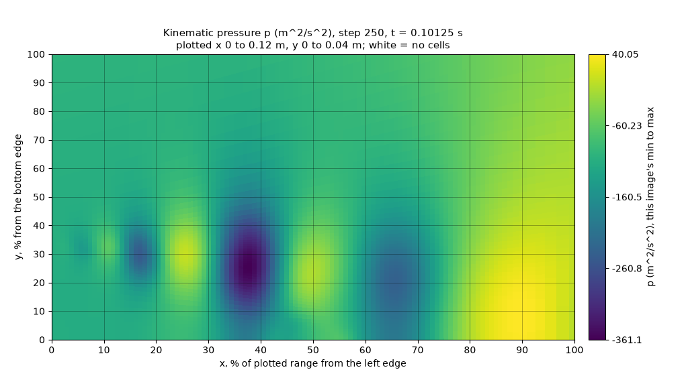
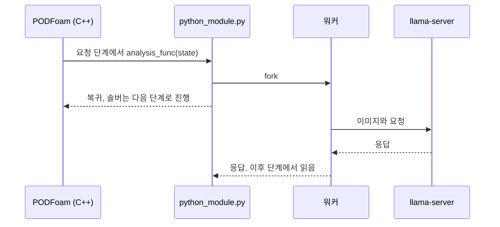

# PythonFOAM: 비전-언어 모델로 OpenFOAM 계산 관찰하기

[](https://github.com/seungminyome/PythonFOAM-Korean/actions/workflows/tests.yml)
[](https://github.com/seungminyome/PythonFOAM-Korean/actions/workflows/evidence.yml)


[](LICENSE)

[결과 페이지](https://seungminyome.github.io/PythonFOAM-Korean/) · [최신 보고서](docs/results-20261030.md) · [실행 방법](Solver_Examples/PODFoam/llm_demo/README.md) · [GPU 노드](Solver_Examples/PODFoam/llm_demo/hpc/README.md) · [English](https://github.com/seungminyome/PythonFOAM)

이 포크는 [PythonFOAM](https://github.com/argonne-lcf/PythonFOAM)의 PODFoam 예제에 선택 사항인 관찰 기능(observer)을 더합니다.
OpenFOAM 계산 중에 솔버가 상태를 Python에 넘기면, Python은 |U|와 p 이미지를 생성하고 [llama.cpp](https://github.com/ggml-org/llama.cpp)로 로컬에서 실행하는 비전-언어 모델(VLM)에 이미지 설명을 요청합니다.
응답은 이미지의 바탕이 된 배열과 함께 기록하며, 모델 출력은 솔버 계산에 반영하지 않습니다.
이 저장소에서는 이런 모델이 솔버 필드를 얼마나 잘 읽는지, 요청이 실행에 얼마나 부담을 주는지 측정합니다.

 

*발달한 후향 계단 유동의 250단계(t = 0.10125 s)에서 실행 중인 솔버가 Gemma 4 12B에 보낸 v2 이미지 두 장입니다.*

## 기능

- 솔버는 매 시간 단계가 끝날 때 Python 훅 `analysis_func`를, 시작할 때 `mesh_func`를 호출합니다.
  원본 함수만 있는 모듈도 그대로 동작합니다.
- 이미지 방식은 두 가지입니다.
  v1은 솔버의 두 패널 이미지이고, v2는 이미지 한 장에 필드 하나를 그리며 축을 표시 영역의 퍼센트로 적습니다.
- 요청 모드는 `observe`(그 시간 단계의 수치와 v1 이미지), `describe`(최대 속도 지점과 최저 압력 지점의 위치), `sequence`(스냅샷 2\~6개에 걸친 추세, v2에서는 최대 3개)입니다.
- 요청은 동기 또는 비동기 방식이며, 지정한 시간 단계에 한 번 보내거나 N단계마다(`describe`, v2) 보냅니다.
  동시에 진행하는 요청은 최대 8개입니다.
- MPI 실행에서는 필드를 마스터 rank로 모으고, 3차원 격자는 v2 이미지에 평면 단면으로 그립니다.
- 같은 조건의 기준 실행(요청 없음)과 비교해 검증합니다.
  단위 테스트 156개는 OpenFOAM과 모델 없이 실행됩니다.

## 결과

표의 숫자는 v2 이미지를 받은 Gemma 4 12B가 정답 셀에서 표시 영역 크기의 10 % 이내로 맞힌 위치의 수입니다.
괄호 안은 상수 기준선(모든 이미지에 같은 답을 낼 때의 최고 점수)입니다.

| 시험 | 맞힌 수 |
|---|---|
| 최대 속도 지점 / 최저 압력 지점, 발달한 유동에서 표시 영역을 무작위로 정한 이미지 140장 | 108 / 130 (16 / 17) |
| 같은 시험, 표시 영역 하나, 실행 중인 솔버에서 250단계마다 요청(이미지 생성 외에 벽시계 시간 +0.7 %) | 96개 중 65 / 89 (53 / 65) |

다른 시험과 모델의 결과는 [결과 페이지](https://seungminyome.github.io/PythonFOAM-Korean/)에 있습니다.

## 동작 방식

`LLM_ASYNC=1`이면 요청 단계에서 콜백이 워커를 포크합니다.
워커는 그 시간 단계의 이미지를 생성해 llama-server에 요청을 보냅니다.
그동안 솔버는 다음 단계로 계속 진행하고, 응답은 이후 단계에서 읽어 기록합니다.



## 요구 사항

- OpenFOAM v2012, v2106, v2212 또는 8.
  `async_v2.slurm`과 `periodic_v2.slurm`은 Apptainer 컨테이너 이미지에 든 v2212로 실행합니다.
- Python 3.10\~3.12(솔버 실행은 3.10과 3.11에서 시험)와 numpy, matplotlib.
  3차원 케이스의 v1 이미지에는 scipy도 필요합니다.
- llama.cpp b11429와 GGUF 형식의 비전 모델.
  CPU에서는 Gemma 4 E2B Q4_0(파일 약 3.4 GB), GPU에서는 Gemma 4 12B QAT(llama.cpp CUDA 빌드를 합쳐 약 8 GB)를 씁니다.
  Gemma 라이선스가 적용되며, 토큰은 필요 없습니다.

## 빠른 시작

OpenFOAM과 모델 없이 단위 테스트와 근거 자료 해시를 확인합니다(테스트 156개, 약 110 s).

```bash
pip install -r Solver_Examples/PODFoam/llm_demo/requirements.txt
make test
make evidence      # manifest에 적힌 모든 파일이 해시와 일치하는지 확인
```

OpenFOAM을 source한 환경에서는 CPU의 Gemma 4 E2B로 동기 방식의 다섯 케이스를 실행해 연결, 제한 시간 처리, 검증을 시험합니다.
솔버는 여기서 지정한 Python에 링크됩니다.

```bash
export PYTHON=<python>    # 기본값: PATH의 python3
export PATH=$(dirname "$PYTHON"):$PATH
export LD_LIBRARY_PATH=$(dirname "$PYTHON")/../lib:$LD_LIBRARY_PATH   # 시스템 Python이 아닐 때
cd Solver_Examples/PODFoam
./validation/run_v2106.sh        # 연결 검증. 통과한 실행이 기준 케이스가 됨
./llm_demo/setup_runtime.sh      # Gemma 4 E2B Q4_0, 이미지 프로젝터, llama.cpp b11429
python3 llm_demo/runtime.py start
python3 llm_demo/runtime.py standalone   # 선택: 합성 그래프로 요청 하나
./llm_demo/run_demo.sh           # PODFoam 빌드, 다섯 케이스 실행, 검증
python3 llm_demo/runtime.py stop
```

Slurm GPU 노드에서는 `async_v2.slurm`이 v2 이미지와 Gemma 4 12B로 비동기 케이스들을 실행하고(`async_v2_sweep.slurm`은 describe sweep을 더함), `periodic_v2.slurm`은 N단계마다 요청을 보내는 실행과 같은 조건의 기준 실행(요청 없음)을 수행합니다.
나머지는 [llm_demo/hpc/README.md](Solver_Examples/PODFoam/llm_demo/hpc/README.md)에 있습니다.

```bash
export POD_LLM_RUNTIME=$PWD/llm-runtime-12b PYTHON=<python>
bash Solver_Examples/PODFoam/llm_demo/hpc/setup_12b.sh   # llama.cpp b11429 (CUDA), Gemma 4 12B QAT
export SIF=<of2212.sif> POD_REFERENCE_RUN=<pod-v2212.XXXXXX> LLM_LONG_START=<developed case>/0.1
sbatch --account=<account> --partition=<partition> Solver_Examples/PODFoam/llm_demo/hpc/async_v2.slurm
POD_SUITE_RUN=<PASS한 async_v2.slurm 실행의 pod-llm-async.XXXXXX> \
  sbatch --account=<account> --partition=<partition> Solver_Examples/PODFoam/llm_demo/hpc/periodic_v2.slurm
```

## 설정

| 설정 | 기본값 | GPU 솔버 실행 |
|---|---|---|
| `LLM_MODE` | `observe` | `describe` 또는 `sequence` |
| `LLM_IMAGE_STYLE` | `v1` | `v2` |
| `LLM_ASYNC` | `0`: 솔버가 응답을 받거나 제한 시간 120 s가 지날 때까지 기다림 | `1` |
| `LLM_ANALYSIS_STEP`, `LLM_ANALYSIS_EVERY` | 5단계에서 요청 하나 | 지정한 단계에서 요청 하나, 또는 N단계마다 `describe` 요청 |
| `LLM_ASYNC_MAX_PENDING` | 1 | 1 또는 2 |
| `LLM_MODEL` | Gemma 4 E2B Q4_0 | Gemma 4 12B QAT |
| `POD_SLICE_Z` | 3차원 케이스: z 범위의 가운데 | – |

모든 설정은 [llm_demo/README.md](Solver_Examples/PODFoam/llm_demo/README.md)에 있습니다.

## 출력 파일

관찰 기능은 케이스 디렉터리에 다음 파일을 씁니다.

- `llm_observation/step-NNNNNN/`: 시간 단계 하나의 v2 이미지와 배열(`U.png`, `p.png`, `fields.npz`, `readable-metadata.json`).
  v1은 `state.png`, `fields.npz`, `image-metadata.json`을 `llm_observation/`에 쓰고, v1 시퀀스의 앞선 프레임은 `step-NNNNNN/`에 씁니다.
- `llm_request.json`, `llm_request_body.json`, `llm_response.json`, `llm_result.json`: 요청, 실제로 보낸 요청 본문, 서버 응답, 결과(상태, 파싱한 응답, 소요 시간).
  `LLM_ANALYSIS_EVERY`를 쓰면 요청마다 `llm_requests/` 안에 폴더가 따로 있고, 그 목록은 `llm_requests/index.json`에 있습니다.
- `telemetry.jsonl`: 시간 단계마다 한 줄.
- `llm_errors.jsonl`: 콜백 자체의 오류. 오류가 나도 솔버는 멈추지 않습니다.

## 한계

- 채점한 것은 위치와 정해진 단어뿐입니다.
  Gemma 4 E2B는 실용적인 수준의 응답을 내지 못합니다.
- 2차원 층류 유동과 압출한 3차원 케이스 하나에서 시험했습니다.
  MPI는 rank 2개에서 모델 요청 없이 시험했고, 동시에 진행한 요청은 최대 두 개입니다.
  단면 이미지를 읽은 모델은 없습니다.
  v2012와 8에서는 모델로 돌린 시험 모음이 없습니다.
- 계산 중단보다 5단계 넘게 앞서 경고한 모델은 없었습니다.
- 잘못된 설정: 80개 중 31B 67개, 나머지 41\~45개, 상수 기준선 40개, 최대 |U| 규칙 56개. 실행 두 개를 빼면 64개 중 31B 55개, 규칙 56개입니다.

## 문서와 보고서

- [실행 방법과 모든 설정](Solver_Examples/PODFoam/llm_demo/README.md), [GPU 노드](Solver_Examples/PODFoam/llm_demo/hpc/README.md), [연결 검증](Solver_Examples/PODFoam/validation/README.md).
- [결과 페이지](https://seungminyome.github.io/PythonFOAM-Korean/): 주요 결과와 모든 보고서, 근거 자료와 내려받기 링크.
- 최근 보고서: [10월 30일](docs/results-20261030.md)(OpenFOAM 버전, 원본 PODFoam, 잘못된 설정 시험), [10월 28일](docs/results-20261028.md)(요청 두 개 동시 진행, 3차원 단면, 불안정 감지 시험), [10월 27일](docs/results-20261027.md)(추세 판독, 원기둥 유동, 250단계마다 요청).
- [근거 자료 목록](docs/evidence/README.md)(폴더마다 해시 목록, CI에서 확인) · [변경 기록](CHANGELOG.md) · [영문 저장소](https://github.com/seungminyome/PythonFOAM).
- [작업 기록](docs/progress.ko.md)과 [한국어판 해설 페이지](https://seungminyome.github.io/PythonFOAM-Korean/#ko-pages)는 이 저장소에만 있습니다.
  이전 용어 대응표는 결과 페이지의 [보고서](https://seungminyome.github.io/PythonFOAM-Korean/#reports) 절에 있습니다.

관찰 기능은 `Solver_Examples/PODFoam/`(`Python*.H` 훅)과 그 안의 `llm_demo/` 폴더에 있으며, 나머지 예제 폴더는 원본 그대로입니다.

## 인용

관찰 기능을 사용한다면 PythonFOAM과 영문 저장소를 인용해 주십시오.

```bibtex
@article{maulik2022pythonfoam,
  title   = {PythonFOAM: In-situ data analyses with OpenFOAM and Python},
  author  = {Maulik, Romit and Fytanidis, Dimitrios K. and Lusch, Bethany and
             Vishwanath, Venkatram and Patel, Saumil},
  journal = {Journal of Computational Science},
  volume  = {62},
  pages   = {101750},
  year    = {2022},
  doi     = {10.1016/j.jocs.2022.101750}
}

@software{yome2026observer,
  author = {Yome, Seungmin},
  title  = {PythonFOAM: a vision-language observer for OpenFOAM runs},
  year   = {2026},
  url    = {https://github.com/seungminyome/PythonFOAM}
}
```

## 감사의 글

이 저장소는 Argonne National Laboratory의 [PythonFOAM](https://github.com/argonne-lcf/PythonFOAM)에 있는 PODFoam 예제를 확장합니다.
원본 소개와 설치 안내는 [프로젝트 참고 문서](docs/upstream-project.md)에 있습니다.
모델은 [llama.cpp](https://github.com/ggml-org/llama.cpp)로 실행합니다.
모델 가중치는 이 저장소에 포함되지 않으며, 각 모델의 라이선스를 따릅니다.
보고서의 GPU 노드 실행과 CPU 노드 실행에는 University of Wyoming Advanced Research Computing Center의 MedicineBow 클러스터를 사용했습니다.

## 라이선스

UChicago Argonne, LLC의 PythonFOAM 오픈 소스 [라이선스](LICENSE)를 그대로 적용합니다.
