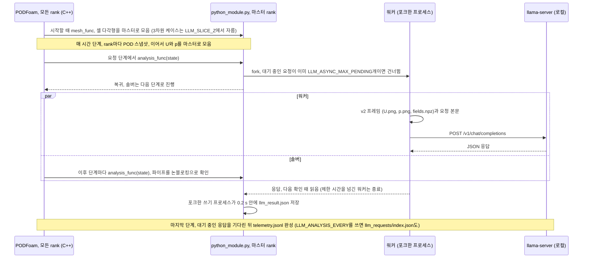

# PythonFOAM: 비전-언어 모델로 OpenFOAM 계산 관찰하기

[](https://github.com/seungminyome/PythonFOAM-Korean/actions/workflows/tests.yml)
[](https://github.com/seungminyome/PythonFOAM-Korean/actions/workflows/evidence.yml)


[](LICENSE)

[최신 보고서](docs/results-20261028.md) · [전체 보고서](#보고서와-근거-자료) · [실행 방법](Solver_Examples/PODFoam/llm_demo/README.md) · [GPU 노드](Solver_Examples/PODFoam/llm_demo/hpc/README.md) · [English](https://github.com/seungminyome/PythonFOAM)

이 포크는 [PythonFOAM](https://github.com/argonne-lcf/PythonFOAM)의 PODFoam 예제에 선택 사항인 관찰 기능(observer)을 더합니다.
OpenFOAM 계산 중에 솔버가 상태를 Python에 넘기면, Python은 |U|와 p 이미지를 생성하고 [llama.cpp](https://github.com/ggml-org/llama.cpp)로 로컬에서 실행하는 비전-언어 모델(VLM)에 이미지 설명을 요청합니다.
그동안 솔버는 응답을 기다리거나, 기다리지 않고 다음 시간 단계로 진행합니다.
응답은 기록만 하며, 모델 출력은 솔버 계산에 반영하지 않습니다.
이 저장소에서는 이런 모델이 솔버 필드를 얼마나 잘 읽는지, 요청이 실행에 얼마나 부담을 주는지 측정하고, 모델 응답을 배열에서 계산한 간단한 수치와 비교합니다.

 

*발달한 후향 계단 유동의 250단계(t = 0.10125 s)에서 실행 중인 솔버가 Gemma 4 12B에 보낸 v2 이미지 두 장입니다.
|U|와 p는 각각 별도의 색 범위로 그렸고, 표시 영역은 x 0\~0.12 m, y 0\~0.04 m입니다.*

## 결과

응답한 위치가 정답 셀에서 표시 영역 크기의 10 % 이내에 있으면 맞힌 것으로 셉니다.
상수 기준선은 모든 이미지에 같은 답을 낼 때의 최고 점수입니다.
v1은 솔버의 원래 이미지로, |U|를 위 패널에, p를 아래 패널에 그리며 축은 미터 단위입니다.
위에 보인 v2는 이미지 한 장에 필드 하나를 그리며, 축을 표시 영역의 퍼센트로 적고 10 %마다 격자선을 긋습니다.
v2own은 시퀀스의 각 이미지를 이미지별 색 범위로 그린 v2입니다.
따로 적지 않으면 케이스는 후향 계단을 지나는 2차원 층류 유동입니다.

| 시험 | 모델, 이미지 | 결과 | 상수 기준선 | 보고서 |
|---|---|---|---|---|
| 최대 속도 지점과 최저 압력 지점, 시작 직후 상태(처음 3 ms), 표시 영역을 무작위로 정한 이미지 48장, 표시 영역 시드 세 개 | Gemma 4 12B, 26B-A4B, 31B, Qwen3.5-35B-A3B; v2 (v1) | 시드마다 48장 중 45\~48장 (v1: 2\~17장) | 7\~10 | [10월 22일 이어서](docs/results-20261022-live.md) |
| 같은 시험, 발달한 유동 상태 35개의 이미지 140장 | 같은 모델; v2 | 최대 속도 지점 106\~121장, 최저 압력 지점 130\~139장 | 16, 17 | [10월 22일 이어서](docs/results-20261022-live.md) |
| 실행 중인 솔버, 요청마다 표시 영역을 달리한 `describe` 요청 11개 | Gemma 4 12B; v2 | 11개 중 최대 속도 지점 9개, 최저 압력 지점 10개 | 4, 4 | [10월 22일 이어서](docs/results-20261022-live.md) |
| 실행 중인 솔버, 24,000단계 동안 250단계마다 `describe` 요청 | Gemma 4 12B; v2 | 96개 중 최대 속도 지점 65개, 최저 압력 지점 89개 | 53, 65 | [10월 27일](docs/results-20261027.md) |
| 세 시점에 걸친 최대 속도 / 최저 압력 추세, 시퀀스 45개 | Gemma 4 12B; v2own (v1) | 45개 중 32 / 28개 (v1: 14 / 15개). 최대 속도가 2 % 이상 바뀐 시퀀스 30개 중 29개에서 최대 속도 추세를 맞힘 | 15 / 20 | [10월 27일](docs/results-20261027.md) |
| 불안정 여부: 계산 중단 1\~10단계 전에 끝나는 프레임 세 장 시퀀스(27개) 또는 정상 종료한 실행의 시퀀스(27개) | Gemma 4 12B, 26B-A4B, 31B, Qwen3.5-35B-A3B; v2own | 54개 중 30\~33개 | 27; 배열에서 계산한 규칙: 33(최대 \|U\| 증가), 38(인접 셀 간 차이) | [10월 28일](docs/results-20261028.md) |
| 비용: 250단계마다 요청, 동시에 하나까지 진행 | Gemma 4 12B | 같은 이미지를 생성한 기준 실행(요청 없음)보다 단계당 벽시계 시간 +0.7 %. 저장 파일 2,016개 중 2,016개 동일 | | [10월 27일](docs/results-20261027.md) |
| 비용: 50단계마다 요청, 동시에 두 개까지 진행 | Gemma 4 12B, 서버 슬롯 2개 | 벽시계 시간 +3.2 %, 요청당 약 0.1 s로 하나씩 진행할 때와 같음. 저장 파일 2,520개 중 2,520개 동일 | | [10월 28일](docs/results-20261028.md) |

v2 이미지에서는 표의 모든 모델이 모든 위치 시험에서 상수 기준선을 넘었고, Gemma 4 12B는 24,000단계 동안 실행 중인 솔버에서도 상수 기준선을 넘었습니다.
발달한 유동에서 최대 속도 지점을 틀린 응답은 대부분 최대 속도의 90 % 이상인 다른 지점을 지목했습니다.
24,000단계 실행에서 최저 압력 지점은 와류 중심 사이를 옮겨 다녔고, 응답한 위치도 이를 따라갔습니다(x 방향 상관계수 0.78).
솔버의 v1 이미지로는 추세 시험에서 상수 기준선보다 뚜렷하게 나은 모델이 없었습니다.

4비트 파일과 llama.cpp 권장 이미지 토큰 설정으로 실행한 Qwen3.5-35B-A3B와 27B는 발달한 유동의 최대 속도 지점을 이미지 140장 중 각각 133장과 128장에서 맞혔고, 이는 어느 Gemma 모델보다 많습니다.
다만 두 모델 계열은 서로 다른 파일과 설정으로 실행했습니다.
두 번째 형상인 원기둥 주위 층류 유동(`offsetCylinder`)에서는 Gemma 모델 세 개가 표시 영역 40개 중 32\~39개에서 최대 속도 지점을 맞혔고, 상수 기준선은 8입니다.
넓고 어두운 후류 옆의 작은 점인 최저 압력 지점은 31B가 38개, 12B가 18개에서 맞혔습니다.
아래 CPU 경로에서 쓰는 Gemma 4 E2B는 합성 이미지에 넣은 고립된 최대 속도 지점을 v1 이미지 32장 중 4장, v2 이미지 32장 중 11장에서 맞혔고, 상수 기준선은 5입니다.

불안정 감지 시험에서 계산 중단 1단계 전에 끝나는 시퀀스는 필드가 이미 발산한 상태이며, 모든 모델이 이 시퀀스에 `unstable`이라고 응답했습니다.
중단보다 5단계 넘게 앞서 경고한 모델은 없었습니다.
최대 |U| 증가를 보는 규칙은 가장 나은 모델만큼 맞혔고, 인접 셀 간 차이를 보는 규칙은 더 많이 맞혔습니다.

## 동작 방식

PODFoam은 시작할 때 셀 형상을 넘기며 `mesh_func`를 한 번 호출합니다.
그 뒤 매 시간 단계가 끝날 때마다 그 단계의 잔차, Courant 수, 연속성 오차, U와 p의 셀 값을 넘기며 `analysis_func`를 호출합니다.
두 함수는 모두 선택 사항이어서, 원본의 `snapshot_func`와 `svd_func`만 있는 모듈로도 실행할 수 있습니다.
병렬 실행에서는 격자와 필드를 마스터 rank로 모으고(MPI gather), 관찰 기능은 마스터 rank에서만 호출합니다.
POD 스냅샷과 SVD는 rank마다 따로 계산합니다.
2차원 케이스는 `empty` 패치에서 셀마다 다각형 하나를 얻어 그립니다.
3차원 격자는 OpenFOAM의 `cuttingPlane`으로 z = `LLM_SLICE_Z`에서 자르고(기본값은 z 범위의 가운데), v2 이미지는 잘린 셀 하나하나를 다각형으로 그립니다.
아래는 v2 이미지를 쓰는 비동기 경로(`LLM_ASYNC=1`)입니다.



| 설정 | 기본값 | GPU 솔버 실행 |
|---|---|---|
| `LLM_MODE` | `observe`: 수치와 v1 이미지 | `describe`: 최대 속도 지점과 최저 압력 지점의 위치. `sequence`: 두세 시점에 걸친 추세 레이블 |
| `LLM_IMAGE_STYLE` | `v1` | `v2` |
| `LLM_ASYNC` | `0`: 솔버가 응답을 받거나 제한 시간 120 s가 지날 때까지 기다림 | `1` |
| `LLM_ANALYSIS_STEP`, `LLM_ANALYSIS_EVERY` | 5단계에서 요청 하나 | 지정한 단계에서 요청 하나, 또는 N단계마다 `describe` 요청 |
| `LLM_ASYNC_MAX_PENDING` | 1 | 1 또는 2 |
| `LLM_MODEL` | Gemma 4 E2B Q4_0 | Gemma 4 12B QAT |

검증 스크립트는 저장 파일 전부를 기준 실행(요청 없음)과 비교하고, 프레임의 배열을 저장된 필드와 비교합니다.
요청 본문은 디스크의 프레임에 이미지 시험의 요청 빌더를 적용한 결과와 바이트 단위로 대조합니다.
모든 설정은 [llm_demo/README.md](Solver_Examples/PODFoam/llm_demo/README.md)에 있습니다.

## 빠른 시작

OpenFOAM과 모델 없이 단위 테스트와 근거 자료 해시를 확인합니다(테스트 125개, 약 80 s).

```bash
pip install -r Solver_Examples/PODFoam/llm_demo/requirements.txt
make test          # 또는: cd Solver_Examples/PODFoam/llm_demo && python3 -m unittest
make evidence      # 모든 근거 자료 파일이 manifest의 해시와 일치하는지 확인
```

OpenFOAM v2106이 있는 워크스테이션(모델 파일용 디스크 약 3.4 GB, RAM 수 GB)에서는 CPU의 Gemma 4 E2B로 동기 방식의 다섯 케이스를 실행해 연결, 제한 시간 처리, 검증을 시험합니다.

```bash
cd Solver_Examples/PODFoam
./validation/run_v2106.sh        # 연결 검증. 통과한 실행이 기준 케이스가 됨
./llm_demo/setup_runtime.sh      # Gemma 4 E2B Q4_0, 이미지 프로젝터, llama.cpp b11429
python3 llm_demo/runtime.py start
./llm_demo/run_demo.sh           # PODFoam 빌드, 다섯 케이스 실행, 검증
python3 llm_demo/runtime.py stop
```

Slurm GPU 노드에서는 OpenFOAM v2212를 Apptainer 컨테이너 이미지에서, llama-server를 노드의 GPU에서 실행합니다.
`async_v2.slurm`은 v2 이미지와 Gemma 4 12B로 비동기 케이스들을 실행합니다.
`periodic_v2.slurm`은 N단계마다 요청을 보내는 실행과, 같은 조건의 기준 실행(요청 없음)을 수행합니다.
클러스터별 설정, Gemma 라이선스, 컨테이너 안에서 하는 연결 검증, 실행의 시작점인 발달한 유동(`LLM_LONG_START`)은 [llm_demo/hpc/README.md](Solver_Examples/PODFoam/llm_demo/hpc/README.md)에 있습니다.

```bash
export HF_TOKEN=hf_... POD_LLM_RUNTIME=$PWD/llm-runtime-12b
bash Solver_Examples/PODFoam/llm_demo/hpc/setup_12b.sh   # llama.cpp b11429 (CUDA), Gemma 4 12B QAT
export POD_REFERENCE_RUN=<pod-v2212.XXXXXX> LLM_LONG_START=<developed case>/0.1
sbatch --account=<account> --partition=<partition> Solver_Examples/PODFoam/llm_demo/hpc/async_v2.slurm
POD_SUITE_RUN=<PASS한 async_v2.slurm 실행의 pod-llm-async.XXXXXX> \
  sbatch --account=<account> --partition=<partition> Solver_Examples/PODFoam/llm_demo/hpc/periodic_v2.slurm
```

## 한계

- Gemma 4 E2B는 실용적인 수준의 응답을 내지 못합니다.
  Gemma 4 12B는 2 % 미만의 최대 속도 변화를 대부분 잘못 읽고, 원기둥 케이스의 최저 압력 지점처럼 비슷한 색의 넓은 영역 옆에 있는 작은 압력 극값을 놓칩니다.
  시험한 다른 모델은 뚜렷한 속도 변화도 놓칩니다.
  채점한 것은 위치와 추세 레이블뿐이며, 설명 문장은 채점하지 않았습니다.
- 불안정 감지 시험 세트에는 결함이 있습니다.
  요청마다 프레임의 시점을 적었는데, 프레임 사이 시간 차이만으로도 두 부류가 구분됩니다.
- 같은 노드에서는 같은 요청이 같은 응답을 냅니다.
  다른 GPU에서는 응답 문장과 일부 위치가 바뀌지만, 10 % 이내에 든 개수는 같습니다.
- 2차원 층류 유동과 압출한 3차원 케이스 하나에서 시험했으며, 3차원 케이스의 단면 이미지를 읽은 모델은 아직 없습니다.
  MPI는 rank 2개에서 모델 요청 없이 시험했고, 동시에 진행한 요청은 최대 두 개입니다.
- 요청별 기록은 포크한 쓰기 프로세스가 0.2 s 제한 시간 안에 씁니다.
  솔버가 그보다 오래 기다리지 않게 하려는 설계입니다.
  요청 두 개를 동시에 진행한 실행에서는 응답을 받은 요청 118개 중 1개의 기록이 남지 않았습니다.

## 향후 작업

1. 발달한 3차원 유동의 단면 이미지를 모델이 읽는 시험.
2. 프레임 간격을 일정하게 하고, 요청에 프레임 시점을 적지 않으며, 콜백에서 계산한 수치 경고(최댓값 증가, 인접 셀 간 차이)를 모델 응답 옆에 기록하는 불안정 감지 시험.
3. 관찰 기능의 훅(hook), MPI gather, 3차원 단면, 요청 빌더, 비동기·주기 경로와 테스트를 PythonFOAM에 기여하는 작업.

## 보고서와 근거 자료

보고서마다 실행 조건, 하드웨어, 코드 리비전을 적었고, 최근 보고서는 이를 '기록' 절에 모았습니다([10월 28일](docs/results-20261028.md#기록), [10월 27일](docs/results-20261027.md#기록), [10월 22일 이어서](docs/results-20261022-live.md#기록)).
근거 자료 폴더마다 해시 목록(manifest)이 있으며, `make evidence`와 CI에서 확인합니다.
[근거 자료 목록](docs/evidence/README.md)에는 폴더마다 실행과 코드가 정리되어 있습니다.

- [10월 28일](docs/results-20261028.md): 요청 두 개 동시 진행, 3차원 단면, 불안정 감지 시험, 실행 중에 쓰는 텔레메트리, 콜백에서 계산한 추세 레이블 ([내려받기](https://github.com/seungminyome/PythonFOAM/releases/tag/tests-2026-10-28))
- [10월 27일](docs/results-20261027.md): 추세 판독, 두 번째 형상(원기둥), 4비트 Qwen, 250단계마다 요청, 재현성, MPI ([내려받기](https://github.com/seungminyome/PythonFOAM/releases/tag/tests-2026-10-27))
- [10월 22일 이어서](docs/results-20261022-live.md): 실행 중인 솔버가 생성한 v2 이미지와 12B, 무작위 표시 영역, 발달한 유동, Qwen 모델 ([내려받기](https://github.com/seungminyome/PythonFOAM/releases/tag/pod-insitu-v2-2026-10-22))
- [10월 22일](docs/results-20261022.md): 이미지 판독 시험, E2B부터 31B까지 Gemma 4 모델 일곱 개, 이미지 방식 두 가지 ([내려받기](https://github.com/seungminyome/PythonFOAM/releases/tag/picture-test-2026-10-22))
- [10월 20일](docs/results-20261020.md): 비동기 실행, 스냅샷 하나와 시퀀스 재생, CPU의 E2B ([내려받기](https://github.com/seungminyome/PythonFOAM/releases/tag/pod-insitu-async-2026-10-20))
- [10월 19일](docs/results.md#gpu에서-gemma-4-12b로-같은-재생-2026-10-19): 10월 17일의 쌍별 요청을 GPU 노드의 Gemma 4 12B에 보낸 재생 ([근거 자료](docs/evidence/2026-10-19-12b/README.md))
- [10월 17일](docs/results.md): 동기 조건과 이미지 유무 쌍별 재생, CPU의 E2B, [10월 19일 반복](docs/results.md#2026-10-19-반복) ([내려받기](https://github.com/seungminyome/PythonFOAM-Korean/releases/tag/korean-docs-2026-10-18))
- [10월 13일](docs/results-20261013.md): 이미지 경로를 넣은 첫 다섯 케이스 실행
- [작업 기록](docs/progress.ko.md): 10월 8일부터의 진행(한국어판에만 있음)
- 한국어판 해설 페이지: [10월 17일 시험 결과](https://seungminyome.github.io/PythonFOAM-Korean/results-20261017.html), [10월 13일 실행 쉬운 해설](https://seungminyome.github.io/PythonFOAM-Korean/overview.ko.html), [10월 13일 실행 상세 해설](https://seungminyome.github.io/PythonFOAM-Korean/guide.ko.html)

내려받기 파일은 영문 저장소의 릴리스에 있습니다. 10월 17일 링크만 이 저장소의 릴리스를 가리킵니다.

근거 자료 폴더, 실행 방법, 변경 기록과 10월 22일까지의 보고서에는 이전 용어가 남아 있습니다: 걸음 = 시간 단계, 칸 = 셀, 창 = 표시 영역, 답 하나로 고정 = 상수 기준선, 묶음 = 시퀀스 또는 시험 세트, 그림 = 이미지.

[변경 기록](CHANGELOG.md) · [영문 저장소](https://github.com/seungminyome/PythonFOAM) · 이 저장소의 [결과 요약 페이지](https://seungminyome.github.io/PythonFOAM-Korean/)

## 저장소 구성

```
Solver_Examples/PODFoam/   관찰 기능 훅을 넣은 PODFoam(OpenFOAM v2106, v2212에서도 빌드)
                           (PythonCreate.H, PythonAnalysis.H, PythonGather.H, PythonSlice.H)
  validation/              연결 검증: 10단계, SVD 왕복, verify.py
  llm_demo/                콜백(python_module.py), llama-server 클라이언트, v1·v2 이미지,
                           요청 빌더, 케이스 실행기와 검증, 이미지 시험, 단위 테스트
  llm_demo/hpc/            GPU 노드용 Slurm 스크립트
docs/                      날짜별 보고서, 해시 목록이 있는 근거 자료, Pages 사이트(index.html)
                           한국어판 문서: progress.ko.md, github-guide.ko.md(저장소 읽는 순서),
                           guide.ko.html, overview.ko.html, results-20261017.html
.github/workflows/         tests.yml(단위 테스트, Python 3.10·3.12),
                           evidence.yml(해시, 링크, 영문 저장소와 코드 일치)
```

나머지 폴더(`APMOSFoam`, `AEFoam`, `PINNFoam`, `TurbulenceModel_Examples`, `Handson_Examples`)는 원본 그대로입니다.

## 출처와 라이선스

이 저장소는 [PythonFOAM](https://github.com/argonne-lcf/PythonFOAM)(Argonne National Laboratory)의 PODFoam 예제를 확장했습니다.
원본 소개와 설치 안내는 [프로젝트 참고 문서](docs/upstream-project.md)에 있습니다.
모델은 [llama.cpp](https://github.com/ggml-org/llama.cpp)로 실행합니다.
[라이선스](LICENSE)는 원본과 같습니다.
