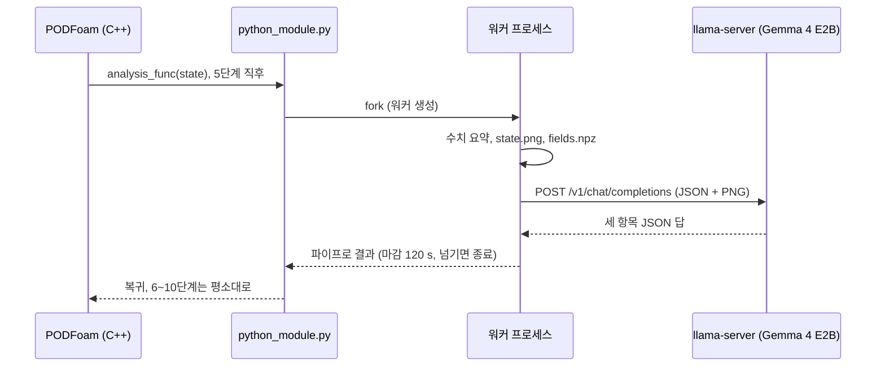

# PythonFOAM + Gemma 4 E2B: 계산 중 상태 읽기 시험

[](https://github.com/seungminyome/PythonFOAM-Korean/actions/workflows/tests.yml)
[](https://github.com/seungminyome/PythonFOAM-Korean/actions/workflows/evidence.yml)


[](LICENSE)

[10월 20일 보고서](docs/results-20261020.md) · [10월 17일 보고서](docs/results.md) · [근거 자료](docs/evidence/README.md) · [실행 방법](Solver_Examples/PODFoam/llm_demo/README.md) · [English](https://github.com/seungminyome/PythonFOAM)

PODFoam 계산 도중 한 단계의 수치와 속도·압력 그림, 또는 계산 중간중간의 그림 여러 장을
로컬 CPU의 Gemma 4 E2B에 보내고, 답을 저장한 뒤 계산을 이어갑니다. 요청은 비동기로 보낼
수 있습니다. 솔버는 계속 걸음을 가고 답은 도착했을 때 기록됩니다. 여기까지는 됩니다.
모델이 한 말은 계산으로 들어가지 않습니다. 답의 내용은 아직 쓸 수 없습니다. 가장 빠른
곳이 어디인지, 스냅샷 사이에 흐름이 어떻게 변하는지 물으면 시험한 거의 모든 경우에 틀립니다.


*10월 17일 실행의 5단계에서 모델에 보낸 그림. 위는 속력 |U|, 아래는 운동학적 압력 p (640x360, 각 셀을 다각형 하나로 그림).*

## 바로 실행해 보기

단위 테스트. OpenFOAM과 모델이 없어도 되고 10초쯤 걸립니다.

```bash
pip install -r Solver_Examples/PODFoam/llm_demo/requirements.txt
make test          # 또는 cd Solver_Examples/PODFoam/llm_demo && python3 -m unittest
make evidence      # 근거 파일 전부를 manifest의 해시와 대조
```

전체 실행. OpenFOAM v2106, 모델 파일용 디스크 약 3.4 GB가 필요하고, 서버는 최대 약 2.2 GiB를 쓰므로 RAM 8 GB 정도면 됩니다.

```bash
cd Solver_Examples/PODFoam
./validation/run_v2106.sh        # 연결 검증. 통과한 실행이 기준 사례가 됩니다
./llm_demo/setup_runtime.sh      # Gemma 4 E2B Q4_0, 이미지 프로젝터, llama.cpp b11429
python3 llm_demo/runtime.py start
./llm_demo/run_demo.sh           # PODFoam 빌드, 다섯 조건 실행, 검증
python3 llm_demo/runtime.py stop
```

자세한 설명과 환경 변수는 [llm_demo/README.md](Solver_Examples/PODFoam/llm_demo/README.md)에 있습니다.

## 구현



- OpenFOAM v2106 PODFoam에 Python 콜백을 추가했습니다. 지정한 시간 단계 직후
  잔차, Courant 수, 연속성 오차, SVD 요약과 그 단계의 |U|·p 그림(PNG)을 로컬
  llama.cpp 서버(Gemma 4 E2B Q4_0, 이미지 프로젝터 포함)에 보내고 응답을
  저장합니다. 이 문서의 "5단계"는 전체 10개 시간 단계 중 다섯 번째
  (t = 5×10⁻⁷ s)를 뜻하며, 기본값입니다. `LLM_ANALYSIS_STEP`으로 바꿀 수 있습니다.
- 요청 모드 셋(`LLM_MODE`): `observe`(수치와 그림, 원래 방식), `describe`(그림 한 장.
  설명과, 가장 빠른 곳·가장 낮은 압력의 위치를 그린 범위의 %로), `sequence`
  (`LLM_SEQUENCE_STEPS` 걸음마다 그림을 저장했다가 마지막에 한 요청으로. 흐름이 어떻게
  변하는지를 정해진 추세 단어로). `LLM_IMAGE_XRANGE`는 영역 전체 대신 일부만 그립니다.
- 기본은 동기입니다. 솔버가 답이나 마감을 기다립니다. `LLM_ASYNC=1`이면 요청 걸음은 워커를
  포크만 하고, 이후 걸음마다 막힘 없이 확인해 답이 온 걸음과 함께 기록하며, 마감을 넘긴
  워커는 종료하고, 동시에 하나의 요청만 둡니다. 마지막 걸음에서는 남은 답을 기다리거나
  분리합니다.
- 서버가 없거나 늦어도 어느 모드에서든 솔버가 마감보다 오래 막히지 않습니다.
- 검증 스크립트가 걸음 완료, 저장된 필드 파일 전부가 요청 없는 실행과 같은지, 로그와
  기록이 맞는지, 프레임의 배열이 저장된 필드와 같은지, 그림 해시가 요청 본문과 같은지
  확인합니다.
- 10월 17일 측정은 코드 `23089bb`, 10월 20일 측정은 모드·비동기 경로·그림 창을 더한
  `9449085`를 썼습니다.

## 측정값 (2026-10-20, 비동기 실행과 재생)

5×10⁻⁷ s 간격으로 3000걸음, 같은 컴퓨터와 서버. 조건마다 한 번.

| 실행 | 요청 걸음 | 답이 기록된 걸음 | 요청 걸음에서 솔버가 기다린 시간 | 모델 대기 | 기준과 같은 파일 |
|---|---:|---:|---:|---:|---:|
| 요청 없음 (기준) | 1250 | 1261 | 0.004 s | - | - |
| 그림 한 장 설명 | 250 | 1093 | 0.006 s | 34.0 s | 216 / 216 |
| 그림 세 장 연속 | 1250 | 2321 | 0.004 s | 43.4 s | 216 / 216 |
| 연결 거부 | 250 | 280 | 0.004 s | 0.002 s | 216 / 216 |
| 서버를 일부러 멈춤 (마감 4 s) | 250 | 353 | 0.004 s | 4.0 s에 종료 | 216 / 216 |

다른 모든 걸음의 콜백은 0.005 s 미만이었습니다. 두 답 모두 솔버가 아직 도는 동안 왔습니다
(요청 뒤 843걸음, 1071걸음). 모델 대기가 10월 17일보다 짧은 것은 시스템 프롬프트가 이미
서버 캐시에 있었기 때문입니다.

저장 프레임 재생, 각 3회, 보기 둘(전체 영역과 계단 주변 창):

| 질문 | 프레임 | 결과 |
|---|---|---|
| 가장 빠른 곳은 어디인가? (그린 범위의 %) | 상태 3 × 보기 2 | 답 18개, 정답 지점의 10 % 안은 없음. 전체 영역에서 14~18 % (0.27~0.39 m), 창에서 50~80 % 벗어남 |
| 흐름이 어떻게 변하는가? (추세 단어) | 프레임 3 × 보기 2 | 최고 속력이 60에서 47(42) m/s로 떨어지는데 두 보기 모두 `increasing`. 단어 셋 중 전체 영역 1개, 창 2개 맞음 |

자세한 내용, 모델이 쓴 글, 주의점은 [10월 20일 보고서](docs/results-20261020.md)에 있습니다.

## 측정값 (2026-10-17, 실행 `pod-llm-demo.LRfJBN`)

8 vCPU, RAM 7.7 GiB, GPU 없음. llama-server 4스레드, llama.cpp b11429,
문맥 길이 2048. 셀 20,540개, 시간
간격 10⁻⁷ s, 10단계. 이 날짜에는 조건마다 한 번씩 실행했습니다. 10월 19일에
되풀이한 실행은 답과 5단계 해시가 같았습니다([자세히](docs/results.md#2026-10-19-반복)).

| 조건 | 결과 | 완료 단계 | 기준과 같은 파일 | 콜백 시간 |
|---|---|---:|---:|---:|
| 모델 요청 없음 | 기준 | 10 | - | 0.493 s |
| 수치 + 그림 | 답변 저장 | 10 | 45 / 45 | 78.256 s |
| 수치만 | 답변 저장 | 10 | 45 / 45 | 39.672 s |
| 연결 거부 | 오류 저장, 계산 계속 | 10 | 45 / 45 | 0.509 s |
| 서버를 일부러 멈춤 (마감 4 s) | 시간 초과 저장, 계산 계속 | 10 | 45 / 45 | 4.013 s |

콜백 시간은 C++에서 Python 분석 함수를 호출 직전부터 돌아온 직후까지입니다.
그림 조건의 78.256 s 중 그림 생성이 0.438 s, 모델 응답 대기가 77.560 s입니다.

저장한 5단계 상태 하나로, 질문·수치·설정을 고정하고 그림 포함 여부만 바꿔 세
쌍(여섯 번)을 다시 물었습니다. 아래에서 이것을 "쌍별 재생"이라고 부릅니다. 최대 속력 값 82.53 m/s는 두 조건 모두 입력에
있었고, 위치는 알려주지 않았습니다. 정답은 셀 12090, (0.0005, 0.0127) m입니다.

| 조건 | 답한 위치 (x, y) m | 평면 오차 | 결과 |
|---|---|---:|---|
| 수치만 | (0.6012, 0.1143) | 60.92 cm | 3회 모두 오답 |
| 수치 + 그림 | (0.5, 0.1143) | 50.97 cm | 3회 모두 오답 |

수치만 받은 답은 입력에 있던 계산 영역의 x, y 최댓값을 그대로 위치로
적었습니다. 그림을 받은 답은 약 10 cm 가까웠지만 역시 틀렸습니다.

## 남은 문제

1. 답의 정확도. 상태 셋과 보기 둘에서 모델은 가장 빠른 곳을 그린 범위의 10 % 안에 둔 적이
   없고, 색 막대가 떨어지는데도 최고 속력이 늘어난다고 했습니다. 이 모델로는 설명을 쓸 수
   없습니다.
2. 비용 측정. 지연이 서버의 프롬프트 캐시에 달려 있어(그림 한 장 새로 26~33 s, 캐시 15 s;
   세 장 11~45 s) 그림 한 장의 비용은 아직 분리되지 않았습니다.
3. 범위. 직렬 유체 사례 하나(시작 직후의 후향 계단), 동시에 요청 하나. MPI, 3D, 12B 모델,
   SVD 요약의 기여는 시험하지 않았습니다.

## 다음 단계

1. GPU 노드에서 Gemma 4 12B QAT로 describe·sequence 재생과 비동기 다섯 조건을 돌려 E2B와
   한 표에서 비교합니다. 서버 스크립트는 [llm_demo/hpc/](Solver_Examples/PODFoam/llm_demo/hpc/README.md),
   재생 명령은 [10월 20일 보고서](docs/results-20261020.md)에 있습니다.
2. 모델이 읽을 수 있는 그림을 시도합니다. 더 크게, 격자선과 눈금 표시, 또는 패널 하나.
   같은 재생 스크립트로 시험합니다.
3. 동시에 둘 이상의 요청과 N걸음마다의 요청을 허용하고, 긴 실행에서 메모리와 파이프
   통신량을 잽니다.
4. 캐시 조건을 맞춘 뒤 그림의 시간 비용을 다시 잽니다.

## 저장소 구성

```
Solver_Examples/PODFoam/      PODFoam 솔버(OpenFOAM v2106)와 콜백 연결 코드
  validation/                 연결 검증: 10단계, SVD 왕복, verify.py
  llm_demo/                   콜백 모듈, llama-server 클라이언트, 다섯 조건 실행기(동기·비동기),
                              재생 비교(쌍별, describe, sequence), 단위 테스트, requirements.txt
docs/results-20261020.md      10월 20일 보고서: 비동기 실행, describe·sequence 재생
docs/evidence/2026-10-20/     10월 20일 실행과 재생의 기록, 해시 목록
docs/results.md               10월 17일 시험 보고서
docs/evidence/2026-10-17/     요청·응답 원문, 로그, 검증 결과, 해시 목록
docs/evidence/2026-10-13/     이전 실행(pod-llm-demo.SwwR2e)과 그 보고서 docs/results-20261013.md
docs/evidence/2026-10-19/     10월 17일 실행의 반복(pod-llm-demo.o5sNLJ), 답과 해시 동일
docs/evidence/check_manifest.py  근거 파일 전부를 manifest와 대조 (CI에서도 실행)
docs/progress.ko.md           10월 8일부터의 작업 기록
docs/upstream-project.md      원본 PythonFOAM README (다른 솔버, Docker, 빌드 안내)
.github/workflows/            tests.yml (단위 테스트, Python 3.10·3.12), evidence.yml (해시, 링크, 영문 저장소와 코드 일치)
CHANGELOG.md, Makefile
```

나머지 폴더(`APMOSFoam`, `AEFoam`, `PINNFoam`, `TurbulenceModel_Examples`, `Handson_Examples`)는 원본 그대로입니다.

## 자료

- [10월 20일 보고서](docs/results-20261020.md): 비동기 실행, 스냅샷 하나·연속 재생, 주의점
- [10월 17일 보고서](docs/results.md): 동기 조건, 그림 유무 쌍별 재생
- [근거 자료](docs/evidence/README.md): 요청·응답 원문, 로그, 검증 결과, 해시 목록
- 전체 실행 결과 내려받기: [10월 20일](https://github.com/seungminyome/PythonFOAM/releases/tag/pod-insitu-async-2026-10-20)(영문 저장소 릴리스), [10월 17일](https://github.com/seungminyome/PythonFOAM-Korean/releases/tag/korean-docs-2026-10-18): 저장 결과 전체와 실행 소스(모델 가중치 제외)
- [작업 기록](docs/progress.ko.md): 10월 8일부터의 진행
- [그림으로 보는 결과](https://seungminyome.github.io/PythonFOAM-Korean/)
- [변경 기록](CHANGELOG.md)

## 출처와 라이선스

[PythonFOAM](https://github.com/argonne-lcf/PythonFOAM)(Argonne National Laboratory)의 PODFoam 예제를 확장했습니다. 원본 소개와 설치 안내는 [프로젝트 참고 문서](docs/upstream-project.md)에 있습니다. 모델 실행에는 [llama.cpp](https://github.com/ggml-org/llama.cpp)를 썼습니다. [라이선스](LICENSE)는 원본과 같습니다.
