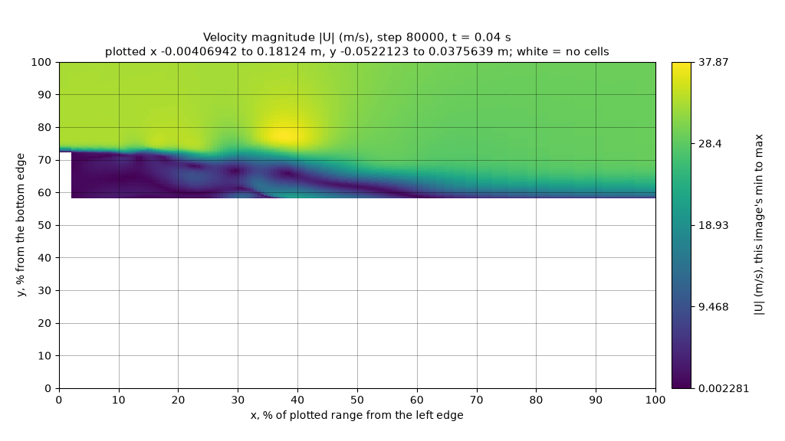
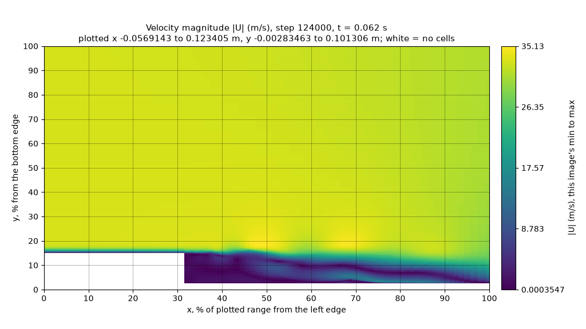

# 10월 22일 이어서: 돌고 있는 솔버가 그린 v2 그림, 무작위 창, 더 많은 모델

MedicineBow Slurm 작업 24757327, 24757344, 24757382\~24757384, 24757459, 24757460, 작업마다 NVIDIA RTX A6000 한 장(49,140 MiB); 흐름 계산 24757337과 24757429는 CPU 노드 · llama.cpp b11429(커밋 `d812350`) · 2026-10-22, 03:14\~11:38 MDT · 코드: [기록](#기록)

[README](../README.md) · [근거 자료: 그림 시험](evidence/2026-10-22-window-test/README.md) · [근거 자료: 솔버 실행](evidence/2026-10-22-live-v2/README.md) · [돌리는 법](../Solver_Examples/PODFoam/llm_demo/README.md#솔버가-그리는-v2-그림-llm_image_stylev2) · 내려받기: [그림 시험](https://github.com/seungminyome/PythonFOAM/releases/tag/picture-test-2026-10-22), [솔버 실행](https://github.com/seungminyome/PythonFOAM/releases/tag/pod-insitu-v2-2026-10-22) · [영문](https://github.com/seungminyome/PythonFOAM/blob/main/docs/results-20261022-live.md)

[10월 22일 첫 보고서](results-20261022.md)에는 빈 곳이 두 군데 있었습니다. 솔버는 여전히 v1 그림을
그렸고, 저장한 흐름 상태에서는 답 하나로 고정해도 어떤 모델만큼 맞았습니다. 가장 빠른 곳과 압력이 가장
낮은 곳이 늘 계단 모서리에 있었기 때문입니다. 그 뒤에 한 일은 다음과 같습니다.

- 콜백이 v2 그림을 그려 `describe`와 `sequence` 요청으로 보냅니다(`LLM_IMAGE_STYLE=v2`). 요청은 그림
  시험과 같은 코드로 만듭니다.
- GPU 노드에서 OpenFOAM v2212를 Apptainer 이미지로 돌리고, PODFoam을 고치지 않고 그 안에서
  빌드했습니다.
- Gemma 4 12B가 돌고 있는 솔버 안에서 답했습니다. 발달한 흐름에서 시작한 비동기 경우 다섯 개에 더해,
  걸음마다 창을 따로 정한 describe 요청 열한 개를 더 보냈습니다.
- 그린 범위(창)를 가장 빠른 칸 둘레에 무작위로 놓아 그림마다 정답 자리가 달라지게 하고 그림 시험을
  다시 했습니다. 모델 열한 개, 창 시드 세 개, 더 큰 이미지 토큰 한도, 발달한 흐름으로 했습니다.
- Qwen 모델 네 개가 첫 그림 시험의 요청 308개에 답했습니다.

## 솔버가 v2 그림을 그린다

`LLM_IMAGE_STYLE=v2`이면 콜백은 그림을 남기는 걸음마다 폴더 하나를 씁니다. 안에는 배열
(`fields.npz`), 필드마다 1024×576 그림 한 장(|U|, 그다음 p), 그리고 마지막에 쓰는 메타데이터 파일이
있습니다. 요청은 그 폴더로부터 `readable_request.py`가 만들고, 그림 시험도 이제 같은 파일을 씁니다.
그래서 솔버는 저장된 그림으로 채점했던 것과 똑같은 종류의 요청을 보냅니다. 프롬프트가 같고,
`max_tokens` 320, 같은 시드, 프롬프트 캐시 없음도 같습니다. sequence는 그림마다 제 색 범위를 쓰고 색
막대에 숫자를 적습니다(뚜렷한 증감을 가장 잘 읽은 v2own 방식). 기본값은 여전히 v1이고, 이때 동작은
예전과 바이트까지 같습니다. v2 describe 요청은 SVD 요약을 보내지 않으므로, 이때 콜백은 스냅샷 창을
쌓지 않습니다.

v2 솔버 실행마다 도는 확인(`verify_async.py`): 요청 본문이 디스크의 프레임 폴더에 빌더를 적용한 결과와
바이트까지 같은지, 프레임의 배열이 솔버가 그 걸음에 쓴 필드와 같은지, 그림 해시가 요청 안의 것과
같은지 보고, 답을 배열에 대해 채점합니다. 단위 시험 하나는 발표된 그림 시험 요청 두 개를 그 그림으로부터
다시 만들어 같은 바이트를 얻고, 다섯 개는 해시로 고정합니다.
테스트는 이제 모두 92개입니다. MedicineBow 계산 노드에서 Python 3.10, 3.11, 3.12로 돌리면 새 테스트는
통과하고, [hpc/README.md](../Solver_Examples/PODFoam/llm_demo/hpc/README.md#돌고-있는-솔버가-그린-v2-그림-async_v2slurm-2026-10-22-실행)에
적은 타이밍 테스트 세 개는 이번 변경 전처럼 그곳에서 가끔 실패합니다. 공개한 코드로 첫 그림 시험의 v2 본문
152개와 v1 본문 120개를 그 그림으로부터 다시 만들고, 첫 보고서를 그 답으로 다시 만들고, 창 프레임 여섯 개를
그 상태로부터 다시 그리면 원본과 바이트까지 같습니다.

## 발달한 흐름

10월 20일 실행과 그림 시험의 저장 상태는 흐름이 멈춘 상태에서 출발한 뒤 처음 3 ms만 담고 있습니다.
거기서는 가장 빠른 칸이 계단 모서리(x 1.6\~12 mm, y 12.6\~13.6 mm)에 있어서, 답 하나로 고정해도 거의
늘 맞습니다. 움직이는 흐름을 얻으려고 같은 경우(2차원, 층류, 입구 32.2 m/s, ν = 1.56×10⁻⁵ m²/s)를
v2212 이미지에서 `pimpleFoam`으로 t = 0.1 s까지 돌렸습니다. 입구 속도로 2.15 m 채널을 한 번 반쯤
지나는 시간입니다. 시간 간격을 스스로 맞추며 21,108걸음을 갔습니다(Slurm 작업 24757429, CPU 노드에서
18분). 시간 간격은 Courant 수를 0.5 근처로 유지했고(처음 한 걸음은 1.25, 그 밖에는 최대 0.507),
t = 0.011 s에서 상한 5×10⁻⁶ s에 닿았습니다. t = 0.03 s 뒤로 Courant 수는 최대 0.34였습니다. 필드는
1 ms마다 썼습니다.

t = 0.032 s부터의 상태에서는 계단 뒤에서 소용돌이가 말려 생겨 하류로 흘러갑니다. 아래에서 쓴 0.032\~0.1 s
상태 35개에서 가장 빠른 칸은 x 22\~75 mm, y 16\~21 mm에 있습니다. t = 0.1 s부터의 솔버 실행에서, 가장
큰 속도를 따라가는 최대 Courant 수는 0.23과 0.35 사이를 약 2.7 ms 주기로 오르내렸습니다(매 걸음
0.03 s 기록의 스펙트럼 봉우리 약 370 Hz).

 

*아래 실행의 250걸음(t = 0.10125 s)에 솔버가 보낸 그림 두 장: |U|(왼쪽)와 p(오른쪽), 창 x 0\~0.12 m, y 0\~0.04 m.*

## 무작위 창

`window_test.py`는 저장 상태를 그리면서 창을 가장 빠른 칸 둘레에 무작위로 놓습니다. 그 칸은 모든 가장자리에서
15 % 이상 떨어지고, 창 안에 칸이 200개 이상 있고, 높이는 0.03\~0.114 m, 너비는 높이의 1.5\~4배입니다.
정답과 채점은 그림 시험과 같습니다(그린 범위의 10 % 안). 그림마다 창이 다르므로, 답 하나로 고정한
점수는 이제 묶음 전체에 정수 (x, y) 하나만 쓰는 가장 좋은 답으로 셉니다.

첫 묶음은 시작 직후 상태를 씁니다. v2212 이미지의 `pimpleFoam`으로 5×10⁻⁷ s 간격 6000걸음을 돌린
실행(작업 24757337)에서 500걸음마다 상태 12개를 골라, 상태마다 창 네 개를 v1과 v2로 그렸습니다(방식마다
그림 48장).

| 모델 | 가장 빠른 곳, v1 / v2 | 가장 낮은 p, v1 / v2 | v2 거리 중앙값, 가장 빠른 곳 / 가장 낮은 p | v2 요청 한 개의 시간 중앙값 |
|---|---:|---:|---:|---:|
| E2B Q4_0, Q8_0 프로젝터 | 6 / 5 | 7 / 14 | 27.8 / 16.0 % | 1.03 s |
| E2B Q4_0, BF16 프로젝터 | 5 / 5 | 5 / 13 | 27.3 / 17.8 % | 1.06 s |
| E2B QAT | 5 / 3 | 5 / 8 | 25.5 / 19.6 % | 1.00 s |
| E4B QAT | 8 / 16 | 5 / 13 | 16.0 / 13.6 % | 1.43 s |
| 12B QAT | 10 / **46** | 17 / **47** | 3.5 / 1.8 % | 3.19 s |
| 26B-A4B QAT | 3 / **47** | 6 / **47** | 2.6 / 1.7 % | 2.43 s |
| 31B QAT | 13 / **45** | 15 / **48** | 3.1 / 2.0 % | 7.51 s |
| Qwen3-VL-8B Q8_0 | 3 / 21 | 4 / 36 | 11.4 / 6.4 % | 2.44 s |
| Qwen3-VL-32B Q8_0 | 0 / 38 | 2 / 39 | 4.6 / 5.1 % | 10.99 s |
| Qwen3.5-27B Q8_0 | 2 / 43 | 3 / 46 | 4.8 / 2.6 % | 8.47 s |
| Qwen3.5-35B-A3B Q8_0 | 5 / **47** | 3 / 46 | 3.1 / 2.5 % | 2.30 s |
| 답 하나로 고정 | 7 | 7 | | |

48개 중 맞힌 수입니다(작업 24757344).

창이 무작위이면 고정 답은 48개 중 7개를 맞힙니다. 그래도 12B, 26B-A4B, 31B, Qwen3.5-35B-A3B는 v2
그림 48장 중 45\~48장에서 두 극값을 모두 10 % 안에 짚었습니다. 같은 네 모델이 v1에서는 48개 중
3\~17개였습니다. E2B는 세 가지 모두 두 방식에서 가장 빠른 곳을 고정 답 이하(48개 중 3\~6개)로 맞혔고,
E4B는 v2에서 16개와 13개였습니다.

가장 잘한 여섯 모델은 같은 상태에 다른 창 시드 두 개로, 그리고 첫 묶음에 이미지 토큰 한도를 256에서
1024로 올려(컨텍스트 8192) 다시 돌렸습니다.

| 모델 | 시드 1 | 시드 1, 이미지 토큰 한도 1024 | 시드 2 | 시드 3 | 시드 1\~3 합계 |
|---|---:|---:|---:|---:|---:|
| 12B QAT | 46 / 47 | 46 / 47 | 48 / 48 | 47 / 48 | 141 / 143 |
| 26B-A4B QAT | 47 / 47 | 46 / 47 | 48 / 48 | 48 / 48 | 143 / 143 |
| 31B QAT | 45 / 48 | 46 / 48 | 46 / 48 | 45 / 48 | 136 / 144 |
| Qwen3-VL-32B Q8_0 | 38 / 39 | 36 / 46 | 34 / 41 | 36 / 41 | 108 / 121 |
| Qwen3.5-27B Q8_0 | 43 / 46 | 47 / 48 | 44 / 48 | 44 / 48 | 131 / 142 |
| Qwen3.5-35B-A3B Q8_0 | 47 / 46 | 48 / 48 | 48 / 48 | 48 / 48 | 143 / 142 |
| 답 하나로 고정 | 7 / 7 | 7 / 7 | 9 / 9 | 9 / 10 | 25 / 26 |

v2만; 가장 빠른 곳 / 가장 낮은 압력을 10 % 안에 짚은 수, 시드마다 48개 중, 합계는 144개 중(작업 24757344,
24757382, 24757384, 24757383). v1에서는 이 모델들이 시드마다 48개 중 0\~17개였습니다.

한도를 올려도 Gemma 요청은 그대로였습니다(어느 쪽이든 프롬프트 1,051토큰). Qwen 요청은 약 1,020에서
약 1,670토큰으로 늘었습니다. llama.cpp 로그는 Qwen-VL 모델이 위치를 짚는 일(grounding)에 이미지 토큰이
최소 1,024개 필요하다고 경고하고 `--image-min-tokens 1024`를 권합니다. 이 설정은 써 보지 않았으므로,
여기의 Qwen 숫자는 이 서버 설정에서의 하한이지 최선이 아닙니다.

## 발달한 흐름, 무작위 창

같은 시험을 발달한 실행의 상태 35개(t = 0.032\~0.1 s, 2 ms마다)에 상태마다 무작위 창 네 개로 했습니다(작업 24757459,
방식마다 그림 140장). 답 하나로 고정하면 140개 중 16개(가장 빠른 곳)와 17개(가장 낮은 압력)입니다.

| 모델 | 가장 빠른 곳, v1 / v2 | 가장 낮은 p, v1 / v2 | v2 거리 중앙값, 가장 빠른 곳 / 가장 낮은 p | v2 요청 한 개의 시간 중앙값 |
|---|---:|---:|---:|---:|
| E4B QAT | 16 / 39 | 21 / 34 | 13.8 / 21.1 % | 1.4 s |
| 12B QAT | 12 / **108** | 30 / **130** | 3.4 / 2.4 % | 3.1 s |
| 26B-A4B QAT | 19 / **113** | 22 / **139** | 3.6 / 2.2 % | 2.4 s |
| 31B QAT | 17 / **106** | 25 / **133** | 3.6 / 1.8 % | 7.3 s |
| Qwen3.5-27B Q8_0 | 10 / **109** | 19 / **136** | 3.4 / 2.9 % | 8.5 s |
| Qwen3.5-35B-A3B Q8_0 | 8 / **121** | 11 / **134** | 4.4 / 2.9 % | 2.1 s |
| 답 하나로 고정 | 16 | 17 | | |

140개 중 맞힌 수입니다.

소용돌이 중심인 가장 낮은 압력은 시작 직후 상태에서만큼 찾았습니다. 큰 모델 다섯 개가 140개 중 130\~139개였습니다.
가장 빠른 곳은 더 어려웠습니다. 140개 중 106\~121개(76\~86 %)로, 시작 직후 상태의 창 시드 세 개에서 91\~99 %였던
것보다 낮습니다. 틀린 답은 대부분 거의 같은 속도의 다른 점을 짚었습니다. 12B, 26B-A4B, 31B, Qwen3.5-27B는
틀린 27\~34개 중 19\~30개가, 창 안 최고 속도의 90 % 이상인 칸을 가리켰습니다. 같은 모델이 v1에서는 가장 빠른
곳을 140개 중 8\~19개 맞혀, 고정 답 수준이었습니다.

 

*발달한 흐름의 v2 |U|. 왼쪽 t = 0.04 s: 12B가 0.4 % 안. 오른쪽 t = 0.062 s: 가장 밝은 점(y 19 %, 35.1 m/s)이 그 위 자유 흐름보다 조금만 빠르고, 12B는 속력 32.5 m/s인 y 80 %를 답함(61 % 떨어짐).*

## 첫 그림 시험의 요청 308개에 대한 Qwen 모델

10월 22일 첫 시험과 같은 요청 308개와 정답을 Qwen 모델 네 개에 보냈습니다(작업 24757327). 모두 Q8_0이고
(Gemma 모델은 4비트였음), 이미지 토큰 한도는 256입니다.

| 모델 | 합성, 가장 빠른 곳 / 가장 낮은 p, v2 | 심은 그림, 가장 빠른 곳 / 가장 낮은 p, v2 | 저장 흐름, 가장 빠른 곳 / 가장 낮은 p, v2 | 뚜렷한 합성 증감, 속도 / p, v2own | 가중치 | 준비됐을 때 GPU 메모리 | 요청 한 개 중앙값 |
|---|---:|---:|---:|---:|---:|---:|---:|
| Qwen3-VL-8B | 18 / 19 | 28 / 18 | 19 / 23 | 12 / 12 | 8.7 GB | 9,946 MiB | 2.31 s |
| Qwen3-VL-32B | 32 / 29 | 32 / 25 | 18 / 17 | 12 / 12 | 34.8 GB | 35,340 MiB | 10.83 s |
| Qwen3.5-27B | 32 / 30 | 32 / 21 | 24 / 24 | 12 / 12 | 28.6 GB | 27,768 MiB | 8.29 s |
| Qwen3.5-35B-A3B | 32 / 32 | 32 / 30 | 24 / 24 | 12 / 12 | 36.9 GB | 35,860 MiB | 2.07 s |
| 12B QAT(첫 시험) | 32 / 32 | 32 / 25 | 22 / 22 | 12 / 12 | 7.0 GB | 7,966 MiB | 2.86 s |
| 답 하나로 고정 | 5 / 5 | 6 / 6 | 24 / 24 | 6 / 6 | | | |

합성과 심은 그림은 32개 중, 저장 흐름은 24개 중, 뚜렷한 증감은 12개 중입니다.

전문가 혼합(MoE) 모델인 Qwen3.5-35B-A3B(토큰마다 약 3 B 매개변수가 일함)만 여기 점수 열 모두에서 12B와
같거나 나았고, 네 모델 중 가장 빨랐습니다. 심은 그림에서 심은 압력 골을 32장 중 30장에서 찾았는데,
12B, 26B-A4B, 31B는 7\~12장에서 계단 모서리를 짚었습니다. 색 범위 하나를 함께 쓰면(v2) 네 모델은
뚜렷한 속도 변화 12개 중 7\~12개, 압력 변화는 5\~9개를 맞혔고, 색 막대에 숫자가 있으면(v2own) 네 모델
모두 두 필드에서 12개를 다 읽었습니다. 저장 흐름의 압력 증감(sequence 14개, v2own)은 10, 6, 12,
14개(8B, 32B, 27B, 35B-A3B)를 맞혔고, 12B는 3개였습니다. v1 그림에서는 합성과 심은 그림에서 가장 빠른
곳을 32개 중 2\~12개 맞혔습니다. 묶음별 수는 작업의
[보고서](evidence/2026-10-22-window-test/reports/picture-test-24757327.md)에 있습니다.

## 돌고 있는 솔버에서 보낸 요청

10월 20일의 비동기 시험을, 이번에는 v2 그림과 노드 GPU의 Gemma 4 12B로 돌렸습니다(작업 24757460).
PODFoam은 v2212 이미지 안에서 conda Python 3.11에 맞춰 빌드했고, 먼저 그 안에서 연결 검증이
통과했습니다. 모든 경우는 t = 0.1 s의 발달한 상태에서 시작했고(격자와 시작 파일은 해시로 확인),
5×10⁻⁶ s 간격 6000걸음을 t = 0.13 s까지 돌며 250걸음마다 필드를 썼습니다. Courant 수는 0.347 이하였습니다.
그린 범위는 x 0\~0.12 m, y 0\~0.04 m입니다(위 그림).

| 실행 | 요청 걸음 | 답을 기록한 걸음 | 요청 걸음에서 솔버가 기다린 시간 | 모델 대기 | 기준과 같은 파일 |
|---|---:|---:|---:|---:|---:|
| 모델 끔(기준: 요청은 만들고 보내지 않음) | 3750 | 3763 | 0.003 s | - | - |
| 스냅샷 하나 설명(describe) | 250 | 320 | 0.004 s | 3.17 s | 432 / 432 |
| 스냅샷 세 개 비교(sequence, 3000·3250·3750걸음) | 3750 | 3823 | 0.004 s | 3.15 s | 432 / 432 |
| 연결 거부 | 250 | 261 | 0.004 s | 0.011 s | 432 / 432 |
| 서버를 멈추게 함(마감 4 s) | 250 | 324 | 0.004 s | 4 s 마감에서 끊음 | 432 / 432 |

경우마다 벽시계 323\~324 s(걸음당 0.054 s)가 걸렸습니다. 콜백은 요청도 답도 없는 걸음에서 최대 0.007 s,
답이나 오류를 기록한 걸음에서 0.023\~0.044 s, 텔레메트리를 쓰는 마지막 걸음에서 약 0.19 s였습니다.
describe 요청은 프롬프트 998토큰, sequence 요청은 2,168토큰이었고, 둘 다 프롬프트 캐시를 쓰지 않았습니다.
모든 경우의 모든 저장 필드가 기준과 같습니다. 요청은 계산을 하나도 바꾸지 않았습니다.

모델이 한 말:

- describe, 250걸음: 가장 빠른 곳을 창의 (40, 45) %로 답했고 정답은 (37.1, 46.5), 3.3 % 떨어짐. 가장
  낮은 압력은 (35, 30) %로 답했고 정답은 (38.0, 25.9), 5.0 % 떨어짐. 둘 다 10 % 안.
- sequence, 3000·3250·3750걸음: 최고 속도 감소(맞음: 38.6에서 34.8 m/s), 가장 빠른 곳이 움직임(맞음:
  창의 24 %), 가장 낮은 압력은 더 음수(틀림: -365에서 -224 m²/s²로 올라감).

그 전에 돌린 짧은 시험 실행(작업 24757458: 같은 상태에서 600걸음, 100걸음에 요청, 200·300·500걸음에
sequence)도 같은 확인을 통과했습니다. 거기서는 describe 답이 33 %와 29 % 떨어졌고, 증감 단어 세 개는
모두 맞았습니다.

두 요청 본문 모두 디스크의 프레임에 시험한 빌더를 적용한 결과와 바이트까지 같습니다. describe 본문은
describe, 연결 거부, 멈춤 경우에서 같은 바이트입니다(같은 프레임, 같은 요청).

### 창을 따로 정한 요청 열한 개 더

다섯 경우가 끝난 뒤 `run_live_sweep.py`가 같은 시작 상태에서 경우 열한 개를 더 돌렸습니다. 경우마다
R = 500, 1000, …, 5500걸음에 describe 요청 하나를 보내고 300걸음 뒤에 멈춥니다. 창은 R에서의 기준
상태의 가장 빠른 칸 둘레에 창 시험 규칙으로 무작위로 놓았습니다. 너비 0.09\~0.32 m, 높이 0.037\~0.106 m,
칸 6,154\~10,793개입니다. 한 번에 두 경우씩 돌렸습니다.

| 요청 걸음 | 답을 기록한 걸음 | 가장 빠른 곳, 거리 | 가장 낮은 압력, 거리 |
|---:|---:|---:|---:|
| 500 | 571 | 2.7 % | 0.8 % |
| 1000 | 1078 | 0.8 % | 1.8 % |
| 1500 | 1569 | **40.8 %** | 4.5 % |
| 2000 | 2092 | 1.6 % | 3.2 % |
| 2500 | 2593 | 3.5 % | 3.7 % |
| 3000 | 3078 | 3.2 % | 2.4 % |
| 3500 | 3589 | 4.0 % | 0.8 % |
| 4000 | 4092 | 4.9 % | 2.2 % |
| 4500 | 4575 | 3.6 % | 1.1 % |
| 5000 | 5076 | 0.5 % | 1.9 % |
| 5500 | 5584 | **13.2 %** | **24.1 %** |

정답 칸에서의 거리를 그린 범위의 퍼센트로 적었습니다. 굵은 글씨는 10 % 넘게 틀린 것입니다.

- 답 열한 개 모두 솔버가 도는 동안, 요청 뒤 69\~93걸음 사이에 왔습니다(모델 시간 2.85\~3.39 s). 요청
  걸음에서 솔버의 콜백은 최대 0.005 s였습니다.
- 모든 요청 본문이 디스크의 프레임에 빌더를 적용한 결과와 바이트까지 같고, 모든 프레임의 배열이 그
  걸음에서 기준이 쓴 필드와 같습니다.
- 가장 빠른 곳은 11개 중 9개, 가장 낮은 압력은 11개 중 10개가 10 % 안이었고, 거리 중앙값은 3.5 %와
  2.2 %였습니다. 열한 개 모두에 답 하나로 고정하면 4개와 4개입니다.
- 1500걸음에서는 가장 빠른 곳을, 전단층 바로 위의 점(y 49 %, 35.5 m/s) 대신 창 위쪽 자유 흐름(y 90 %,
  32.5 m/s)으로 답했습니다. 5500걸음 그림에는 비슷한 세기의 밝은 점 두 개와 압력 최저점 두 개가
  있는데, 가장 빠른 곳은 두 점 사이(26.5 대 37.8 m/s)를, 가장 낮은 압력은 다른 최저점(-337 대
  -359 m²/s²)을 짚었습니다.

열한 경우가 쓴 모든 시각 폴더에서 U, p, phi와 시간 파일은 기준과 바이트까지 같습니다(파일 858개).
PODFoam이 자체 SVD로 쓰는 POD 모드 파일(upod, vpod, wpod; 파일 2,145개)은 기준과 최대 9.4×10⁻¹²(그
파일의 최댓값 대비)만큼 다르고, 경우를 하나씩 돌린 다섯 경우에서는 같았습니다. 원인은 따로 밝히지
않았습니다. sweep 경우들은 스레드 제한 없이 두 개씩 동시에 돌았고, 공개한 sweep 스크립트는 경우마다 BLAS
스레드를 하나만 씁니다.

## 시간과 메모리

| | |
|---|---|
| 콜백을 켠 솔버 한 걸음 | 0.054 s(경우마다 6000걸음에 323\~324 s) |
| 콜백, 모든 걸음의 중앙값 | 0.00005 s |
| 12B 답, 다섯 경우와 sweep | 2.85\~3.39 s(describe 프롬프트 998토큰, sequence 2,168) |
| GPU 메모리, 작업 전체(1초마다 측정) | 49,140 MiB 중 7,966\~7,996 MiB |
| Python 콜백과 워커를 포함한 솔버, 최대 상주 메모리 | 560\~582 MiB |
| llama-server, 호스트 최대 상주 메모리 | 1.3 GiB(기준 경우)\~2.8 GiB |
| 작업 24757460: 빌드, 다섯 경우, sweep 열한 경우 | 68분 |
| 발달한 흐름, `pimpleFoam` 21,108걸음(작업 24757429) | 18분 |
| 창 시험, 작업마다 모델 6\~11개(작업 24757344, 24757382\~24757384) | 56\~70분 |
| 요청 308개에 Qwen(작업 24757327) | 2시간 4분 |
| 발달한 흐름 창 시험, 모델 여섯 개(작업 24757459) | 1시간 53분 |

12B는 A6000의 49,140 MiB 중 약 8,000 MiB를 썼고, 10월 19일에는 24 GB인 A30에서도 돌았습니다. 서버가
준비됐을 때 26B-A4B는 15,892 MiB, 31B는 20,128 MiB, Q8_0 Qwen 모델은 9,946\~35,860 MiB를 썼습니다. 이
모델들은 A6000에서만 돌렸습니다.

## 이 결과가 보여 주는 것과 보여 주지 않는 것

보여 주는 것:

- 솔버가 v2 그림을 그리고, 계산을 바꾸지 않으면서 실행 중에 GPU의 12B 모델에 물을 수 있습니다. 요청을 보낸
  실행 열다섯 개(다섯 경우 중 넷, sweep 열한 경우)에서 저장한 흐름 필드는 기준 실행과 바이트까지 같고,
  요청 걸음의 콜백은 최대 0.005 s였으며, 모든 답이 93걸음(약 3 s) 안에 왔습니다.
- 솔버가 보내는 것은 시험한 그대로입니다. 실시간 요청 본문은 모두 디스크의 프레임에 그림 시험 빌더를
  적용한 결과와 바이트까지 같습니다.
- 고정 답이 48개 중 7\~10개를 맞히는 무작위 창에서, 12B, 26B-A4B, 31B, Qwen3.5-35B-A3B는 창 시드 세 개
  모두에서 그림 48장 중 45\~48장의 두 극값을 10 % 안에 짚었습니다. 실시간 sweep에서 12B는 11개 중
  9개와 10개를 10 % 안에 짚었고, 고정 답은 4개입니다.
- 소용돌이가 있는 발달한 흐름의 무작위 창에서 12B, 26B-A4B, 31B, Qwen3.5-35B-A3B는 그림 140장 중 130\~139장에서
  가장 낮은 압력을, 106\~121장에서 가장 빠른 곳을 10 % 안에 짚었고, 고정 답은 16개와 17개입니다. 가장 빠른 곳을
  틀린 답은 대부분 최고 속도의 90 % 이상인 다른 점을 짚었습니다.

보여 주지 않는 것:

- 흐름이 어떻게 바뀌는지 읽는 능력. 돌고 있는 솔버에서 증감 질문은 두 번 했고(이번과 시험 실행), 압력
  증감을 한 번 틀렸습니다. 재생에 쓴 시작 직후 상태에서는 증감 단어가 거의 바뀌지 않습니다.
- 실시간 숫자의 재현성. 다섯 경우는 한 번씩 돌았고, 시험 실행의 describe 답은 33 % 틀렸으며, sweep은
  요청 열한 개입니다.
- 다른 경우. 계단 뒤의 2차원 층류 하나, 칸 20,540개 격자 하나, 직렬 프로세스 하나, 컨테이너 안의
  OpenFOAM v2212(10월 13\~20일 실행은 v2106; 연결 검증은 둘 다 통과).
- 답의 글. 위치 두 개와 증감 단어 세 개만 채점했고, 설명 글은 확인하지 않았습니다.
- 공정한 Qwen 비교. Qwen 모델은 Q8_0이고 Gemma는 4비트였으며, Qwen은 llama.cpp가 권하는 이미지 토큰
  최솟값보다 적게 받았습니다.
- 답의 쓰임. 모델에서 나온 것은 아무것도 솔버로 돌아가지 않습니다.

## 다음

1. 증감 질문을 2 % 기준을 프롬프트에 넣어서, 증감 단어가 바뀌는 발달한 흐름의 sequence로 묻기.
2. 한 실행에서 N걸음마다 요청하고 동시에 두 개 이상 보내기, 더 긴 실행; 메모리와 파이프 통신량 재기.
3. Qwen에 `--image-min-tokens 1024`를 주고 4비트 Qwen 파일도 써서, 같은 조건에서 모델 계열 비교하기.
4. 콜백 연결부, v2 그림, 요청 빌더, 비동기 경로와 그 시험을 PythonFOAM 저장소에 기여할 수 있게 정리하기.

## 기록

- 코드. 창 시험과 Qwen 작업(24757327, 24757344, 24757382\~24757384)은 그림 시험 묶음으로 돌았습니다.
  `58e00d9`의 `llm_demo`에 `window_test.py`, `window_test.slurm`, `models.tsv`의 Qwen 줄을 더하고, 작업
  24757382부터는 `start_server.sh`가 `LLM_IMAGE_TOKENS`를 읽게 한 것입니다. 작업마다 `sha256.txt`에 돌린
  스크립트의 해시가 있습니다. 작업 24757459와 24757460은 `354caf9`에 커밋하지 않은 변경을 얹은 체크아웃에서 돌았습니다.
  그 패치, 상태, 새 파일은 [근거 자료](evidence/2026-10-22-live-v2/README.md)에 있고, 솔버 실행이 기록한
  원본 62개가 모두 그것과 같습니다. 공개한 코드(영문 저장소 커밋 `dee7731`, 이 저장소의 `f26bac5`)에는
  점검에서 나온 수정이 더해졌고, 그중 요청 본문을 바꾸는 것은 없습니다. `python_module.py`는 예전 실행이 남긴 프레임 폴더를 거부하고, `max_tokens`
  규칙을 확인하고, 거부된 sequence 설정을 한 번만 알리고, 긴 실행에서 텔레메트리를 쓸 시간을 더 줍니다.
  `run_live_sweep.py`는 경우마다 BLAS 스레드를 하나만 쓰고 실패한 확인을 멈추지 않고 모두 기록합니다.
  `verify_async.py`, `pack_run.py`, `run_demo.sh`와 작업 스크립트는 더 많이 기록하고 확인합니다.
- [그림 시험 근거 자료](evidence/2026-10-22-window-test/README.md): 작업마다 보고서, 점수가 붙은 모든 답
  (`metrics.jsonl`), 창 묶음 네 개의 정답, 서버 로그, 예시 그림, 발달한 흐름 실행의 설정, 그리고 시험 코드
  없이 보고서 여섯 개의 모든 수를 다시 세는 검산.
- [솔버 실행 근거 자료](evidence/2026-10-22-live-v2/README.md): 설정, 검증, 시간, 경우마다 요청·답·결과,
  요청 본문, 프레임(그림과 배열), 압축한 로그와 텔레메트리; sweep의 계획, 요약, 프레임, 답; sweep의 모든
  필드를 기준과 비교한 결과; 작업 스크립트, 출력, 서버 기록, 코드 상태; 그리고 모든 요청 본문을 프레임에서
  다시 만들고 모든 점수를 배열에서 다시 계산하는 검산 스크립트.
- 내려받기. [picture-test-2026-10-22](https://github.com/seungminyome/PythonFOAM/releases/tag/picture-test-2026-10-22):
  창 시험과 Qwen 작업의 모든 압축 파일과 시험 묶음.
  [pod-insitu-v2-2026-10-22](https://github.com/seungminyome/PythonFOAM/releases/tag/pod-insitu-v2-2026-10-22):
  다섯 경우의 전체 출력(모든 시각 폴더), sweep 열한 경우, 시험 실행, 저장한 상태 101개가 있는 발달한 흐름,
  작업 기록.
