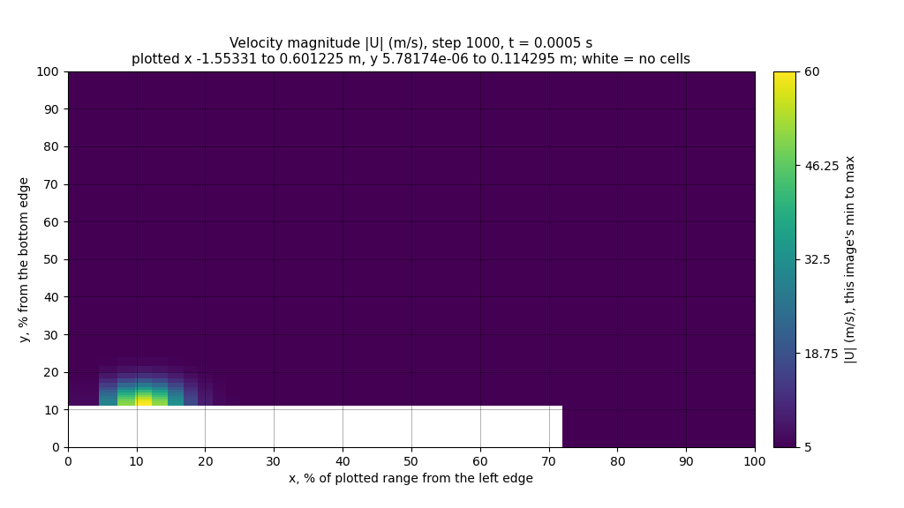
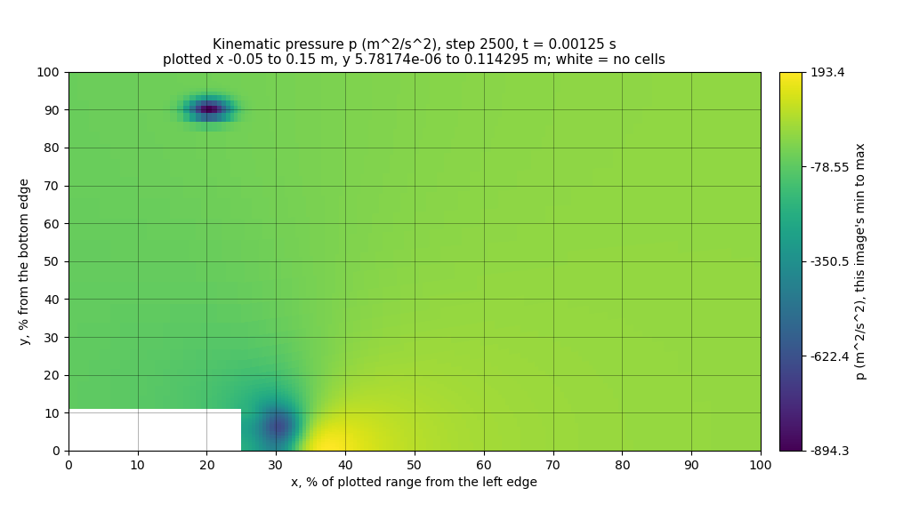
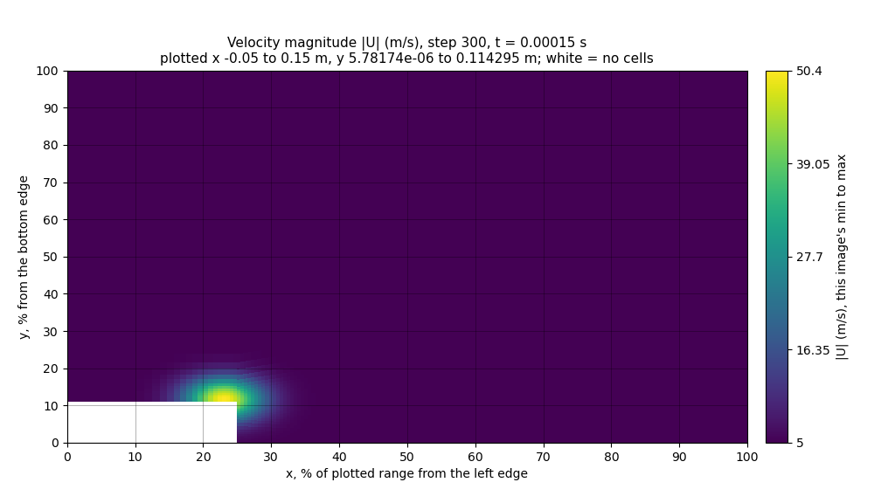

# 10월 22일 그림 읽기 시험: Gemma 4 모델 일곱 개, 그림 두 가지

코드 `58e00d9`(영문 저장소, 이 저장소에서 같은 코드는 `7435513`) · MedicineBow Slurm 작업 24756981, NVIDIA RTX A6000 한 장(49,140 MiB) · llama.cpp b11429(커밋 `d812350`)를 CUDA로 소스 빌드 · 2026-10-22, 모델 실행 01:20\~02:43 MDT

[README](../README.md) · [근거 자료](evidence/2026-10-22-picture-test/README.md) · [요청을 만드는 법](../Solver_Examples/PODFoam/llm_demo/hpc/README.md#그림-읽기-시험-2026-10-22-실행) · [내려받기](https://github.com/seungminyome/PythonFOAM/releases/tag/picture-test-2026-10-22) · [영문](https://github.com/seungminyome/PythonFOAM/blob/main/docs/results-20261022.md)

솔버는 돌리지 않았습니다. 미리 만든 같은 요청 308개를 Gemma 4 모델 일곱 개에 차례로 보냈습니다.
모델은 E2B 세 가지, E4B, 12B, 26B-A4B, 31B입니다. 모두 4비트이고 `--n-gpu-layers 99`로 띄웠으며,
temperature는 0입니다. 새 묶음은 프롬프트 캐시를 끄고 보냈습니다. 요청 여섯 개(10월 17일의 수치만
보내는 요청)를 빼면 모두 그림에 대해 묻습니다. 그림은 합성 필드, 저장한 PODFoam 상태, 또는 저장한
상태에 봉우리와 골을 심은 것입니다. 그림은 지금 솔버가 그리는 방식(v1)이거나, 읽기 쉽게 새로 그린
방식(v2)입니다. 답은 모델에게 보여 주지 않은 정답과 비교해 채점했습니다. 답 2,156개가 모두 정해진
JSON 형식으로 왔습니다.

## 그림 두 가지

v1(`pod_image.py`, 솔버가 보내는 그림)은 |U|와 p를 640x360 그림 한 장에 위아래 패널로 그립니다.
축은 미터이고, 패널마다 색 막대가 있어 딱 떨어지는 값에만 눈금이 있으며, 색 범위는 그 패널의
최솟값부터 최댓값까지입니다. v2(`readable_image.py`)는 그림 한 장에 필드 하나만 1024x576 크기로
그립니다. 두 축은 그린 범위의 퍼센트로 적고 10 %마다 격자선을 그으며, 색 막대에는 최솟값부터
최댓값까지 값 다섯 개를 적습니다.

 

*같은 합성 사례를 v1(왼쪽, 두 필드)과 v2(오른쪽, |U| 그림. p는 따로 한 장 더 있음)로 그린 것.*

프롬프트도 그림에 따라 다릅니다. 두 방식 모두 위치를 그린 범위의 퍼센트로 묻지만, v1 프롬프트는
축이 미터이고 세로축이 늘어나 있다고 알려 주고, v2 프롬프트는 퍼센트 축과 격자를 알려 줍니다. v2
스냅샷 요청은 그림 두 장이 들어가 프롬프트가 약 1,040토큰이었고, v1은 약 560토큰(그림 한 장이
106토큰)이었습니다.

## 가장 빠른 곳, 압력이 가장 낮은 곳은 어디인가

- 합성 그림 32장: 전체 영역 16장, 계단 주변 창 16장. 정해 둔 자리에 |U|의 밝은 점 하나와 p의
  어두운 점 하나를 넣었습니다.
- 심은 그림 32장: 저장 상태 4개(1000·2500·4000·5500걸음)를 상태마다 8장씩, 절반은 전체 영역,
  절반은 창으로 그렸습니다. 그림마다 좁은 |U| 봉우리(그 상태 최댓값의 1.3배) 하나와 좁은 p 골
  하나를 저마다 다른 자리에, 계단 모서리에서 그린 범위의 15 % 이상 떨어진 곳에 넣었습니다.

정답 위치에서 그린 범위의 10 % 안이면 맞은 것으로 셉니다(x와 y를 퍼센트로 잰 거리). 그린 범위마다
답을 하나로 고정하면 합성 그림 32장 중 5장, 심은 그림 32장 중 6장을 맞힙니다.

| 모델 | 합성, 가장 빠른 곳, v1 / v2 | 합성, 가장 낮은 p, v1 / v2 | 심은 그림, 가장 빠른 곳, v1 / v2 | 심은 그림, 가장 낮은 p, v1 / v2 |
|---|---:|---:|---:|---:|
| E2B Q4_0, Q8_0 프로젝터 | 4 / 11 | 3 / 6 | 2 / 10 | 3 / 6 |
| E2B Q4_0, BF16 프로젝터 | 4 / 8 | 2 / 7 | 1 / 12 | 2 / 7 |
| E2B QAT | 3 / 6 | 3 / 5 | 5 / 9 | 2 / 3 |
| E4B QAT | 9 / 15 | 3 / 2 | 4 / 15 | 4 / 5 |
| 12B QAT | 9 / **32** | 13 / **32** | 5 / **32** | 9 / 25 |
| 26B-A4B QAT | 17 / **32** | 9 / **32** | 15 / 31 | 5 / 20 |
| 31B QAT | 18 / **32** | 15 / **32** | 17 / **32** | 9 / 24 |
| 답 하나로 고정 | 5 | 5 | 6 | 6 |

모두 32개 중 맞힌 수입니다.

v2에서 12B, 26B-A4B, 31B는 합성 그림 전부와 심은 그림 32장 중 31\~32장에서 가장 빠른 곳을 10 %
안에 짚었고, 거리의 중앙값은 그린 범위의 1.2\~2.6 %였습니다. 같은 모델이 v1에서는 32개 중
5\~18개였습니다. 문항 하나하나를 보면, 세 모델 모두 가장 빠른 곳을 v1에서는 맞히고 v2에서는 틀린
문항이 하나도 없었습니다.

심은 그림의 가장 낮은 압력은 더 어려웠습니다. 32개 중 25, 20, 24개를 맞혔습니다. 틀린 답 7, 12,
8개는 모두 계단 모서리에서 10 % 안의 점을 댔습니다. 계단 모서리는 아무것도 심지 않은 같은 상태에서
압력이 가장 낮은 곳입니다. 26B-A4B가 가장 빠른 곳을 틀린 한 번도 같은 경우입니다. 아래 그림에서
위쪽(x 약 20 %, y 90 %)의 심은 골은 일부러 가장 어둡게 만든 곳이고, 계단 뒤의 원래 낮은 압력은 더
넓고 조금 더 밝은 얼룩입니다. 12B, 26B-A4B, 31B 모두 그 얼룩(x 27\~31 %, y 5\~12 %)을 댔고, 세 모델
모두 심은 |U| 봉우리는 찾았습니다.

 

*심은 그림, 2500걸음, 계단 주변 창: |U|(왼쪽)와 p(오른쪽).*

E2B는 세 가지 모두 32개 중 1\~12개였습니다(답 하나로 고정하면 5개나 6개). 가중치는 그대로 두고
프로젝터만 Q8_0에서 BF16으로 바꾸면 위치 문항의 맞힌 수가 32개 중 많아야 3개 달라졌습니다. QAT는
가중치가 다르고 프로젝터도 Google이 따로 낸 파일(역시 BF16)이며, BF16 프로젝터 쪽과는 많아야 4개,
Q8_0 쪽과는 많아야 5개 달랐고, 늘기도 줄기도 했습니다. E4B는 v2에서 두 묶음 모두 가장 빠른 곳을
32개 중 15개, 가장 낮은 압력을 2개와 5개 맞혔습니다.

## 최고 속력은 오르나 내리나

계단 주변 창에서 세 시각을 그린 합성 연속 그림 18개입니다. 최고 속력은 40에서 60으로, 60에서
40으로, 또는 50.0에서 50.4 m/s로 바뀌고, 가장 낮은 압력은 -400에서 -800으로, -800에서 -400으로,
또는 -600에서 -604 m²/s²로 바뀌며, 밝은 점은 제자리에 있거나 움직입니다. 모든 조합이 한 번씩
있습니다. 그림은 세 가지입니다. v1, 모든 시각이 색 범위 하나를 같이 쓰는 v2(변화는 색으로 판단),
같은 v2 그림이지만 그림마다 자기 색 범위를 쓰는 v2own(변화는 색 막대에 적힌 최댓값과 최솟값으로
판단)입니다. v2와 v2own의 프롬프트는 색 범위와 판단 방법을 말하는 문장만 다릅니다. 답을 하나로
고정하면 18개 중 6, 6, 9개를 맞힙니다.

| 모델 | 최고 속력, v1 / v2 / v2own | 가장 낮은 압력, v1 / v2 / v2own | 점이 제자리인지 움직이는지, v1 / v2 / v2own |
|---|---:|---:|---:|
| E2B Q4_0, Q8_0 프로젝터 | 9 / 7 / 6 | 6 / 6 / 7 | 11 / 9 / 9 |
| E2B Q4_0, BF16 프로젝터 | 8 / 6 / 7 | 8 / 6 / 8 | 14 / 9 / 9 |
| E2B QAT | 8 / 7 / 6 | 7 / 5 / 9 | 9 / 9 / 9 |
| E4B QAT | 7 / 11 / 10 | 9 / 6 / 11 | 11 / 14 / 12 |
| 12B QAT | 17 / 13 / 12 | 16 / 13 / 12 | 17 / 18 / 18 |
| 26B-A4B QAT | 15 / 11 / 12 | 13 / 11 / 16 | 17 / 18 / 18 |
| 31B QAT | 18 / 16 / 12 | 17 / 17 / 12 | 18 / 17 / 18 |
| 답 하나로 고정 | 6 | 6 | 9 |

모두 18개 중 맞힌 수입니다.

필드마다 여섯 개씩 있는 "거의 그대로" 설계는 시험을 잘못 만든 부분입니다. 정답은 2 %보다 작은
변화를 `roughly_constant`로 칩니다. 그런데 이 설계들은 0.8 %(속력)와 0.7 %(압력)만 바뀌고,
프롬프트에는 2 % 기준을 적지 않았습니다. v2own에서는 |U| 색 막대의 끝이 첫 시각에는 50, 셋째
시각에는 50.4로 찍혀 있어서, 큰 모델 셋은 속력 여섯 개를 모두 `increasing`이라고 했고, 압력도
26B-A4B(6개 중 4개 맞음)를 빼면 모두 `more_negative`라고 했습니다. 숫자를 제대로 읽었는데 틀렸다고
채점된 것입니다. v1의 색 막대에는 딱 떨어지는 값에만 눈금이 있고, v2에서는 0.8 % 변화가 색으로
보이지 않아서, 거기서는 이 설계들을 대부분 `roughly_constant`라고 했습니다.

 

*v2own의 "거의 그대로" 설계: 색 막대 끝이 50(왼쪽, 첫 시각)과 50.4(오른쪽, 셋째 시각).*

변화가 뚜렷한 설계 12개만 보면:

| 모델 | 최고 속력, v1 / v2 / v2own | 가장 낮은 압력, v1 / v2 / v2own |
|---|---:|---:|
| 12B QAT | 12 / 7 / 12 | 12 / 7 / 12 |
| 26B-A4B QAT | 12 / 5 / 12 | 7 / 5 / 12 |
| 31B QAT | 12 / 10 / 12 | 11 / 11 / 12 |

모두 12개 중 맞힌 수입니다.

색 막대에 숫자가 있으면(v2own) 큰 모델 셋은 두 필드 모두 뚜렷한 변화 12개를 다 맞혔습니다. 색
범위를 하나로 같이 쓰면(v2) 뚜렷한 변화를 `roughly_constant`라고 한 경우가 많았습니다. 밝은 점이
제자리인지 움직이는지는 어느 그림에서나 18개 중 17\~18개를 맞혔습니다. E2B 세 가지는 필드와
그림마다 뚜렷한 변화 12개 중 5\~9개를 맞혔습니다.

## 아무것도 심지 않은 저장 상태

- `flow-describe`: 6000걸음까지 500걸음마다 저장한 상태 12개를 전체 영역과 창으로 하나씩 그린
  그림 24장.
- `flow-sequence`: 250걸음부터 6000걸음 사이의 저장 상태를 세 개씩 묶은 일곱 묶음을 두 보기로
  그린 연속 그림 14개.
- `oct20-replay`: 10월 20일 요청 24개(위치 18개, 연속 6개), v1 그림.

이 상태들에서는 가장 빠른 곳과 압력이 가장 낮은 곳이 계속 계단 모서리에 있고, 추세 단어도 거의
모든 연속 그림에서 같습니다. 최고 속력은 연속 그림 14개 중 10개에서 3.8\~29.8 % 줄고, 나머지 4개에서는
2 %보다 적게 바뀝니다. 가장 낮은 압력은 14개 모두에서 5\~58 % 덜 낮아집니다. 밝은 점은 14개 모두
제자리입니다. 그래서 답을 하나로 고정해도 위치 24개 중 24개, 10월 20일 위치 18개 중 18개, 연속
그림의 추세 단어는 14개 중 10, 14, 14개를 맞힙니다. 여기서는 맞힌 답이 별로 보여 주는 것이 없고,
틀린 답은 여전히 모델의 약점을 보여 줍니다.

| 모델 | 가장 빠른 곳, v1 / v2 | 가장 낮은 p, v1 / v2 | 최고 속력, v1 / v2 / v2own | 가장 낮은 압력, v1 / v2 / v2own |
|---|---:|---:|---:|---:|
| 12B QAT | 4 / 22 | 4 / 22 | 8 / 4 / 12 | 7 / 0 / 3 |
| 26B-A4B QAT | 0 / 24 | 1 / 24 | 8 / 7 / 12 | 1 / 3 / 11 |
| 31B QAT | 4 / 24 | 7 / 24 | 8 / 5 / 11 | 4 / 1 / 12 |
| 답 하나로 고정 | 24 | 24 | 10 | 14 |

위치는 24개 중(`flow-describe`), 추세 단어는 14개 중(`flow-sequence`) 맞힌 수입니다.

- v2에서 26B-A4B와 31B는 24장 모두에서 두 극값을 10 % 안에 짚었고 12B는 22장이었습니다. 답을
  고정한 것과 같은 수준입니다. v1에서는 가장 빠른 곳을 24장 중 0\~4장, 10월 20일 요청에서는 18개 중
  0\~8개 맞혔습니다.
- 색 막대에 숫자가 있으면(v2own) 세 모델 모두 최고 속력이 줄어드는 10개를 다 맞혔고, 틀린 것은
  2 %보다 적게 바뀌는 네 개 가운데 `decreasing`이라고 한 것뿐이었습니다. 가장 낮은 압력은 31B가 14개
  중 12개, 26B-A4B가 11개를 맞혔지만 12B는 3개뿐이었습니다. 12B는 11번 `more_negative`라고 했습니다.
- 색 범위를 하나로 같이 쓰면(v2) 압력을 `roughly_constant`라고 한 것이 14개 중 12개(12B), 8개
  (26B-A4B), 13개(31B)였습니다.
- 10월 20일의 연속 요청(v1)에서는 세 모델 모두 줄어드는 최고 속력을 6개 중 6개 맞혔고, 압력 추세는
  3, 0, 6개 맞혔습니다.

수는 모두 [report.md](evidence/2026-10-22-picture-test/report.md)에 있습니다.

## 10월 17일 쌍별 요청

10월 17일의 쌍별 요청 여섯 개(수치만, 수치 + 그림)를 프롬프트 캐시를 켜고 한 번, 끄고 한 번
보냈습니다. E2B 세 가지는 12개 모두에서 공개된 CPU 답과 같은 좌표를 댔습니다. E4B, 12B, 26B-A4B,
31B는 채점기가 읽는 `observations`에 12개 모두 위치를 모른다고 적어서, 채점된 것은 없습니다. 그래도
그림을 받은 12B, 26B-A4B, 31B는 `possible_interpretation`에 6개 모두 빠른 흐름이 x = 0 m 근처에
있다고 적었습니다. 31B는 y = 0.0 m까지 적었는데, 이 점은 정답 셀 (0.0005, 0.0127) m에서 1.3 cm
떨어져 있습니다. E4B는 위치를 대지 않았습니다. 자동 검사기는 E4B 12개 중 6개, 26B-A4B 12개 중 11개,
31B 12개 중 6개에 표시를 붙였습니다. 주로 힘의 균형을 언급한 것이고, 31B는 SVD 에너지를 보고 흐름이
"안정적"이라고 한 것입니다. 사람이 직접 검토하지는 않았습니다.

## 시간과 메모리

| 모델 | 매개변수 | 가중치 | 준비됐을 때 GPU 메모리 | 요청당 중앙값 | 요청 308개 전체 |
|---|---:|---:|---:|---:|---:|
| E2B Q4_0, Q8_0 프로젝터 | 4.6 B | 2.8 GB | 2,644 MiB | 1.01 s | 5.4분 |
| E2B Q4_0, BF16 프로젝터 | 4.6 B | 2.8 GB | 3,054 MiB | 1.00 s | 5.3분 |
| E2B QAT | 4.6 B | 3.3 GB | 2,960 MiB | 1.01 s | 5.2분 |
| E4B QAT | 7.5 B | 5.1 GB | 4,378 MiB | 1.31 s | 6.9분 |
| 12B QAT | 11.9 B | 7.0 GB | 7,966 MiB | 2.86 s | 14.6분 |
| 26B-A4B QAT | 25.2 B | 14.4 GB | 15,892 MiB | 2.18 s | 11.5분 |
| 31B QAT | 30.7 B | 17.6 GB | 20,128 MiB | 6.33 s | 32.3분 |

매개변수와 가중치 크기는 서버가 알려 준 값이고, 따로 있는 파일인 프로젝터는 들어 있지 않습니다.
메모리는 서버가 처음 준비됐다고 알렸을 때, 요청을 보내기 전에 한 번 읽은 값이라 최댓값이 아닙니다.
GPU는 49,140 MiB입니다. E2B(Q8_0 프로젝터와 QAT)와 E4B는 이 값이 가중치 크기보다도 작아서, 가중치
일부는 GPU 메모리에 없었습니다(llama.cpp는 입력 임베딩 표를 호스트 메모리에 둡니다. 로그에는 나뉜
몫이 나오지 않습니다). 26B-A4B는 전문가 혼합 모델이라 토큰마다 매개변수 약 40억 개만 쓰고(이름의
A4B), 12B보다 빨랐습니다. 모델 일곱 개를 돌린 시간은 모델을 띄우는 시간까지 합쳐 83분이었습니다.
그 앞에 시험 묶음과 모델 파일 해시 확인이 있었고, 결과는 02:45 MDT에 GitHub에 올라갔습니다.

## 보여준 것과 못 보여준 것

보여준 것(저장한 그림을 다시 보낸 시험에서, v2 그림으로): 큰 모델 셋은 따로 떨어진 밝은 점을 몇
퍼센트 안으로 짚습니다(합성 그림 32장 중 32장, 심은 그림 32장 중 31\~32장). 따로 떨어진 어두운 점은
합성 그림에서는 32장 모두 짚었지만, 심은 그림에서는 32장 중 20\~25장이었습니다. 점이 움직였는지도
압니다. 색 막대에 숫자가 있으면 합성 연속 그림의 뚜렷한 오르내림(12개 중 12개)과 저장 상태에서
줄어드는 최고 속력(10개 중 10개)을 읽습니다. 지금 솔버가 쓰는 E2B는 어느 그림에서도 그렇지 못합니다.
위치 문항 전체에서 388개 중 67개만 10 % 안이었고, 추세 단어는 306개 중 140개를 맞혀서, 답을 하나로
고정했을 때(176개, 195개)보다 적었습니다.

못 보여준 것:

- 흐름을 믿을 만하게 읽는 것. 저장 상태에서는 답을 고정해도 같은 점수가 나옵니다. 심은 그림에서는
  더 어두운 곳이 따로 있어도 큰 모델들이 32장 중 7\~12장에서 가장 낮은 압력으로 계단 모서리를
  댔습니다. 12B는 색 막대에 숫자가 있어도 저장 상태의 압력 추세를 14개 중 11개에서 거꾸로
  읽었습니다.
- 솔버 안에서 쓰는 것. 솔버는 아직 v1 그림을 그리고, 이번 작업에서는 솔버를 돌리지 않았습니다.
- v2의 어느 부분이 도움이 되는지. 그림(그림당 필드 하나, 크기, 퍼센트 축, 격자, 색 막대 숫자),
  프롬프트와 그 JSON 설명, 이미지 토큰 수(약 다섯 배)가 한꺼번에 바뀌었습니다.
- 반복성. GPU 종류 하나, temperature 0에서 요청마다 답 하나입니다. 심은 그림은 배경 상태를 같이
  씁니다(저장 상태마다 8장).
- 추세 채점. 정답의 2 % 기준이 프롬프트에 없었습니다(위 참고).

## 다음

1. 솔버 콜백이 v2 그림을 그리게 하고, GPU 노드에서 12B나 26B-A4B로 비동기 조건들을 돌립니다. 그
   노드에는 아직 OpenFOAM v2106이 없습니다.
2. 기준을 프롬프트에 넣어 추세를 묻고, 빠른 곳이나 압력이 낮은 곳이 실제로 움직이는 흐름을 더합니다.

## 기록

[근거 자료](evidence/2026-10-22-picture-test/README.md)에는 작업이 쓴 보고서, 모델과 묶음마다
해석한 모든 답과 그 점수·시간(`metrics.jsonl`), 10월 17일 쌍별 요청의 답, 정답, 서버 로그, 그리고
독립 재채점이 있습니다. 독립 재채점은 보고서의 모든 수를 답과 정답으로 다시 계산하고, 고정 답
점수와 문항별 비교도 확인했습니다(518개 확인, 다른 것 없음). 두 압축 파일은
[릴리스](https://github.com/seungminyome/PythonFOAM/releases/tag/picture-test-2026-10-22)에 있습니다.
입력 묶음에는 요청 본문 308개(그림은 본문 안에 들어 있음)와 정답이, 작업 결과에는 모든 원본 답이
들어 있습니다.
