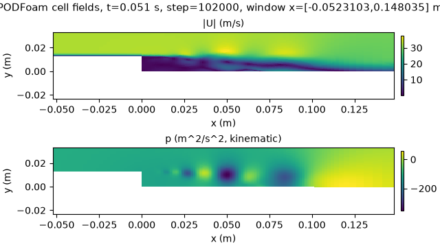
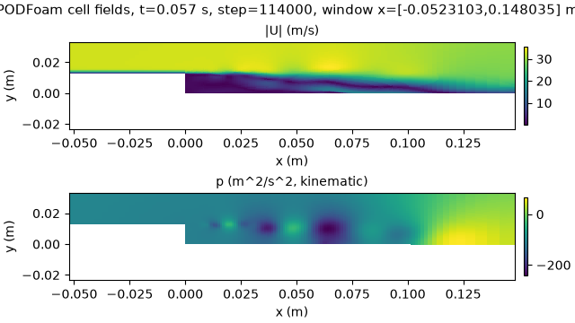
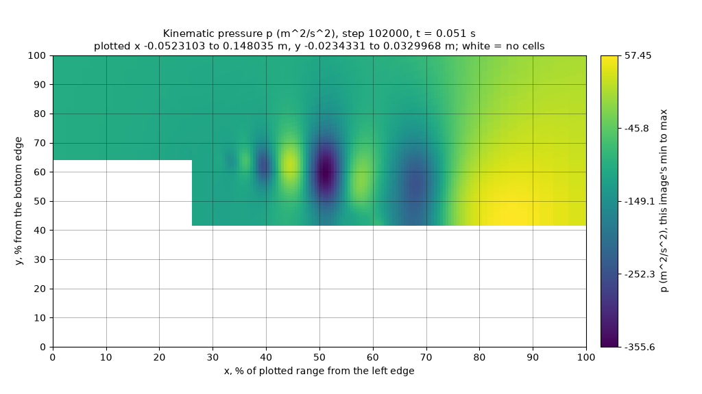

# 10월 27일: 추세 판독, 두 번째 형상, 주기적 요청

MedicineBow, 2026-10-27: NVIDIA A30과 L40S GPU 노드, CPU 노드 · llama.cpp b11429(커밋 `d812350`) · 작업과 코드: [기록](#기록)

[README](../README.md) · [근거 자료: 이미지 시험](evidence/2026-10-27-picture-tests/README.md) · [근거 자료: 솔버 실행](evidence/2026-10-27-solver/README.md) · [실행 방법](../Solver_Examples/PODFoam/llm_demo/README.md#발달한-흐름의-변화-읽기-시험-sequence_testpy) · [내려받기](https://github.com/seungminyome/PythonFOAM/releases/tag/tests-2026-10-27) · [영문](https://github.com/seungminyome/PythonFOAM/blob/main/docs/results-20261027.md)

발달한 후향 계단 유동의 스냅샷 세 개에 걸쳐 최대 속도와 최저 압력이 증가하는지, 감소하는지, 거의 일정한지를 묻는 시험에서, 솔버의 원래 이미지로는 상수 기준선보다 뚜렷하게 나은 모델이 없었습니다.
각 필드를 이미지별 색 범위로 그리고 극값 수치를 표시한 이미지에서는 모든 모델이 맞힌 추세 수가 약 두 배로 늘었습니다.
이 이미지로 Gemma 4 12B는 최대 속도의 뚜렷한 변화 30개 중 29개를 맞혔지만, 2 % 미만의 변화는 대부분 놓쳤습니다.
다른 모델은 뚜렷한 변화도 놓쳤습니다.
Gemma 4 31B는 이미지 없이 극값을 수치로만 받았을 때 뚜렷한 변화를 모두 맞혔습니다.
4비트 파일과 llama.cpp가 권장하는 이미지 토큰 설정으로 실행한 Qwen3.5-35B-A3B와 Qwen3.5-27B는 발달한 유동의 v2 이미지 140장 중 각각 133장과 128장에서 최대 속도 지점을 맞혔습니다.
이는 어느 Gemma 모델보다 많습니다(Gemma 106\~113장, 상수 기준선 16장).
다만 두 모델 계열은 서로 다른 파일, 설정, GPU로 실행했습니다.
두 번째 형상인 원기둥 주위 유동에서는 Gemma 모델 세 개가 v2 이미지 40장 중 32\~39장에서 최대 속도 지점을 맞혔습니다(상수 기준선 8장).
그러나 원기둥 옆의 작은 최저 압력 지점은 가장 큰 모델인 31B만 믿을 만하게 찾았습니다(40장 중 38장).

시간 단계 24,000개를 계산하면서 250단계마다 `describe` 요청을 보낸 실행에서는 이미지 생성 외에 벽시계 시간이 0.7 % 더 들었고(실행 한 쌍에서 측정), 저장 파일은 하나도 바뀌지 않았습니다.
Gemma 4 12B는 요청 96개 중 89개에서 최저 압력 지점을 10 % 이내로 맞혔습니다(상수 기준선 65개).
응답은 최저 압력 지점이 와류 중심 사이를 옮겨 다니는 것을 따라갔고, 틀린 응답은 거의 같은 크기의 두 번째 후보를 지목했습니다.
같은 노드에서는 같은 요청이 같은 응답을 냈습니다.
다른 GPU에서는 응답 문장과 일부 위치가 달라졌지만, 10 % 이내에 든 개수는 같았습니다.
관찰 기능은 MPI rank 2개에서도 동작했습니다.

응답한 위치가 정답 셀에서 표시 영역 크기의 10 % 이내에 있으면 맞힌 것으로 셉니다.
상수 기준선은 모든 이미지에(추세 시험에서는 모든 시퀀스에) 같은 답을 낼 때의 최고 점수입니다.
v1은 |U|와 p를 두 패널에 그린 솔버의 원래 이미지입니다.
v2는 이미지 한 장에 필드 하나를 그리고, 축을 표시 영역의 퍼센트로 적으며, 10 %마다 격자선을 긋습니다.
v2own은 시퀀스의 각 이미지를 이미지별 색 범위로 그린 v2입니다.

## 스냅샷 사이의 변화 읽기

시퀀스 하나는 후향 계단을 지나는 발달한 유동의 세 시점(1\~3 ms 간격)으로 이루어지며, 세 시점을 같은 무작위 표시 영역으로 그립니다.
모델은 레이블 세 개로 응답합니다.
최대 속도의 추세(`increasing`, `decreasing`, `roughly_constant`), 최저 압력의 추세(`more_negative`, `less_negative`, `roughly_constant`), 그리고 최대 속도 지점이 움직이는지(`moves`, `same_place`)입니다.
정답에서 추세는 첫 시점부터 마지막 시점까지의 상대 변화가 2 % 이내이면 `roughly_constant`이고, 최대 속도 지점은 표시 영역 크기의 5 %보다 많이 이동하면 `moves`입니다.
시퀀스 45개는 속도와 압력 추세의 조합을 고루 담도록 골랐습니다.
최대 속도 추세는 세 레이블이 15개씩이고, 최저 압력 추세는 `more_negative`, `less_negative`, `roughly_constant`가 각각 20개, 18개, 7개입니다.
시퀀스마다 다섯 가지 형태로 물었습니다.

| 형태 | 모델이 받는 것 |
|---|---|
| v1 | 솔버의 2패널 이미지(시점마다 한 장)와 10월 20일 프롬프트 |
| v2own | 필드와 시점마다 이미지 한 장, 이미지별 색 범위. 프롬프트는 색 막대의 숫자를 비교하라고 지시(10월 22일) |
| v2own + 임계값 | 위와 같고, 정답의 2 % 규칙과 5 % 규칙을 프롬프트에 적음 |
| v2own + 수치 | 위와 같고, 시점마다 최대 \|U\|와 최저 p를 프롬프트에 적음 |
| 수치만 | 수치와 규칙만, 이미지 없음 |

아래 표는 45개 중 맞힌 수입니다.
Gemma 모델은 NVIDIA A30에서, Qwen은 NVIDIA L40S에서 실행했습니다.

| 모델 | v1 속도 / p | v2own | + 임계값 | + 수치 | 수치만 |
|---|---:|---:|---:|---:|---:|
| Gemma 4 12B | 14 / 15 | 32 / 28 | 36 / 26 | 33 / 28 | 32 / 28 |
| Gemma 4 26B-A4B | 16 / 19 | 31 / 36 | 29 / 34 | 33 / 33 | 36 / 37 |
| Gemma 4 31B | 18 / 20 | 32 / 33 | 32 / 31 | 37 / 41 | 35 / 42 |
| Qwen3.5-35B-A3B Q8_0 | 15 / 18 | 31 / 32 | 34 / 35 | 32 / 28 | 34 / 33 |
| 상수 기준선 | 15 / 20 | 15 / 20 | 15 / 20 | 15 / 20 | 15 / 20 |

뚜렷한 변화(2 % 이상)가 있는 시퀀스만 세면 다음과 같습니다.
이런 시퀀스는 최대 속도 30개, 최저 압력 38개입니다.

| 모델 | v1 | v2own | + 임계값 | + 수치 | 수치만 |
|---|---:|---:|---:|---:|---:|
| Gemma 4 12B | 4 / 12 | 29 / 28 | 29 / 25 | 23 / 28 | 23 / 24 |
| Gemma 4 26B-A4B | 12 / 19 | 25 / 33 | 27 / 33 | 29 / 32 | 27 / 33 |
| Gemma 4 31B | 7 / 17 | 20 / 33 | 26 / 30 | **30 / 36** | **30 / 38** |
| Qwen3.5-35B-A3B Q8_0 | 2 / 16 | 17 / 32 | 20 / 34 | 20 / 28 | 21 / 31 |

 

 

*한 시퀀스의 첫 시점과 마지막 시점입니다(t = 0.051 s와 0.057 s). 최대 속도는 5.4 % 감소하고, 최저 압력은 −356 m²/s²에서 −243 m²/s²로 올라갑니다. 위는 v1 이미지로, 패널마다 색 범위가 하나이고 극값 수치는 표시하지 않습니다. 12B는 `increasing`, `more_negative`로 응답했습니다. 아래는 v2own 압력 이미지로, 색 막대에 이미지마다 최솟값을 표시합니다. 12B는 `decreasing`, `less_negative`로 응답했습니다.*

- v1 이미지로는 상수 기준선보다 뚜렷하게 나은 모델이 없었습니다.
  필드마다 이미지를 따로 그려 이미지별 색 범위를 쓰고 색 막대에 극값을 표시하면, 최대 속도와 최저 압력 추세 모두 맞힌 수가 약 두 배가 됩니다.
- v2own 이미지에서 12B가 최대 속도 추세를 틀린 것은 대부분 뚜렷한 변화가 없는 시퀀스 15개에서였습니다.
  12B가 `roughly_constant`로 응답한 것은 45번 중 3번뿐이었습니다.
  프롬프트에 2 % 규칙을 적은 형태에서는 이 15개에서 12B가 맞힌 수가 3개에서 7개로 늘었지만, 최저 압력 추세는 나아지지 않았습니다.
- v2own 이미지로 31B와 Qwen3.5는 뚜렷한 속도 변화 30개 중 각각 20개와 17개를 맞혔습니다.
  따라서 두 모델의 오답은 대부분 뚜렷한 변화에서 나왔습니다.
  26B-A4B는 25개를 맞혔고, 오답 14개 중 9개는 2 % 미만의 변화에서 나왔습니다.
- 극값을 수치로 받으면 31B는 이미지가 있든 없든 뚜렷한 속도 변화 30개를 모두 맞혔습니다.
  뚜렷한 압력 변화는 이미지가 있을 때 38개 중 36개, 이미지가 없을 때 38개 모두 맞혔습니다.
  다른 모델은 수치가 주어져도 틀린 응답을 냈습니다.
  뚜렷한 속도 변화 30개 중 12B는 23개, Qwen3.5는 20\~21개만 맞혔습니다.
  따라서 이 모델들은 두 수치를 2 % 규칙에 따라 비교하는 일을 믿을 만하게 하지 못합니다.
- 최대 속도 지점은 시퀀스 45개 중 39개에서 움직이므로, 세 번째 레이블에서는 상수 기준선도 39개를 맞힙니다.
  따라서 이 레이블은 여기서 변별력이 없습니다.

## 권장 이미지 토큰 설정을 적용한 4비트 Qwen

[10월 22일 무작위 표시 영역 시험](results-20261022-live.md)에서 Qwen 모델은 Q8_0 파일로(Gemma는 4비트 파일로) 실행했고, 이미지 토큰도 llama.cpp가 권장하는 최솟값보다 적었습니다.
이 시험에서는 더 큰 Qwen 모델 세 개를 Q4_K_M 파일로, `--image-min-tokens 1024`, `--image-max-tokens 1024`, 컨텍스트 길이 8192를 적용해 NVIDIA L40S GPU에서 실행했습니다.
시험 세트는 10월 22일과 같은 무작위 표시 영역 세트 두 개로, 시작 직후 상태의 이미지 48장(표시 영역 시드 1)과 발달한 유동의 이미지 140장입니다.
모두 v2 이미지이며, 아래 표는 10 % 이내에 든 위치의 수입니다.

| 모델 | 시작 직후 상태, 표시 영역 시드 1 (48장): 최대 속도 / 최저 p | 발달한 유동 (140장): 최대 속도 / 최저 p | 요청당 시간 중앙값 (발달한 유동) |
|---|---:|---:|---:|
| Qwen3.5-35B-A3B Q4_K_M | 48 / 46 | **133 / 137** | 2.0 s |
| Qwen3.5-27B Q4_K_M | 48 / 48 | 128 / 136 | 6.1 s |
| Qwen3-VL-32B Q4_K_M | 38 / 46 | 112 / 134 | 7.6 s |
| *10월 22일:* Gemma 4 12B / 26B-A4B / 31B | 45\~47 / 47\~48 | 106\~113 / 130\~139 | 2.4\~7.3 s |
| *10월 22일:* Qwen3.5-35B-A3B Q8_0, 이미지 토큰 256 | 47 / 46 | 121 / 134 | 2.1 s |
| 상수 기준선 | 7 / 7 | 16 / 17 | |

- 이 설정에서 Qwen3.5-35B-A3B와 Qwen3.5-27B는 발달한 유동의 최대 속도 지점을 어느 Gemma 모델보다 자주 맞힙니다.
  최저 압력 지점에서는 모든 모델이 비슷합니다.
- 표의 Gemma 행은 QAT Q4_0 파일, 이미지 토큰 상한 256, 컨텍스트 길이 4096으로 NVIDIA RTX A6000에서 실행한 결과이며, Gemma 요청은 이 상한에 이르지 않습니다.
  따라서 두 모델 계열은 파일, 설정, GPU가 모두 다릅니다.
  Qwen에서는 4비트 파일과 이미지 토큰 설정이 한꺼번에 바뀌었으므로, 나아진 결과를 어느 한쪽의 효과로 보지 않습니다.
  10월 22일에도 `--image-max-tokens 1024`만 적용한 Qwen3.5 Q8_0 파일 두 개가 시작 직후 상태에서 이미 48장 중 47\~48장을 맞혔습니다.
- 이 설정에서 Qwen 요청의 프롬프트는 약 2,590토큰이고, Gemma 요청은 약 1,050토큰입니다.

## 두 번째 형상: 원기둥 주위 유동

두 번째 유동은 OpenFOAM-9 튜토리얼의 `offsetCylinder` 케이스(층류, `pimpleFoam`)입니다.
원래 격자(셀 1,800개)와 방향마다 두 배 조밀한 격자(셀 7,200개)에서 t = 0부터 150 s까지 계산했습니다.
콜백을 켠 PODFoam은 두 격자 모두에서 프레임을 생성합니다.
이 케이스의 empty 패치에는 셀마다 두 면이 모두 들어 있으므로, `pod_image.py`는 셀마다 다각형 하나만 남깁니다.
시험에는 조밀한 격자 실행의 상태 열 개(t = 100\~145 s)를 썼습니다.
상태마다 무작위 표시 영역 네 개를 정해 v1 이미지와 v2 이미지를 생성했고, 모델은 NVIDIA A30에서 실행했습니다.
아래 표는 40개 중 10 % 이내에 든 위치의 수입니다.

| 모델 | 최대 속도 지점, v1 / v2 | 최저 압력 지점, v1 / v2 | v2 거리 중앙값, 최대 속도 / 최저 p |
|---|---:|---:|---:|
| Gemma 4 12B | 10 / 32 | 1 / **18** | 4.7 / 14.4 % |
| Gemma 4 26B-A4B | 9 / 39 | 3 / 26 | 3.4 / 8.1 % |
| Gemma 4 31B | 3 / 35 | 7 / 38 | 4.6 / 4.0 % |
| 상수 기준선 | 8 | 8 | |

*t = 135 s의 원기둥 주위 유동을 표시 영역 하나로 그린 압력 이미지입니다. 흰색은 원기둥, 그리고 이미지 아래쪽의 계산 영역 밖 부분입니다. 최저 압력 지점은 원기둥 아래쪽 표면의 진한 점(x 41 %, y 47 %)입니다. 12B는 원기둥 뒤쪽의 x 85 %, y 50 %로 응답했으며, 그곳의 p는 최솟값의 40 %입니다.*

- v2 이미지는 이 형상에서도 최대 속도 지점을 찾는 데 유효합니다.
- 최저 압력 지점은 원기둥 표면 근처의 작은 점이고, 바로 옆에 넓고 어두운 후류가 있습니다.
  12B가 틀린 22개는 모두 최저 압력의 15\~61 %에 불과한 지점을 지목했습니다.
  8개는 원기둥 뒤쪽, 4개는 원기둥 아래 뒤편, 10개는 원기둥 아래였습니다([cylinder_misses.py](evidence/2026-10-27-picture-tests/cylinder_misses.py)).
- 상태 열 개의 |U|는 서로 최대 6×10⁻⁵ m/s만 다르고, 두 극값은 모든 상태에서 같은 셀에 있습니다.
  유동이 정상 상태이므로, 이미지 40장은 사실상 한 필드에 놓은 표시 영역 40개입니다.

## 250단계마다 요청

솔버는 발달한 유동의 t = 0.1 s부터 시간 간격 5×10⁻⁶ s로 24,000단계를 계산했고, 설정은 `LLM_MODE=describe`, `LLM_ANALYSIS_EVERY=250`이었습니다.
250단계마다 v2 이미지로 요청을 하나 보내고, 동시에 진행하는 요청은 최대 하나이며, NVIDIA A30의 Gemma 4 12B QAT가 응답했습니다.
비교 대상은 같은 노드에서 실행한 기준 실행(요청 없음)이며, 이 실행도 같은 이미지 96장을 생성했습니다.
표시 영역은 x 0\~0.12 m, y 0\~0.04 m로 고정했습니다.

| | 기준 실행(요청 없음) | 요청 96개 |
|---|---:|---:|
| 응답을 받은 요청 | | 96개 중 96개 |
| 다른 실행과 같은 저장 파일 | 2,016개 중 2,016개 | |
| 단계당 벽시계 시간 | 0.05794 s | 0.05833 s (+0.7 %) |
| 요청 단계의 콜백 시간 | | 최대 0.017 s. 마지막 단계는 설계상 대기 중인 응답을 기다리므로 6.8 s |
| 응답 도착 | | 요청 뒤 85\~144단계(모델 시간 4.2\~5.3 s). 마지막 요청은 마지막 단계에서 기다림 |
| 요청당 파이프로 돌아온 바이트 | | 4,009\~4,461 |
| 요청 본문 | | 212\~230 kB |
| 250단계 주기마다 가장 낮을 때의 솔버 프로세스 메모리(PSS), 실행의 처음 4분의 1 → 마지막 4분의 1 | 131 → 216 MiB | 173 → 243 MiB |
| llama-server 메모리(RSS) | | 12.5 GiB |
| 최대 속도 지점 10 % 이내 | | 96개 중 65개 (상수 기준선: 53) |
| 최저 압력 지점 10 % 이내 | | 96개 중 89개 (상수 기준선: 65) |

*t = 0.1 s부터 250단계마다 보낸 요청 96개에서 (a) 최저 압력 지점과 (b) 최대 속도 지점의 x 위치입니다. x는 표시 영역의 퍼센트이며, 선은 실제 위치, 점은 Gemma 4 12B의 응답입니다.*

- 모델이 응답하는 동안 솔버는 응답을 기다리지 않고 계산을 이어 갔습니다.
  두 실행의 벽시계 시간 차이는 이미지 생성 외에 요청에 든 비용입니다.
  이 값은 실행 한 쌍에서 측정했으며, 측정 중에는 같은 노드에서 이 연구의 다른 작업 세 개도 실행 중이었습니다.
- 최저 압력 지점은 요청마다 와류 중심 사이를 옮겨 다닙니다(x 28\~80 %).
  응답은 x 방향 상관계수 0.78로 이를 따라갑니다([tracking.py](evidence/2026-10-27-solver/periodic/tracking.py)).
  최대 속도 지점은 응답이 덜 따라갑니다(상관계수 0.35).
  실제 위치는 19 %와 81 %까지 가지만, 응답 96개 중 93개는 35\~65 % 사이에 있습니다.
- 최대 속도 지점 응답 중 10 %를 넘게 벗어난 31개 가운데 27개는 표시 영역 안 최대 속도의 90 % 이상인 지점을 지목했고, 31개 모두 86 % 이상이었습니다.
  최저 압력 지점을 틀린 7개 중 5개는 최저 압력의 90 % 이상인 지점을 지목했습니다([misses.py](evidence/2026-10-27-solver/periodic/misses.py)).
  이 유동에서 틀린 응답은 거의 같은 크기의 두 번째 후보를 골랐으며, 원기둥에서 12B가 최저 압력 지점을 틀린 경우와는 다릅니다.
- 이 케이스의 POD 모듈은 스냅샷 250개를 모았다가 SVD 때마다 비우므로, 솔버 프로세스의 메모리는 250단계 주기마다 최대 430 MiB만큼 오르내립니다.
  주기마다 가장 낮을 때의 메모리는 요청 유무와 관계없이 비슷하게 늘었으므로(실행 동안 요청 없이 +85 MiB, 요청과 함께 +70 MiB), 요청 때문에 더 늘지는 않습니다.
  증가분 중 약 32 MiB는 콜백이 `telemetry.jsonl`을 쓰려고 단계마다 쌓아 두는 기록입니다(단계당 1.35 KiB).
  나머지 증가의 원인은 추적하지 않았습니다([memory.py](evidence/2026-10-27-solver/periodic/memory.py)).

## 실행과 GPU에 따른 재현성

10월 22일에 NVIDIA RTX A6000에서 처음 실행한 비동기 케이스 다섯 개와 요청 열한 개의 sweep을, NVIDIA A30 노드 하나에서 두 번 더 실행했습니다.

| | 반복 1 | 반복 2 |
|---|---|---|
| 다섯 케이스의 검증 | PASS | PASS |
| 첫 실행과 같은 저장 유동장 | 모두 | 모두 |
| 첫 실행과 같은 요청 본문(13개) | 13 | 13 |
| 모든 항목이 첫 실행과 같은 응답 | 13개 중 0개 | 13개 중 0개 |
| 다른 반복과 같은 응답 | 13개 중 13개 | 13개 중 13개 |
| sweep에서 10 % 이내, 최대 속도 / 최저 p | 11개 중 9 / 10 | 11개 중 9 / 10 |
| `sequence` 응답에서 맞힌 레이블 | 3개 중 3개 | 3개 중 3개 |

- 같은 노드에서는 같은 요청이 바이트 단위까지 같은 응답을 냅니다.
  다른 GPU에서는 같은 요청 본문이 다른 응답 문장을 냈고, sweep 요청 11개 중 6개에서는 위치도 달랐지만, 10 % 이내에 든 개수는 바뀌지 않았습니다.
  `sequence` 응답의 최저 압력 추세 레이블은 A6000에서 틀렸고 A30에서 맞았습니다.
- sweep의 POD 모드 파일은 첫 실행과 다르지만 유동장은 같습니다.
  원인은 다음 절에서 설명합니다.

## MPI와 POD 파일

병렬 실행에서 관찰 기능은 격자와 필드를 마스터 rank로 모으고, 마스터만 `mesh_func`와 `analysis_func`를 호출합니다.
POD 스냅샷과 SVD는 rank마다 따로 계산합니다.
rank 2개로 실행하면(scotch 분할, 600단계, 100단계에서 프레임 생성, 모델 없음) 프레임은 직렬 실행과 같은 셀 20,540개로 이루어집니다.
셀 중심 좌표는 4×10⁻¹⁷ m 이내에서 같고, U 차이는 7.5×10⁻⁴ m/s 이내(37 m/s 대비), p 차이는 0.021 m²/s² 이내(335 대비)입니다.
이는 병렬 풀이에서 생기는 차이입니다.
같은 빌드로 [연결 검증](../Solver_Examples/PODFoam/validation/README.md)도 통과합니다.

10월 22일에는 sweep의 POD 모드 파일이 모델을 끈 실행의 파일과 최댓값 대비 최대 10⁻¹¹만큼 달랐고, U, p, phi는 같았습니다.
모델 요청 없이 600단계를 계산한 실행 여섯 개에서 BLAS 스레드 수와 두 번째 솔버의 동시 실행 여부를 바꾸었습니다.
스레드 8개로 실행했을 때는 단독 실행과 동시 실행 모두에서 모드 파일 30개가 모두 스레드 1개 실행과 달랐고, 차이는 최대 1.0×10⁻¹³(최댓값 대비 10⁻¹²)이었습니다.
스레드 1개로 실행했을 때는 동시 실행에서도 저장 파일 42개가 모두 같았습니다.
따라서 이 차이의 원인은 SVD의 스레드 수뿐입니다.

## 한계

- 채점한 것은 위치와 추세 레이블뿐이며, 설명 문장은 채점하지 않았습니다.
- 모델이 잘못되어 가는 실행을 알아채는지는 시험하지 못했습니다.
  후향 계단 유동에서 `pimpleFoam`으로 아홉 번 시도했지만 그런 실행의 이미지를 얻지 못했습니다([요약](evidence/2026-10-27-solver/unstable/unstable-summary.json)).
  대류항에 풍상 차분(upwind)을 쓴 실행은 Courant 수 28까지 모두 정상 종료했습니다.
  중심 차분을 쓴 실행은 첫 단계에서 부동소수점 예외로 멈추거나(Courant 수 4.5와 11), 눈에 보이는 진동 없이 끝났습니다(Courant 수 1.54 이하, 육안 판단).
- 3차원 케이스, rank 2개를 넘는 실행, 모델 요청이 있는 병렬 실행은 시험하지 않았습니다.
- 요청 두 개 이상을 동시에 진행한 실행은 없습니다.
- 응답을 활용하는 방법은 시험하지 않았습니다.
  모델 출력은 솔버 계산에 반영하지 않습니다.

## 향후 작업

1. 배열에서 정확하게 구할 수 있는 추세 레이블은 콜백에서 계산하고, 모델에게는 이미지가 더해 주는 정보, 즉 특징의 위치와 모양만 묻는 방식.
2. 3차원 케이스, 더 많은 rank, 모델 요청이 있는 병렬 실행.
3. 단계마다 상태를 쌓아 두지 않고 실행 중에 텔레메트리를 쓰는 방식, 그리고 메모리 증가의 나머지 원인 추적.
4. 예를 들어 격자나 시간 간격 때문에 천천히 발산하는 실행을 기록하고, 모델이 이를 알아채는지 확인하는 시험.
5. 훅(hook), MPI gather, v2 이미지, 요청 빌더, 비동기 경로와 주기 경로, 테스트를 PythonFOAM에 기여하는 작업.

## 기록

MedicineBow의 Slurm 작업은 모두 2026-10-27 08:28\~16:10 MDT에 실행했습니다.

| 시험 | 작업 | 하드웨어 |
|---|---|---|
| 추세 시험, Gemma 4 12B, 26B-A4B, 31B | 24903974 | NVIDIA A30 |
| 추세 시험, Qwen3.5-35B-A3B Q8_0 | 24903975 | NVIDIA L40S |
| 4비트 Qwen, 시작 직후 상태 | 24903976 | NVIDIA L40S |
| 4비트 Qwen, 발달한 유동 | 24903977 | NVIDIA L40S |
| 원기둥 주위 유동, 무작위 표시 영역 | 24903978 | NVIDIA A30 |
| 250단계마다 요청, 그리고 기준 실행(요청 없음) | 24903264 | NVIDIA A30 |
| 10월 22일 다섯 케이스와 sweep의 반복 1 | 24903298 | NVIDIA A30 |
| 반복 2: 다섯 케이스, 이어서 sweep | 24903263, 24903755 | NVIDIA A30 |
| MPI, rank 2개 | 24903786 | CPU |
| POD 파일, 실행 여섯 개 | 24903065 | CPU |

10월 22일 다섯 케이스와 sweep의 첫 실행은 NVIDIA RTX A6000의 작업 24757460이었습니다.
원기둥 주위 유동 계산과 불안정 유동 시도는 별도의 CPU 작업으로 실행했으며, 두 근거 자료 README에 적혀 있습니다.

- 코드. 이 항목의 커밋은 모두 영문 저장소의 커밋입니다.
  이미지 시험 작업은 `ab6b943`과 같은 스크립트를 실행했습니다(작업마다 `sha256.txt`에 모든 파일의 해시를 기록).
  추세 시험 세트는 `6afbdeb`로, 원기둥 시험 세트는 `df72c24`와 같은 코드로 만들었습니다.
  주기 요청 실행과 반복 실행은 `df72c24`의 Python 콜백을 사용했습니다.
  반복 실행의 PODFoam은 `df72c24` 소스로 컴파일했으며, 나중에 병렬 수정이 들어간 파일 두 개만 다릅니다(실행은 직렬).
  주기 요청 실행은 10월 22일의 PODFoam 바이너리를 사용했습니다.
  MPI 시험은 `df72c24`를 그대로 컴파일했습니다.
  작업별 세부 사항과 코드 상태는 [솔버 근거 자료](evidence/2026-10-27-solver/README.md#참고)에 있습니다.
- 코드에 새로 추가한 것은 다음과 같습니다.
  `LLM_ANALYSIS_EVERY`(N단계마다 `describe` 요청을 보내고, 요청마다 별도 폴더에 기록하며 목록 파일을 씀); 임계값과 수치를 넣은 추세 프롬프트와 `sequence_test.py`; MPI gather(`PythonGather.H`); `pod_image.py`에서 셀마다 다각형 하나; 표시 영역 시험용 `--dt`와 `--y-span`; GPU 스크립트의 `--image-min-tokens`와 4비트 Qwen 항목; `run_periodic.py`와 `periodic_v2.slurm`; 빌드 뒤에 바뀐 소스를 기록하는 `pack_run.py`.
  단위 테스트는 95개입니다.
- [이미지 시험 근거 자료](evidence/2026-10-27-picture-tests/README.md): 작업마다 보고서, 점수를 매긴 모든 파싱 응답, 새 시험 세트 두 개의 정답, 서버 로그, 예시 이미지, 원기둥 계산 설정, 원기둥 오답 분석, 그리고 시험 코드를 쓰지 않고 다시 세어 보고서 다섯 개의 개수 38행을 모두 재현하는 검산.
- [솔버 실행 근거 자료](evidence/2026-10-27-solver/README.md): 주기 요청 실행의 요약, 요청 목록, 로그, 텔레메트리, 위치 추적 분석, 오답 분석, 메모리 분석; 반복 실행의 검증 결과, 응답, 해시 목록과 비교 스크립트; MPI 프레임 비교; POD 파일 비교; 불안정 유동 시도.
- 내려받기([tests-2026-10-27](https://github.com/seungminyome/PythonFOAM/releases/tag/tests-2026-10-27)): 이미지 시험 작업 다섯 개와 새 시험 세트 두 개; 원기둥 계산; 시간 디렉터리를 뺀 주기 요청 실행(모든 요청 본문, 응답, 프레임); MPI와 POD 파일 실행; 불안정 유동 시도(설정과 로그).
